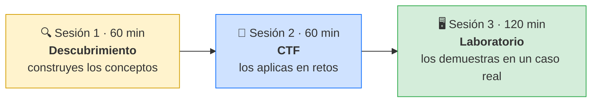
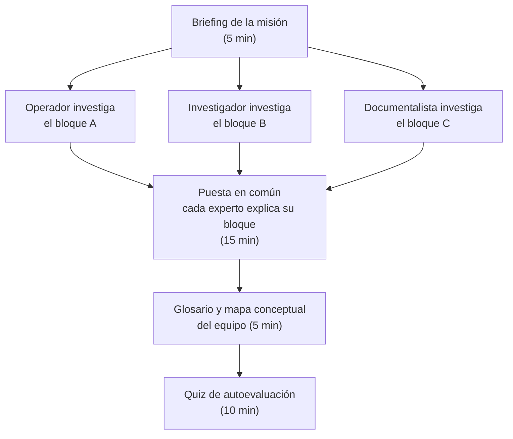
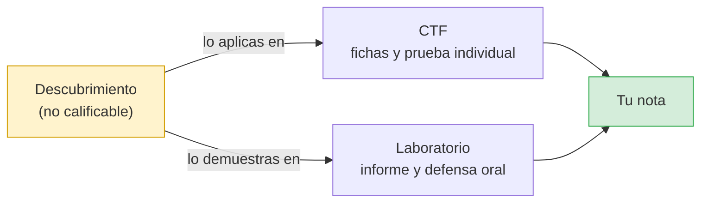

# Sesiones de Descubrimiento: cómo aprenderás la teoría

**Módulo 5025 · Hacking ético**
**Curso de Especialización en Ciberseguridad**

> Este documento explica cómo funcionan las **sesiones de Descubrimiento**, la primera de las
> tres actividades que harás cada semana. Hay otros dos documentos: uno para los **CTF** y otro
> para el **Laboratorio**.

---

## 1. Cómo funciona este módulo

En este módulo **no hay clases magistrales**. Aprenderás haciendo, igual que trabaja un equipo
profesional de auditoría: investigas lo que necesitas, lo aplicas en retos y lo demuestras en un
laboratorio real. La **inteligencia artificial** será tu tutora técnica, y la profesora dirige el
trabajo, te hace preguntas y evalúa lo que demuestras.

Cada semana es una **misión** con tres sesiones:

| Sesión | Qué haces | ¿Cuenta para la nota? |
|---|---|---|
| **Descubrimiento** | Investigas los conceptos con los apuntes y la IA | **No.** Es formativa: te prepara para lo que sí se evalúa |
| **CTF** | Resuelves retos en la plataforma CTFd y explicas cómo | **Sí** |
| **Laboratorio** | Atacas y defiendes máquinas en tu laboratorio y lo documentas | **Sí** |

### 1.1. Trabajarás en equipo, con roles que rotan

Formarás parte de un equipo de 3 personas durante el curso. Cada semana tendrás un **rol**
distinto, de modo que todos pasaréis por todos:

| Rol | Qué hace |
|---|---|
| 🖥️ **Operador** | Ejecuta los comandos y explica en voz alta qué espera obtener |
| 🔎 **Investigador** | Dialoga con la IA usando los prompts guiados y contrasta lo que dice |
| 📝 **Documentalista** | Rellena las fichas y prepara la explicación del equipo |

Al inicio de cada semana se proyectan los roles de cada equipo.

---

## 2. Qué es una sesión de Descubrimiento

Es la sesión en la que **construyes la teoría que necesitarás** en los CTF y en el laboratorio.
No te la explica nadie: la investigas tú con tu equipo.

### 2.1. Tus fuentes

| Fuente | Para qué la usas |
|---|---|
| 📘 Apuntes creados a partir del **Libro de texto**: *Hacking ético*, J. L. Berenguel y P. Esteban (Paraninfo, 2024) | Es la fuente principal. Cada pregunta indica el apartado que debes leer |
| 🤖 **IA tutora** | Para que te explique lo que no entiendas, con ejemplos y analogías |
| 🏛️ **Fuentes oficiales** (INCIBE, BOE, CVE, CCN-CERT) | Para comprobar datos: leyes, identificadores de vulnerabilidades, fechas |

### 2.2. La dinámica: técnica del puzle

Cada miembro del equipo se convierte en **experto** de un bloque de preguntas y después se lo
**enseña** al resto. Para enseñar algo hay que entenderlo de verdad.

| Tiempo | Actividad |
|---|---|
| 0–5 min | Briefing y reparto de los bloques según el rol de la semana |
| 5–30 min | **Investigación individual** de tu bloque conlos apuntes y la IA |
| 30–45 min | **Puesta en común:** cada experto explica su bloque en 4 minutos y responde preguntas |
| 45–50 min | El equipo completa el **glosario** y el **mapa conceptual** |
| 50–60 min | **Quiz de autoevaluación** individual en Moodle |

### 2.3. Durante la sesión, la profesora puede preguntarte

Mientras investigáis, la profesora pasará por las mesas y pedirá a alguien del equipo que le
explique un concepto **sin mirar la pantalla**. No es un examen: es la comprobación de que el
equipo está entendiendo y no solo copiando.

---

## 3. Cómo usar la IA en el Descubrimiento

La regla es sencilla: **primero lees los apuntes y después usas la IA para entender**. Tu respuesta
debe estar escrita **con tus palabras** e incluir un **ejemplo propio**.

| ❌ Así no aprendes | ✅ Así sí |
|---|---|
| «Responde a esta pregunta: ¿qué es la tríada CIA?» | «He leído que la seguridad se basa en confidencialidad, integridad y disponibilidad. Ponme un ejemplo de un instituto en el que falle cada una» |
| «Dame los tipos de auditoría» | «No entiendo la diferencia entre caja gris y caja blanca. ¿Me lo explicas con una analogía?» |
| Copiar la respuesta de la IA | «Esta es mi explicación de qué es un CVE: […]. ¿Es correcta? ¿Qué me falta?» |
| Fiarte de la IA en leyes y fechas | Comprobar el artículo en los apuntes o en el BOE |

**Tipos de prompt que te ayudarán:**

| Tipo | Ejemplo |
|---|---|
| **Explícame** | «Explícame qué es un ataque de intermediario con una analogía de la vida real» |
| **Ponme a prueba** | «Hazme cinco preguntas para comprobar si distingo virus, gusano y troyano. Corrígeme después de cada una» |
| **Hazme de cliente** | «Eres el director de una empresa que quiere contratar un *pentest*. Pregúntame lo que preguntaría un cliente real» |
| **Comprueba mi razonamiento** | «Esta es mi definición de *zero-day*: […]. ¿Es correcta?» |

> **La IA se equivoca**, sobre todo con artículos de leyes, fechas y números. Si detectas un
> error, apúntalo en tu bitácora: saber detectar los fallos de la IA es una competencia
> profesional.

---

## 4. Qué generas

Al final de cada sesión, el equipo debe haber generado:

| Entregable | Quién | Contenido |
|---|---|---|
| **Respuestas del bloque** | Cada experto | Las respuestas de tu bloque, con tus palabras y un ejemplo propio |
| **Glosario** | Equipo | Los términos de la sesión con su definición y un ejemplo |
| **Mapa conceptual** | Equipo | Un esquema que relacione los conceptos (en papel, Mermaid o cualquier herramienta) |
| **Bitácora de IA** | Cada persona | Una pregunta que hiciste a la IA, qué aprendiste y, si la hubo, qué error detectaste |

---

## 5. Cómo se evalúa el Descubrimiento

**Las sesiones de Descubrimiento no cuentan para la nota.** Son tu preparación.

| Elemento | ¿Calificable? | Para qué te sirve |
|---|---|---|
| Quiz de autoevaluación | No | Ver al momento qué has entendido y qué tienes que repasar. Puedes repetirlo las veces que quieras |
| Glosario y mapa conceptual | No | Es tu material de consulta en los CTF y en el laboratorio |
| Bitácora de IA | No | Practicar el uso crítico de la IA, que **sí** se evalúa en las fichas de los CTF y en el informe del laboratorio |

Entonces, ¿por qué es importante? Porque **todo lo que investigues aquí se evalúa después**,
cuando tengas que aplicarlo en un CTF, explicarlo en una ficha o defenderlo oralmente en el
laboratorio. Quien se salta el Descubrimiento llega a la práctica sin saber por qué hace lo que
hace, y eso es justo lo que se califica.

---

## 6. Resumen

| Pregunta | Respuesta |
|---|---|
| ¿Quién me explica la teoría? | Nadie: la investigas con los apuntes, la IA y tu equipo |
| ¿Qué hago yo? | Investigo mi bloque, se lo explico a mi equipo y completamos el glosario |
| ¿Puedo usar la IA? | Sí, para entender. Nunca para copiar sus respuestas |
| ¿Cuenta para la nota? | No. Pero sin el Descubrimiento no podrás superar los CTF ni el laboratorio |
