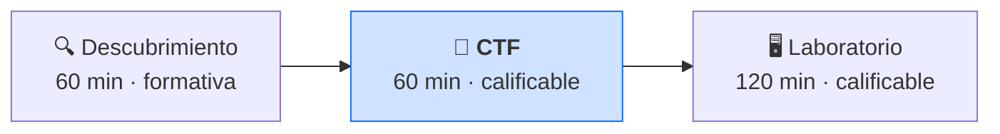
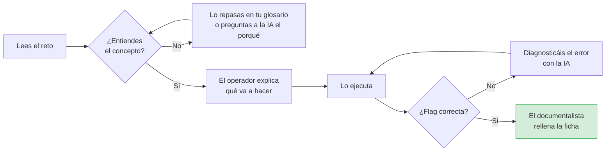
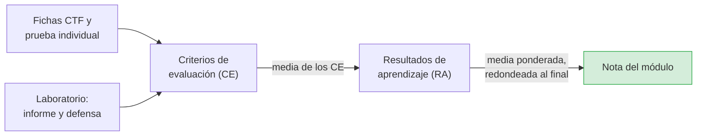

# CTF: retos, fichas de razonamiento y prueba individual

**Módulo 5025 · Hacking ético**
**Curso de Especialización en Ciberseguridad**

> Este documento explica cómo funcionan los **CTF** (*Capture The Flag*): los retos de la sesión 2
> de cada semana y la **prueba práctica individual** del final de cada unidad. Hay otros dos
> documentos: uno para el **Descubrimiento** y otro para el **Laboratorio**.

---

## 1. Dónde encajan los CTF

Cada semana es una misión de tres sesiones. Los CTF son la segunda: aplicas lo que investigaste en
el Descubrimiento antes de llevarlo al laboratorio.

Un CTF es un reto en el que debes encontrar una **flag**: una cadena de texto con un formato fijo,
por ejemplo `flag{...}`, que solo se obtiene si resuelves el reto. Es el formato que usan las
competiciones y las plataformas de formación en ciberseguridad.

---

## 2. Cómo es una sesión de CTF

### 2.1. La plataforma: CTFd

Los retos están en **CTFd**, una plataforma de CTF de código abierto. La profesora os dará la
dirección (`http://IP:8000`) y la contraseña de vuestro equipo.

| Elemento de CTFd | Qué es |
|---|---|
| **Challenges** | La lista de retos, organizados por categoría y con sus puntos |
| **Flag** | Lo que envías al resolver un reto. CTFd te dice al momento si es correcta |
| **Hints** (pistas) | Ayudas que puedes desbloquear a cambio de puntos |
| **Scoreboard** | El marcador de equipos, que se proyecta al final de cada sesión |

### 2.2. Desarrollo de la sesión

| Tiempo | Actividad |
|---|---|
| 0–5 min | Comprobáis los roles de la semana y entráis en CTFd |
| 5–20 min | **Casos guiados:** retos resueltos paso a paso en la ficha de la práctica. Los reproducís y os aseguráis de entender cada línea |
| 20–55 min | **Retos autónomos:** de dificultad creciente. Cada reto resuelto se documenta en una ficha de razonamiento |
| 55–60 min | Marcador y cierre |

### 2.3. Puntos y pistas: la parte del juego

| Elemento | Funcionamiento |
|---|---|
| **Puntos por reto** | Cada reto vale más cuanto más difícil es |
| **Pistas con coste** | Si os atascáis, podéis desbloquear una pista. Cuesta puntos del marcador |
| **Marcador** | Se proyecta al final de cada sesión |
| **Insignias** | Al superar cada fase del hacking ético: 🔍 Reconocimiento · 🗺️ Enumeración · 💥 Explotación · 🔐 Posexplotación · 📄 Informe |

> **Importante: el marcador no es tu nota.** Los puntos de CTFd son la parte lúdica. Usar una
> pista te resta puntos en el marcador, **pero no en la nota**. Lo que se califica es que sepas
> explicar lo que has hecho.

---

## 3. Normas de los CTF

1. **Solo atacas lo que está en el reto.** Nunca la plataforma CTFd, ni los equipos de otros
   compañeros, ni la red del centro.
2. **No compartes flags con otros equipos.** CTFd registra cada intento y la profesora lo revisa.
3. **La IA te ayuda a entender, no a resolver.** Puedes preguntarle qué es una función hash o qué
   hace un comando; no le pidas la flag ni la solución.
4. **Antes de ejecutar un comando, el operador dice en voz alta qué hace y qué espera obtener.**
   Si no lo sabe, el investigador vuelve a la IA.

---

## 4. La ficha de razonamiento

Por cada reto resuelto, el equipo entrega una **ficha de razonamiento** en Moodle. Es lo que se
califica, no la flag.

| Apartado de la ficha | Qué escribes |
|---|---|
| **Tipo de reto y concepto** | De qué trata (hash, codificación, cifrado…) y qué concepto hay detrás |
| **Procedimiento** | Cada paso que diste y **por qué** lo diste |
| **Herramientas** | Qué usaste y qué hace cada parámetro importante |
| **Uso de la IA** | Qué le preguntaste, qué aprendiste y si se equivocó en algo |
| **Flag** | La flag obtenida |

### 4.1. Cómo se califica la ficha (rúbrica 1)

| Criterio | Peso | Nivel alto | Nivel medio | Nivel bajo |
|---|---|---|---|---|
| **Identificación del concepto** | 25 % | Nombra el concepto con precisión y lo relaciona con otros retos | Identifica el concepto principal | No reconoce de qué trata el reto |
| **Justificación del procedimiento** | 35 % | Explica el porqué de cada paso y de los detalles | Explica los pasos principales | Ejecuta comandos sin justificar |
| **Uso reflexivo de la IA** | 20 % | Sus preguntas buscan entender y detecta errores de la IA | Usa la IA para apoyarse y entender | Copia respuestas de la IA sin entenderlas |
| **Resultado técnico** | 10 % | Flag correcta y en el formato pedido | Flag correcta con un fallo menor de formato | Flag incorrecta |
| **Expresión y rigor** | 10 % | Vocabulario técnico correcto y claro | Se entiende, con imprecisiones menores | Vocabulario incorrecto o confuso |

> Fíjate en que la flag pesa solo un **10 %**. Puedes sacar buena nota con una flag mal si tu
> razonamiento es correcto, y puedes suspender con todas las flags bien si no sabes explicar por
> qué. **Aquí se evalúa que entiendas.**

---

## 5. La prueba práctica individual

Al final de cada unidad harás una **prueba práctica individual** en formato CTF. Es el instrumento
que más pesa en tu nota, porque demuestra lo que **tú** sabes hacer sin tu equipo.

| Aspecto | Cómo es |
|---|---|
| **Formato** | Retos en CTFd, parecidos a los que has hecho en clase |
| **Duración** | Entre 45 y 60 minutos, cronometrados |
| **Modalidad** | Individual, con tu propio usuario de CTFd |
| **Qué entregas** | Las flags en CTFd y, por cada reto, una **pregunta de justificación** en Moodle: por qué funciona lo que has hecho |
| **Materiales permitidos** | Tu glosario, tus fichas y la documentación de las herramientas. La profesora indicará en cada prueba si se permite la IA |

Cómo se califica:

| Elemento | Peso en la prueba |
|---|---|
| Flags correctas | 50 % |
| Justificación de cada reto | 50 % |

Una flag sin justificación vale la mitad. Una justificación correcta con un pequeño error en la
flag también puntúa.

---

## 6. Cómo cuentan los CTF en tu nota

### 6.1. Peso de cada actividad

Tu nota sale **solo de la parte práctica**:

| Instrumento | Peso | Ámbito | Actividad |
|---|---|---|---|
| **Prueba práctica individual (CTF)** | 40 % | Individual | CTF |
| Informe técnico del laboratorio | 25 % | Equipo | Laboratorio |
| Defensa oral | 20 % | Individual | Laboratorio |
| **Fichas de razonamiento de los CTF** | 15 % | Equipo | CTF |

Los CTF suman el **55 %** de la nota. El 60 % de la nota es **individual**: aunque trabajes en
equipo, cada persona tiene que demostrar lo que sabe.

### 6.2. Escala de niveles

Cada criterio de la rúbrica se puntúa con uno de estos niveles:

| Nivel | Nota | Nivel | Nota |
|---|---|---|---|
| Excelente | 10 | Aprobado | 5 |
| Sobresaliente | 9 | Insuficiente | 2 |
| Notable | 7,5 | Muy insuficiente | 0,5 |
| Bien | 6 | Sin respuesta | 0 |

### 6.3. Del CTF a la nota del módulo

- Cada actividad aporta nota a uno o varios **criterios de evaluación** (CE) del módulo.
- Cada **resultado de aprendizaje** (RA) es la media de sus CE.
- La nota del módulo es la media ponderada de los RA: **RA1 15 %, RA2 15 %, RA3 30 %, RA4 15 %,
  RA5 25 %**, redondeada al final.
- **Para aprobar, cada RA debe llegar a 5.** Si alguno no llega, la nota final no puede ser
  superior a 4, y tendrás que recuperar ese RA.
