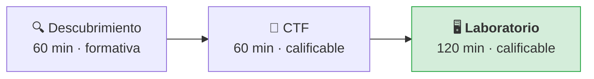
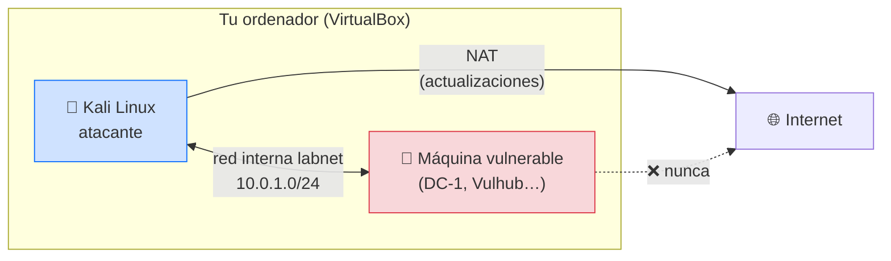
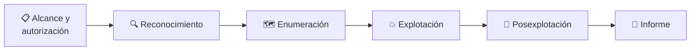
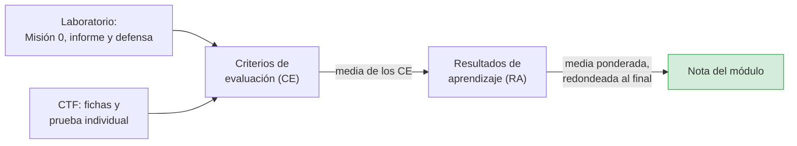

# Laboratorio: misiones, informe técnico y defensa oral

**Módulo 5025 · Hacking ético**
**Curso de Especialización en Ciberseguridad**

> Este documento explica cómo funciona el **Laboratorio**, la sesión de 120 minutos de cada
> semana, y cómo se califican el **informe técnico** y la **defensa oral**. Hay otros dos
> documentos: uno para el **Descubrimiento** y otro para los **CTF**.

---

## 1. Dónde encaja el Laboratorio

El Laboratorio es la última sesión de la misión semanal. Aquí demuestras en un caso real lo que
investigaste en el Descubrimiento y practicaste en los CTF.

En el Laboratorio trabajas como un equipo profesional de auditoría: recibes un encargo con un
alcance, atacas una máquina vulnerable en **tu propio laboratorio**, documentas lo que haces y,
al final, lo defiendes ante la profesora.

---

## 2. Tu laboratorio

### 2.1. Lo montas tú

No hay un laboratorio preparado: **cada equipo construye el suyo** en la primera semana
(Misión 0) y lo amplía durante el curso. Saber montar un entorno de pruebas seguro es una
competencia profesional, y forma parte de lo que se evalúa.

| Máquina | Red | Para qué |
|---|---|---|
| **Kali Linux** | NAT + red interna `labnet` | Es tu equipo de ataque. El NAT le da acceso a Internet para instalar herramientas |
| **Máquina vulnerable** | **Solo** red interna `labnet` | Es el objetivo. Nunca puede tener salida a Internet ni a la red del centro |

### 2.2. La norma de oro

> **Solo se ataca lo que está dentro de tu laboratorio y dentro del alcance de la misión.**

Atacar un sistema sin autorización es un delito (artículos 197 bis y 264 del Código Penal),
aunque sea «para probar». Por eso:

1. Las máquinas vulnerables se conectan **solo** a la red interna `labnet`. Nunca en NAT ni en
   adaptador puente.
2. Antes de lanzar cualquier escaneo, comprueba que la IP objetivo está en `10.0.1.0/24`.
3. No se escanea la red del centro, ni la de casa, ni los equipos de otros compañeros.
4. Si dudas de si algo está dentro del alcance, **pregunta antes**.

Incumplir la norma de oro supone la retirada de la práctica y la comunicación al centro.

---

## 3. Tipos de misión de laboratorio

| Misión | Cuándo | Qué haces |
|---|---|---|
| 🧰 **Misión 0 · Monta tu laboratorio** | Primera semana del curso | Instalas Kali, creas la red `labnet`, importas DC-1, compruebas la conectividad y guardas instantáneas |
| 🎯 **Máquina vulnerable (*boot2root*)** | La mayoría de las semanas | Despliegas una máquina (VulnHub o Vulhub con Docker) y la auditas siguiendo las fases del hacking ético |
| ⚔️ **Red team vs blue team** | Al cierre de algunas unidades | Un equipo bastiona y vigila una máquina; otro la ataca. Después se intercambian los papeles |

### 3.1. Ejemplo de encargo

Cada misión empieza con un encargo, igual que en una auditoría real:

> **Cliente:** Empresa ficticia *Drupalia, S. L.*
> **Objetivo:** servidor web `10.0.1.x` (máquina DC-1).
> **Alcance:** solo esa IP. Se permite escanear puertos y explotar el servicio web.
> **Fuera de alcance:** cualquier otra IP, ataques de denegación de servicio.
> **Entregable:** informe técnico con hallazgos y recomendaciones.

### 3.2. Las fases que seguirás

En cada unidad trabajarás con más profundidad una o varias de estas fases.

---

## 4. Cómo es una sesión de Laboratorio

| Tiempo | Actividad |
|---|---|
| 0–10 min | **Briefing:** la profesora presenta el encargo y el alcance. Comprobáis los roles |
| 10–80 min | **Laboratorio:** desplegáis la máquina (unos 10 min) y la auditáis por fases, guardando evidencias |
| 80–90 min | **Redacción:** el documentalista cierra el borrador del informe con lo que ha recogido el equipo |
| 90–115 min | **Debriefing y defensa oral:** se sortea quién del equipo defiende y responde a las preguntas |
| 115–120 min | **Autoevaluación:** qué ha salido bien y qué repasaréis |

El informe definitivo se entrega en Moodle en el plazo que indique la tarea.

### 4.1. Los roles en el laboratorio

| Rol | Qué hace en el Laboratorio |
|---|---|
| 🖥️ **Operador** | Ejecuta los comandos. Antes de cada uno, dice en voz alta qué hace y qué espera obtener |
| 🔎 **Investigador** | Consulta a la IA, interpreta los resultados y propone el siguiente paso |
| 📝 **Documentalista** | Guarda evidencias (comando, salida y captura) y redacta el informe |

Aunque cada persona tenga un rol, **todo el equipo debe entender todo lo que se ha hecho**: la
persona que defiende se elige por sorteo.

### 4.2. Cómo usar la IA en el Laboratorio

La IA te explica, interpreta y te ayuda a diagnosticar. **Quien decide y ejecuta eres tú.**

| Fase | ✅ Pregunta útil | ❌ Pregunta que no te ayuda |
|---|---|---|
| Reconocimiento | «Esta es la salida de `netdiscover`. ¿Cómo identifico cuál es la máquina objetivo?» | «Escanea la red por mí» |
| Enumeración | «`nmap` muestra el puerto 80 con Drupal 7. ¿Qué debería investigar sobre esta versión?» | «Dame el exploit de DC-1» |
| Explotación | «Este módulo de Metasploit ha fallado con este error: […]. ¿Qué puede estar pasando?» | «Resuelve la máquina paso a paso» |
| Informe | «Esta es mi recomendación para corregir la vulnerabilidad: […]. ¿Es concreta?» | «Escríbeme el informe» |

Anota en el informe qué consultaste y, si la IA se equivocó, en qué. Es uno de los criterios de
la rúbrica.

---

## 5. Qué se califica en el Laboratorio

Del Laboratorio salen **tres** instrumentos de evaluación:

| Instrumento | Ámbito | Cómo se califica |
|---|---|---|
| **Misión 0** (laboratorio montado) | Individual | Lista de cotejo de hitos |
| **Informe técnico** | Equipo | Rúbrica 2 |
| **Defensa oral** | Individual | Rúbrica 3 |

### 5.1. Misión 0: lista de cotejo

La Misión 0 se califica comprobando que tu laboratorio cumple cada hito. Partes de un 10 y se
resta **1 punto por cada hito que falte**.

| Hito | Qué tienes que demostrar |
|---|---|
| H1 | Tu equipo cumple los requisitos (virtualización activa, memoria y disco suficientes) |
| H2 | Kali Linux instalada y actualizada |
| H3 | Red interna `labnet` creada, con servidor DHCP `10.0.1.0/24` |
| H4 | DC-1 importada y conectada **solo** a `labnet` |
| H5 | Kali descubre DC-1 (`netdiscover`) y llega a ella (`ping`) |
| H6 | Instantáneas guardadas de las dos máquinas |

> **Ejemplo:** Lucía tiene todo correcto, pero no ha guardado las instantáneas. Le falta el H6,
> así que su nota es **9**.

### 5.2. Informe técnico (rúbrica 2)

El informe lo entrega el equipo en Moodle. Esta es la estructura que debe tener:

| Apartado | Contenido |
|---|---|
| **Resumen ejecutivo** | Media página para alguien sin conocimientos técnicos: qué se ha encontrado y qué riesgo supone |
| **Alcance y autorización** | Objetivo, IP, qué estaba permitido y qué no |
| **Metodología por fases** | Qué hicisteis en cada fase, con comandos, salidas y capturas |
| **Hallazgos** | Cada vulnerabilidad, su causa y su gravedad |
| **Recomendaciones** | Cómo corregir cada vulnerabilidad y cómo detectar el ataque |
| **Uso de la IA** | Qué consultasteis, qué aprendisteis y qué errores detectasteis |

Así se califica:

| Criterio | Peso | Nivel alto | Nivel medio | Nivel bajo |
|---|---|---|---|---|
| **Alcance y autorización** | 10 % | Define objetivo, alcance, reglas y limitaciones | Indica el objetivo y el alcance | No delimita el alcance |
| **Metodología por fases** | 25 % | Documenta todas las fases con evidencias (capturas y comandos) | Documenta las fases principales | Lista de comandos sin estructura |
| **Hallazgos y causa** | 25 % | Explica cada vulnerabilidad, su causa y su gravedad | Identifica las vulnerabilidades | Solo indica que «ha entrado» |
| **Recomendaciones defensivas** | 20 % | Propone medidas concretas de corrección y de detección | Propone medidas genéricas | Sin recomendaciones |
| **Uso crítico de la IA** | 10 % | Indica qué consultó y qué corrigió de la IA | Menciona cómo la usó | No lo menciona o la usó sin criterio |
| **Redacción profesional** | 10 % | Claro, ordenado y con resumen ejecutivo | Claro con algún desorden | Desordenado o incompleto |

**Ejemplo de hallazgo bien y mal redactado:**

| ❌ Nivel bajo | ✅ Nivel alto |
|---|---|
| «Hemos entrado con Metasploit.» | «El servidor usa Drupal 7, vulnerable a *Drupalgeddon2* (CVE-2018-7600). La causa es que no valida los parámetros de los formularios, lo que permite ejecutar código remoto sin autenticación. Gravedad: crítica (CVSS 9,8). **Recomendación:** actualizar Drupal a una versión corregida y revisar los registros del servidor web en busca de peticiones a `/user/register` con parámetros anómalos.» |

### 5.3. Defensa oral (rúbrica 3)

Al final de la sesión, la profesora **sortea** a una persona de cada equipo para que explique lo
que han hecho y responda a una pregunta. La nota de la defensa es **individual**.

| Criterio | Peso | Nivel alto | Nivel medio | Nivel bajo |
|---|---|---|---|---|
| **Explica el porqué** | 40 % | Explica por qué funciona cada paso, no solo qué se hizo | Explica los pasos principales | Describe comandos sin saber por qué |
| **Responde a la pregunta socrática** | 30 % | Razona la respuesta y la relaciona con otros conceptos | Responde correctamente con ayuda | No sabe responder |
| **Vocabulario técnico** | 15 % | Usa los términos con precisión | Usa los términos con alguna imprecisión | Vocabulario incorrecto |
| **Visión defensiva y ética** | 15 % | Explica cómo se evitaría y detectaría el ataque y los límites legales | Menciona alguna medida defensiva | No contempla la defensa ni la ética |

**Ejemplos de preguntas socráticas:**

- «¿Por qué has escaneado primero con `netdiscover` y después con `nmap`?»
- «Si el administrador hubiera actualizado Drupal, ¿qué habría cambiado en tu ataque?»
- «¿Qué huella ha dejado tu ataque en el servidor? ¿Cómo lo detectaría un *blue team*?»
- «¿Qué pasaría legalmente si lanzaras este mismo ataque contra la web de una empresa real?»

**Ejemplo de cálculo.** Álex obtiene *Excelente* (10) en «Explica el porqué», *Notable* (7,5) en
la pregunta socrática, *Aprobado* (5) en vocabulario y *Sobresaliente* (9) en visión defensiva:

> (0,40 × 10) + (0,30 × 7,5) + (0,15 × 5) + (0,15 × 9) = 4 + 2,25 + 0,75 + 1,35 = **8,35**

> **Cómo prepararla:** como no sabes si te tocará a ti, la mejor preparación es que el equipo se
> explique mutuamente cada paso durante la sesión. Si eres el operador, no ejecutes nada que no
> sepas explicar.

---

## 6. Cómo cuenta el Laboratorio en tu nota

### 6.1. Peso de cada actividad

Tu nota sale **solo de la parte práctica**:

| Instrumento | Peso | Ámbito | Actividad |
|---|---|---|---|
| Prueba práctica individual (CTF) | 40 % | Individual | CTF |
| **Informe técnico del laboratorio** | 25 % | Equipo | Laboratorio |
| **Defensa oral** | 20 % | Individual | Laboratorio |
| Fichas de razonamiento de los CTF | 15 % | Equipo | CTF |

El Laboratorio suma el **45 %** de la nota. La Misión 0 se califica como un informe de
laboratorio y aporta nota a los criterios de evaluación b) y c) del RA1.

### 6.2. Escala de niveles

| Nivel | Nota | Nivel | Nota |
|---|---|---|---|
| Excelente | 10 | Aprobado | 5 |
| Sobresaliente | 9 | Insuficiente | 2 |
| Notable | 7,5 | Muy insuficiente | 0,5 |
| Bien | 6 | Sin respuesta | 0 |

### 6.3. Del Laboratorio a la nota del módulo

- Cada actividad aporta nota a uno o varios **criterios de evaluación** (CE) del módulo.
- Cada **resultado de aprendizaje** (RA) es la media de sus CE, con decimales.
- La nota del módulo es la media ponderada de los RA: **RA1 15 %, RA2 15 %, RA3 30 %, RA4 15 %,
  RA5 25 %**, redondeada al final.
- **Para aprobar, cada RA debe llegar a 5.** Si alguno no llega, la nota final no puede ser
  superior a 4, y tendrás que recuperar ese RA.

---

## 7. Resumen

| Pregunta | Respuesta |
|---|---|
| ¿Quién monta el laboratorio? | Tú y tu equipo, en la Misión 0 |
| ¿Qué puedo atacar? | Solo las máquinas de tu red `labnet` que estén en el alcance de la misión |
| ¿Puedo usar la IA? | Sí, para entender e interpretar. Quien ejecuta y decide eres tú |
| ¿Qué se califica? | La Misión 0, el informe técnico (equipo) y la defensa oral (individual) |
| ¿Quién defiende? | Una persona del equipo elegida por sorteo, así que todos debéis entenderlo todo |
| ¿Cuánto pesa? | El 45 % de la nota del módulo |
