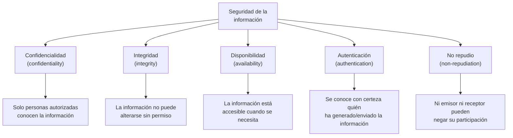
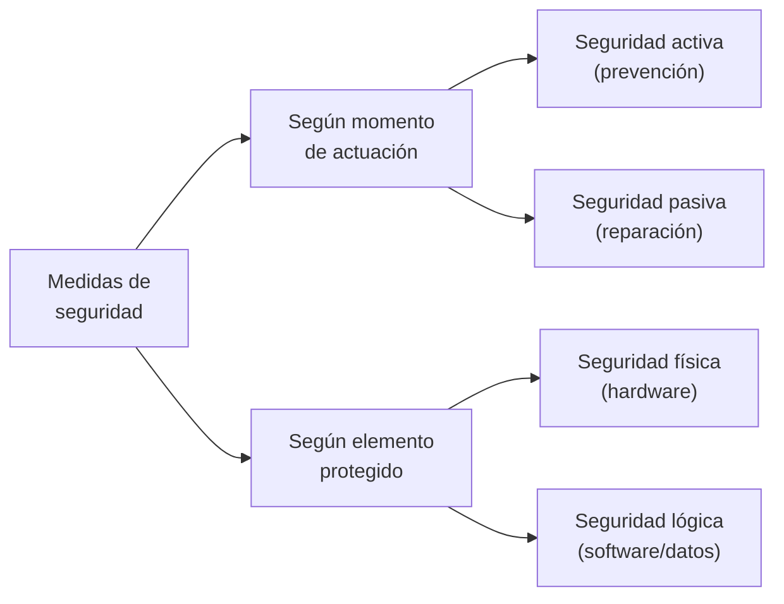
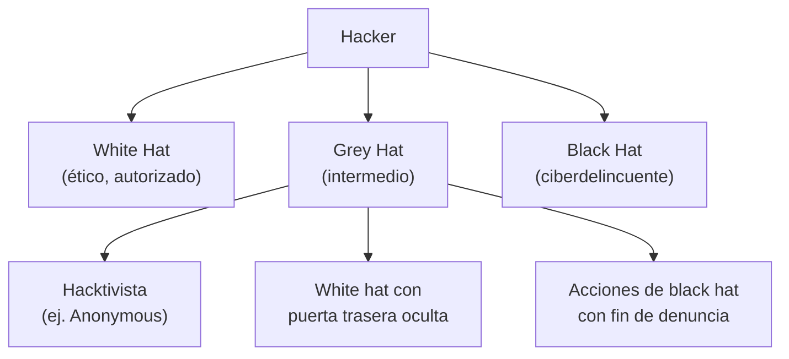
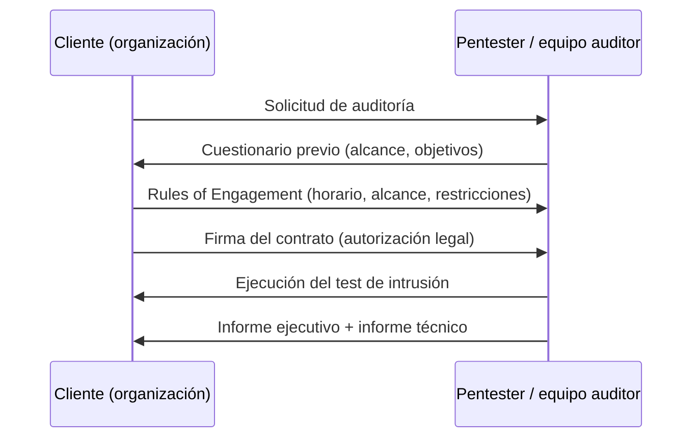
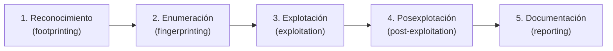
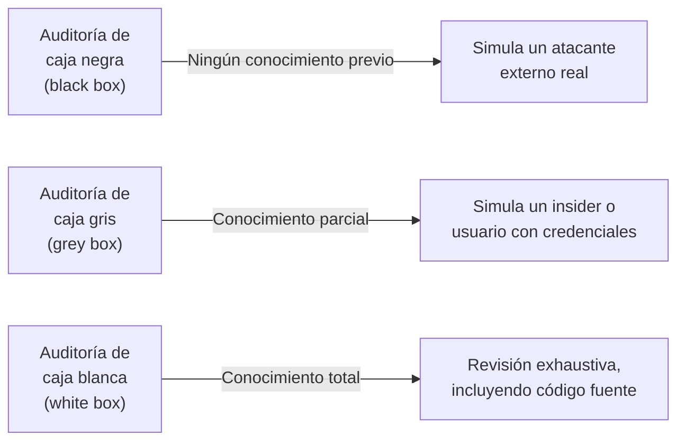
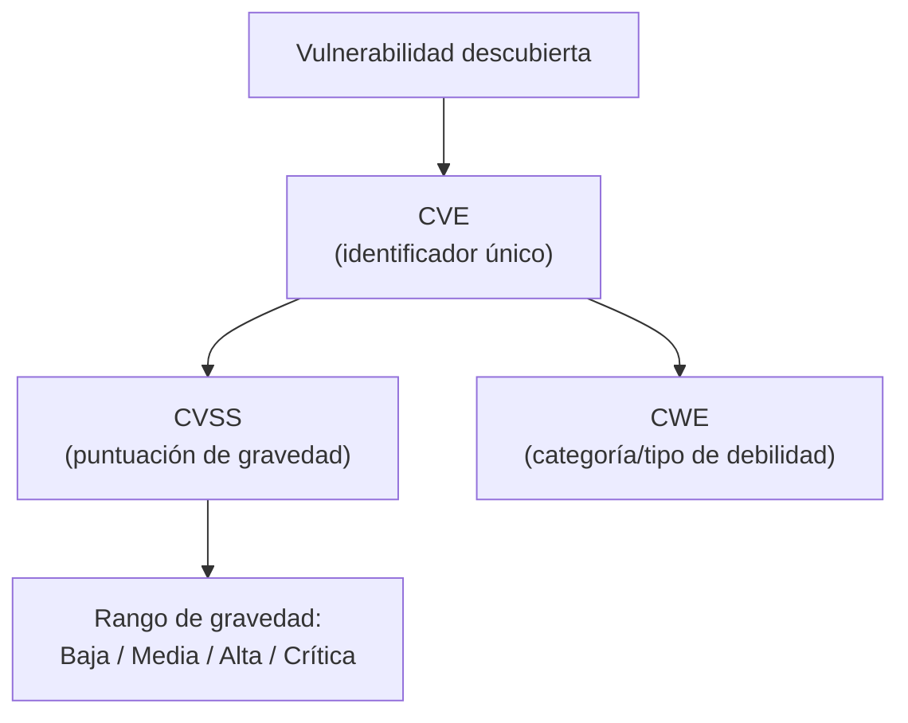
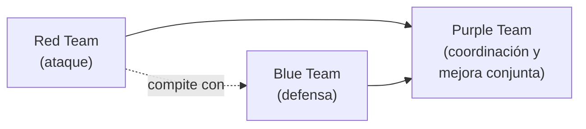
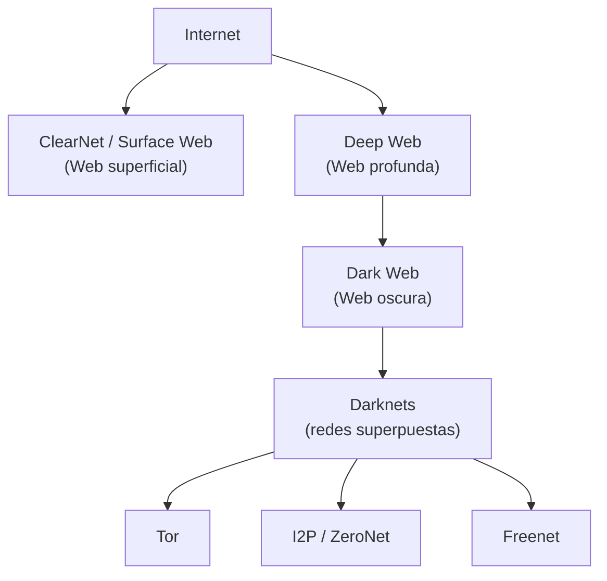

<!-- content: UD01 -->

# UD01. Introducción al hacking ético

## 1. Introducción

Esta primera Unidad Didáctica sienta las bases conceptuales, terminológicas, metodológicas y legales de todo el módulo de Hacking Ético. Antes de ejecutar un solo comando de escaneo o explotación, un futuro profesional de la ciberseguridad debe comprender **qué** es realmente el hacking ético, **quién** puede practicarlo legalmente, **bajo qué condiciones contractuales** se autoriza, **qué fases** sigue un ataque o una auditoría, **cómo se documentan** las vulnerabilidades descubiertas y **qué herramientas y recursos** existen para formarse y ejercer esta profesión de forma responsable.

A lo largo de esta unidad se desarrollan los ocho contenidos (`UD01-C01` a `UD01-C08`) definidos en la especificación curricular, todos ellos vinculados al resultado de aprendizaje **RA1**: *"Determina herramientas de monitorización para detectar vulnerabilidades aplicando técnicas de hacking ético"*.

> ⚠️ **Advertencia legal general.** Todo el contenido de esta unidad tiene una finalidad exclusivamente educativa. La realización de cualquier prueba de intrusión, escaneo o explotación sobre sistemas que no sean de tu propiedad o sobre los que no dispongas de autorización expresa y por escrito constituye un **delito** tipificado en el Código Penal español (artículos 197 y siguientes, 264 y siguientes). Esta advertencia se desarrolla en profundidad en `UD01-C03`.

---

## 2. UD01-C01 — Elementos esenciales del hacking ético

<!-- content: UD01-C01 -->

### 2.1. Origen histórico del término *hacker*

El término **hack**, en inglés, designa una solución rápida e ingeniosa a un problema. En los inicios de la computación (finales de los años 60 y principios de los 70 del siglo XX), estudiantes e ingenieros que trabajaban en los primeros desarrollos informáticos (como el MIT) buscaban constantemente mejorar las soluciones a los problemas técnicos a los que se enfrentaban, muchas veces llevando la tecnología de la época —líneas telefónicas lentas y caras, universidades con redes rápidas interconectadas entre sí— hasta sus límites. Estos pioneros curiosos fueron los primeros **hackers**.

En ese mismo periodo nació el **phreaking**: el pirateo de las comunicaciones telefónicas para realizar llamadas gratuitas o conectarse a Internet de forma ilimitada, aprovechando vulnerabilidades en la señalización de las compañías telefónicas (por ejemplo, AT&T empleaba una señal de 2600 Hz para liberar la línea).

Estos primeros hackers estaban motivados por la curiosidad y el deseo de compartir conocimiento. Sin embargo, sus acciones eran consideradas ilegales por las compañías telefónicas y corporaciones, lo que les obligaba a moverse en una **subcultura underground**: chats, foros privados y publicaciones (*magazines*) donde se ocultaban tras seudónimos o *nicknames*. Muchos de estos grupos fueron detenidos y encarcelados; algunos de sus miembros, tras cumplir condena, acabaron trabajando para grandes corporaciones o fundando sus propias empresas.

#### El Manifiesto Hacker (*The Conscience of a Hacker*)

Uno de los hitos culturales más relevantes de esta subcultura es el texto conocido como **Manifiesto Hacker**, publicado en 1986 en la revista underground *Phrack* bajo el título *The Conscience of a Hacker*, por un autor que firmaba como **The Mentor** (Loyd Blankenship), miembro de la segunda generación del grupo **Legion of Doom**, tras su detención. El manifiesto expone las motivaciones éticas de todo hacker y defiende que sus acciones no deberían considerarse ilegales:

> *"...Sí, soy un delincuente. Mi delito es la curiosidad. Mi delito es juzgar a la gente por lo que dice y por lo que piensa, no por lo que parece. Mi delito es ser más inteligente que vosotros, algo que nunca me perdonaréis. Soy un hacker, y este es mi manifiesto. Podéis eliminar a algunos de nosotros, pero no a todos... Después de todo, somos todos iguales."*

### 2.2. Hackers históricos relevantes

| Hacker | Alias | Hito histórico |
|---|---|---|
| **John T. Draper** | *Captain Crunch* | Descubrió que el silbato regalado en las cajas de cereales Cap'n Crunch emitía una señal de 2600 Hz idéntica a la usada por las líneas de AT&T para liberar la línea, permitiendo llamadas gratuitas (phreaking). Autor del libro *Beyond the little blue box*. Más tarde trabajó para Apple en el diseño de un dispositivo para conectar el Apple II a las líneas telefónicas. |
| **Vladimir Levin** | — | De origen ruso, considerado el primer hacker en robar un banco a través de Internet: accedió a los sistemas centrales de Citibank en Nueva York y realizó transferencias ilícitas por valor de 10 millones de dólares. Fue detenido por la Interpol en el aeropuerto de Heathrow en 1995. |
| **Kevin Poulsen** | *Dark Dante* | *Phreaker* famoso por intervenir y manipular las llamadas de concursos radiofónicos telefónicos para ganarlos. Detenido por el FBI, tras su condena se dedicó al periodismo de seguridad informática, trabajando para SecurityFocus y la revista *Wired*. |
| **Kevin Mitnick** | — | Posiblemente el hacker más famoso de la historia, tras acceder a los sistemas de la NASA y del Departamento de Defensa de los Estados Unidos. Autor de *El Arte de la Intrusión* y *El Arte de la Invisibilidad*. Su historia inspiró la novela *Takedown* (Tsutomu Shimomura, 1996) y la película *Asalto Final* (título original *Takedown*, 2000). |

> 📚 Para profundizar en la historia del hacking en España, el libro de Mercè Molist *Historia del hacking en España. La historia nunca contada del underground hacker en la Península Ibérica* (disponible libremente en `https://hackstory.es/`) hace un repaso de los primeros grupos de hackers españoles, sus foros, *magazines* y rivalidades.

### 2.3. La ciberdelincuencia en la actualidad

La preocupación por la seguridad informática ha aumentado considerablemente en los últimos años, agravada tras la pandemia de COVID-19. Según el Observatorio Español de Delitos Informáticos (OEDI), los ciberdelitos han crecido de forma sostenida:

| Tipo de ciberdelito | 2016 | 2017 | 2018 | 2019 | 2020 | 2021 |
|---|---|---|---|---|---|---|
| Fraude informático | 45 894 | 60 511 | 88 760 | 192 375 | 257 907 | 267 011 |
| Amenazas y coacciones | 11 473 | 11 270 | 11 906 | 12 782 | 14 066 | 17 319 |
| Falsificación informática | 2 697 | 2 961 | 3 095 | 4 275 | 6 289 | 10 476 |
| Acceso e interceptación ilícita | 2 579 | 2 505 | 2 750 | 4 004 | 4 653 | 5 342 |
| Contra el honor | 1 524 | 1 537 | 1 423 | 1 422 | 1 550 | 1 426 |
| Delitos sexuales | 1 188 | 1 312 | 1 393 | 1 774 | 1 783 | 1 628 |
| Interferencia en datos/sistema | 1 110 | 1 102 | 1 015 | 1 473 | 1 590 | 2 138 |
| Contra la propiedad intelectual | 121 | 109 | 217 | 197 | 125 | 137 |
| **TOTAL** | **66 586** | **81 307** | **110 603** | **218 302** | **287 963** | **305 477** |

*(Fuente citada en la documentación de referencia: Observatorio Español de Delitos Informáticos)*

Casos reales destacados que ilustran el impacto de la ciberdelincuencia:

- **Twitch (octubre de 2021)**: filtración de 125 GB de información (código fuente de la plataforma e ingresos de *streamers*).
- **CSIC (julio de 2022)**: ataque de *ransomware*, posiblemente desde Rusia, detectado a tiempo sin robo confirmado de información sensible.
- **Pegasus (software espía, 2022)**: ataque dirigido a teléfonos de miembros del Gobierno de España, con posible robo de más de 2 GB de información.

Esta creciente amenaza explica también el aumento de la demanda de profesionales en ciberseguridad: según el INCIBE, la demanda de talento doblará a la oferta en 2024, con una estimación de más de 83 000 profesionales necesarios.

### 2.4. Elementos esenciales de la seguridad de la información

La **seguridad** se entiende como la ausencia de peligro, daño o riesgo, y la **información** como el conjunto organizado de datos que constituye un mensaje. La seguridad de la información consiste en el conjunto de medidas de **prevención, detección y corrección** orientadas a proteger tres propiedades fundamentales, conocidas como **principios de la seguridad de la información**:

<!-- content: UD01-C01 -->

| Principio | Definición | Ejemplo de vulneración |
|---|---|---|
| **Confidencialidad** | Garantiza que la información solo pueda ser conocida por las personas autorizadas, evitando su divulgación accidental o intencionada. | Filtración de una base de datos de clientes. |
| **Integridad** | Garantiza que la información no pueda ser alterada o modificada sin permiso o de forma accidental, asegurando la consistencia de los datos. | Modificación no autorizada de un saldo bancario. |
| **Disponibilidad** | Garantiza que la información esté accesible por un sistema o usuarios autorizados cuando se necesite, de forma ininterrumpida. | Ataque de denegación de servicio (DoS/DDoS). |
| **Autenticación** | Permite conocer con certeza quién ha generado o enviado la información. Se logra mediante factores de autenticación (algo que el usuario sabe, algo que tiene, algo que es —biometría—). Cuando se combinan varios factores se habla de **múltiple factor de autenticación** (*multi-factor authentication*, MFA). | Suplantación de identidad en un envío de correo. |
| **No repudio** | El emisor no puede negar haber enviado la información (**no repudio de origen**), ni el receptor puede negar haberla recibido (**no repudio de destino**). | Firma digital en una transacción. |

Estos tres primeros principios (CIA: *Confidentiality, Integrity, Availability*) constituyen la llamada **tríada CIA**, pilar fundamental de toda la ciberseguridad, al que se añaden autenticación y no repudio cuando la información es compartida entre partes.

### 2.5. Clasificación de las medidas de seguridad

Las medidas de seguridad pueden clasificarse según distintos criterios:

**Según el momento de actuación:**

- **Seguridad activa**: medidas que tratan de **prevenir** algún daño en un sistema informático (controles de acceso, protocolos seguros, cortafuegos).
- **Seguridad pasiva**: medidas que tratan de **reparar o minimizar** un daño ya producido (copias de seguridad, sistemas de discos redundantes RAID, sistemas de alimentación ininterrumpida SAI).

**Según el elemento que se protege:**

- **Seguridad física**: protege el hardware de los sistemas informáticos. Amenazas comunes: incendios, inundaciones, sobrecargas eléctricas, robos o accesos no autorizados a los centros de proceso de datos (CPD).
- **Seguridad lógica**: protege el software y los datos. Amenazas comunes: *malware*, pérdida de información, ataques de denegación de servicio (DoS).

Una misma medida no tiene por qué pertenecer exclusivamente a una categoría; muchas *suites* de seguridad modernas combinan prevención y reparación.

**Según el enfoque metodológico (defensivo u ofensivo):**

- **Seguridad defensiva**: conjunto de medidas cuyo objetivo es proteger la información y los recursos de la organización.
- **Seguridad ofensiva**: técnicas y procedimientos empleados para vulnerar los controles de seguridad y poner en riesgo los principios anteriores, con fines legítimos de mejora (hacking ético).

Es habitual que grandes empresas y entidades bancarias dispongan de equipos dedicados tanto a la seguridad defensiva (**Blue Team**) como a la seguridad ofensiva (**Red Team**), que compiten entre sí en una especie de "juego del ratón y el gato" que permite una mejora continua de la seguridad (este concepto se desarrolla en profundidad en `UD01-C07`).

<!-- content: UD01-C01 -->

### 2.6. Definición RAE de *hacker*

Desde la vigesimotercera edición del diccionario de la RAE (2017), la palabra **hacker** (o **jáquer**, adaptación ortográfica) tiene dos acepciones:

1. *Pirata informático*: persona que accede ilegalmente a sistemas informáticos ajenos para apropiárselos u obtener información secreta.
2. *Persona con grandes habilidades en el manejo de computadoras* que investiga un sistema informático para avisar de los fallos y desarrollar técnicas de mejora.

La segunda acepción (introducida en 2017) reconoce explícitamente la labor del **hacker ético**: el profesional que investiga fallos de seguridad y los reporta para que sean corregidos antes de que puedan ser explotados maliciosamente.

### Errores frecuentes

- Confundir *hacker* con *ciberdelincuente*: en la cultura popular, "hacker" suele asociarse erróneamente solo a la connotación negativa (la del *cracker*), ignorando la acepción profesional y ética.
- Pensar que la seguridad física es irrelevante en ciberseguridad: numerosos ataques exitosos comienzan con un acceso físico no autorizado (p. ej., introducir un USB malicioso).
- Creer que basta con una sola medida de seguridad (p. ej., solo un cortafuegos) para estar protegido: la seguridad es un proceso de **defensa en profundidad**, combinando múltiples capas y tipos de medidas.

---

## 3. UD01-C02 — Diferencias entre hacking, hacking ético, tests de penetración y hacktivismo

<!-- content: UD01-C02 -->

### 3.1. Clasificación de los *hackers* según sus intenciones

La clasificación más habitual de los hackers se realiza en función de sus intenciones, utilizando la metáfora de los "sombreros" (*hats*), heredada de las películas del Oeste donde los personajes buenos llevaban sombrero blanco y los malos, negro:

| Tipo | Denominación inglesa | Descripción |
|---|---|---|
| **Hacker de sombrero blanco** | *white hat hacker* | Mejora la seguridad: encuentra agujeros en ella y notifica a la víctima para que tenga la oportunidad de arreglarlos. Suele ser un profesional contratado por una empresa u organización para atacar sus propios sistemas buscando vulnerabilidades y fallos. Esta es la categoría del **hacker ético**. |
| **Hacker de sombrero negro** | *black hat hacker* | Es un ciberdelincuente (aunque en la cultura popular se le conoce simplemente como "hacker"). Usa su conocimiento con fines negativos y normalmente egoístas: robo, extorsión, etc. |
| **Hacker de sombrero gris** | *gray/grey hat hacker* | Se sitúa a medio camino entre el sombrero blanco y el negro. Incluye distintos casos: *hacktivistas* (grupos con un propósito definido, normalmente altruista, como la defensa de la libertad de expresión o los derechos humanos; un ejemplo es el grupo **Anonymous**); quienes trabajan como sombrero blanco pero dejan alguna puerta trasera para vender información a la competencia; o quienes realizan acciones propias de sombrero negro, pero persiguiendo o denunciando determinados delitos (p. ej., la pederastia). |

<!-- content: UD01-C02 -->

### 3.2. Tipos de intrusos y motivaciones

Además de la clasificación anterior por intenciones, existen otras denominaciones muy comunes que hacen referencia a los distintos tipos de intrusos o ciberdelincuentes según las motivaciones de sus actos:

| Tipo de intruso | Motivación / características |
|---|---|
| **Cracker** | Busca provocar daños y obtener beneficios de forma ilegal. Término ligado a los años 80, cuando la mayoría del software propietario disponía de licencias y sistemas anticopia; los *crackers* utilizaban ingeniería inversa para desarrollar *keygens* y *cracks* que modificaban el software original para evitar las restricciones. |
| **Phreaker** | Busca acceder a Internet de forma gratuita a través de redes telefónicas. Término proveniente de los años 60, cuando se iniciaban las primeras conexiones analógicas vía módem en EE. UU., motivadas por el elevado coste de estas conexiones. |
| **Spammer** | Se dedica al envío masivo de mensajes de correo electrónico con diversos objetivos: ganancia económica o colapso de buzones y servidores de correo. |
| **Lamer** | Trata de parecerse a un *hacker*, pero tiene pocos conocimientos técnicos y no sabe lo que está haciendo (no entiende el código ni los comandos que ejecuta; se limita a copiar y pegar). También se conoce como **wannabe** o **script-kiddie**. |
| **Insider** | Personal que trabaja dentro de la propia empresa y actúa contra ella por motivos económicos o de venganza. |
| **Exempleado** | Antiguo trabajador cuyas motivaciones son similares a las del *insider*. |
| **Hacktivist** | Busca relevancia política con acciones de reivindicación contra injusticias, la protección de los derechos humanos o del medioambiente, etc. **Anonymous** es un grupo vinculado a este tipo de acciones. |
| **State-Sponsored Hacker** | Ciberdelincuente que realiza sus acciones normalmente criminales, bajo el paraguas de una nación o Estado. Sus ataques van dirigidos a otras naciones amigas o enemigas con el objetivo de conseguir información valiosa, colapsar sistemas informáticos o infraestructuras críticas del país (centrales nucleares, hospitales, etc.). |

También se denomina **script kiddie** a personas sin los conocimientos ni habilidades de un *hacker* que tratan de atacar sistemas empleando herramientas creadas por verdaderos hackers; pueden tener éxito ante configuraciones o problemas de seguridad muy obvios o sencillos, aunque no tengan ni idea de cómo lo han conseguido.

### 3.3. Hacking vs. hacking ético vs. test de penetración vs. hacktivismo

Es fundamental distinguir conceptualmente estos cuatro términos, que a menudo se confunden:

| Término | Definición | Legalidad | Finalidad |
|---|---|---|---|
| **Hacking** (a secas) | Acción de vulnerar sistemas, con independencia de la intención del actor. Término neutro que engloba tanto actividad legítima como ilegítima. | Depende del contexto y autorización. | Variable (investigación, delito, activismo...). |
| **Hacking ético** | Actividad de un *hacker de sombrero blanco* que, con **autorización expresa**, identifica vulnerabilidades en sistemas para mejorar su seguridad. | **Legal**, siempre que exista autorización y contrato previos. | Mejorar la seguridad de la organización auditada. |
| **Test de penetración / pentest** | Actuación legítima concreta, acotada en alcance y tiempo, mediante contrato, cuyo objetivo es vulnerar servicios de una empresa para hacerse con su control y así evaluar su seguridad real. Es la **materialización práctica** del hacking ético. | **Legal**, regulado contractualmente (desarrollado en `UD01-C03`). | Detectar vulnerabilidades explotables antes de que lo haga un atacante real. |
| **Hacktivismo** | Uso de técnicas de hacking con una motivación política, social o ideológica (defensa de derechos humanos, libertad de expresión, medioambiente, etc.), normalmente sin autorización del objetivo. | **Generalmente ilegal**, al no existir autorización del sistema atacado, independientemente de la legitimidad moral de la causa. | Reivindicación política/social, no la mejora de la seguridad del objetivo. |

> 💡 **Idea clave.** El hacking ético y el test de intrusión comparten las mismas técnicas que un ciberdelincuente (*black hat*), pero se diferencian radicalmente en dos aspectos: la **autorización previa** (contrato, alcance, reglas de compromiso) y la **finalidad** (mejorar la seguridad, no explotarla en beneficio propio). El hacktivismo, aunque pueda perseguir fines éticamente defendibles, normalmente carece de esa autorización, por lo que **no debe confundirse con el hacking ético**.

### 3.4. Marco normativo del Código Penal español sobre el hacking

En España, el **Código Penal** establece los supuestos en los que un hacker podría estar cometiendo un delito. Son de interés los artículos comprendidos entre el 197 y el 201, especialmente el **197 bis** y el **197 ter**, incorporados al Código Penal en 2015:

- **Artículo 197 bis.1**: *"El que por cualquier medio o procedimiento, vulnerando las medidas de seguridad establecidas para impedirlo, y sin estar debidamente autorizado, acceda o facilite a otro el acceso al conjunto o una parte de un sistema de información o se mantenga en él en contra de la voluntad de quien tenga el legítimo derecho a excluirlo, será castigado con pena de prisión de seis meses a dos años"*.
- **Artículo 197 bis.2**: *"El que mediante la utilización de artificios o instrumentos técnicos, y sin estar debidamente autorizado, intercepte transmisiones no públicas de datos informáticos que se produzcan desde, hacia o dentro de un sistema de información, incluidas las emisiones electromagnéticas de los mismos, será castigado con una pena de prisión de tres meses a dos años o multa de tres a doce meses"*.
- **Artículo 197 ter**: castiga con pena de prisión de seis meses a dos años (o multa) a quien, sin estar debidamente autorizado, produzca, adquiera para su uso, importe o facilite a terceros, con la intención de facilitar la comisión de los delitos anteriores: a) un programa informático concebido o adaptado principalmente para cometer dichos delitos; o b) una contraseña de ordenador, un código de acceso o datos similares que permitan acceder a la totalidad o a una parte de un sistema de información.

De estos artículos se deduce que es **totalmente imprescindible tener la autorización correspondiente** mediante un contrato donde se establezca claramente el propósito y ámbito de la actividad. Incluso si se realiza una investigación sin ánimo malintencionado y se reportan las vulnerabilidades encontradas, la ausencia de autorización puede dar lugar a denuncia (es lo que le ocurrió a un hacker que descubrió un fallo de seguridad grave en el sistema LexNET del Ministerio de Justicia español, quien tras hacerlo público fue denunciado por dicho Ministerio).

### Errores frecuentes

- Pensar que investigar "sin hacer daño" y reportando la vulnerabilidad exime de responsabilidad legal: sin autorización previa, puede constituir delito igualmente.
- Equiparar hacktivismo con hacking ético porque ambos "persiguen el bien": la diferencia legal clave es la **autorización**.
- Creer que *cracker* y *hacker* son sinónimos: el *cracker* tiene una connotación específicamente maliciosa/ilegal (y, originalmente, relacionada con la ruptura de protecciones anticopia), mientras que *hacker* es un término más amplio y, en su acepción RAE más moderna, también designa al profesional ético.

---

## 4. UD01-C03 — Recolección de permisos y autorizaciones previos a un test de intrusión

<!-- content: UD01-C03 -->

### 4.1. El test de intrusión (*pentest*)

Un **test de intrusión**, o *penetration testing* (abreviado ***pentest***), es una actuación **legítima** de un hacker que trata de vulnerar los servicios de una empresa para hacerse con su control. Los objetivos y el alcance del test de intrusión se establecen **por contrato**, que incluye, entre otros aspectos, una **cláusula de confidencialidad**.

El objetivo del test de intrusión es analizar el estado de seguridad de los servicios de una empresa mediante la búsqueda activa de vulnerabilidades. De este modo, la empresa que contrata el *pentest* trata de anticiparse y protegerse ante posibles ataques de ciberdelincuentes. Al concluir el test de intrusión se presenta un **informe de resultados** donde se describen y analizan los problemas de seguridad descubiertos y se proponen soluciones a los mismos (desarrollado en `UD01-C04`, fase de documentación).

### 4.2. El contrato del test de intrusión: *rules of engagement*

Los detalles de cómo debe llevarse a cabo el test de intrusión —qué servicios serán auditados, la duración del test, etc.— deben estar acordados previamente con el cliente mediante un contrato que deben firmar ambas partes. En la bibliografía anglosajona se refieren a este acuerdo como ***rules of engagement*** (reglas de compromiso). Este documento debe dar respuesta, como mínimo, a preguntas como:

- ¿En qué horario debe realizarse el *pentest*? ¿Hay servicios críticos donde la carga de trabajo no puede superar un cierto umbral?
- ¿Se van a realizar pruebas de denegación de servicio?
- ¿Está permitida la ingeniería social a empleados?
- ¿El personal de la organización o el personal de IT tendrá conocimiento previo del test?
- ¿Está permitido instalar *backdoors* o usar *exploits* peligrosos?

Es difícil encontrar ejemplos de contratos de test de intrusión reales entre corporaciones privadas (por la cláusula de confidencialidad), pero sí se pueden encontrar ejemplos en los pliegos de contratación publicados por organismos públicos en los boletines oficiales (por ejemplo, pliegos de contratación de un test de intrusión por parte de Loterías y Apuestas del Estado).

<!-- content: UD01-C03 -->

### 4.3. Aspectos éticos y legales frente al ciberdelito

Como ya se ha explicado en `UD01-C02`, el Código Penal español (artículos 197 bis, 197 ter y concordantes) castiga el acceso no autorizado a sistemas de información. Por tanto, **la existencia de un contrato firmado que autorice expresamente la actuación es el elemento que diferencia jurídicamente al hacker ético del ciberdelincuente**, aunque ambos puedan emplear exactamente las mismas técnicas.

Elementos que debe garantizar, como mínimo, todo contrato de test de intrusión:

1. **Alcance (scope)**: qué sistemas, redes, aplicaciones o rangos de IP están incluidos y cuáles están explícitamente excluidos.
2. **Ventana temporal**: fecha de inicio y fin de las pruebas autorizadas.
3. **Tipo de auditoría**: caja negra, blanca o gris (desarrollado en `UD01-C05`).
4. **Técnicas permitidas y prohibidas**: por ejemplo, si se autoriza la ingeniería social, los ataques DoS o el uso de *exploits* que puedan causar inestabilidad en los sistemas de producción.
5. **Punto de contacto de emergencia**: a quién avisar si se detecta un incidente grave o no planificado durante el test.
6. **Cláusula de confidencialidad**: tratamiento de la información obtenida durante la auditoría, incluso tras finalizar el contrato.
7. **Autorización explícita y firmada** por una persona con capacidad legal para otorgarla en nombre de la organización.

> ⚠️ Realizar cualquier prueba de intrusión —incluso con intención benévola— **sin disponer de este contrato firmado previamente constituye un delito**. No existe una "zona gris" legal para la buena intención sin autorización expresa.

### 4.4. Relación con el marco normativo de protección de datos

Más allá del Código Penal, cualquier test de intrusión que implique el tratamiento de datos de carácter personal debe respetar el **Reglamento General de Protección de Datos (RGPD)**, de aplicación directa en toda la Unión Europea, y su desarrollo en España mediante la **Ley Orgánica 3/2018, de Protección de Datos Personales y garantía de los derechos digitales (LOPDGDD)**. Durante un *pentest*, el auditor puede acceder incidentalmente a datos personales (credenciales, bases de datos de clientes, etc.), por lo que el contrato debe regular también:

- el tratamiento, almacenamiento y destrucción posterior de cualquier dato personal al que se acceda durante la auditoría;
- la notificación de incidentes de seguridad detectados que puedan implicar una brecha de datos personales, conforme a los plazos que marca el RGPD (72 horas para notificar a la autoridad de control, art. 33 RGPD).

Asimismo, a nivel europeo, la **Directiva NIS2** (*Network and Information Security Directive 2*) refuerza las obligaciones de ciberseguridad para operadores de servicios esenciales e importantes, estableciendo requisitos de gestión de riesgos, notificación de incidentes y, en ciertos casos, obligación de someterse a auditorías periódicas de seguridad —marco en el que se insertan también los test de intrusión regulares.

### Errores frecuentes

- Comenzar un test de intrusión "a cuenta" para luego mostrar resultados y conseguir el contrato: sin autorización previa firmada, esa actuación es ilegal, independientemente de la intención posterior.
- Asumir que el alcance "todo el perímetro de la empresa" incluye automáticamente filiales, proveedores cloud de terceros o aplicaciones de socios: el alcance debe delimitarse con precisión.
- Olvidar las implicaciones de protección de datos: un pentest que accede a bases de datos de clientes está sujeto al RGPD/LOPDGDD igual que cualquier otro tratamiento de datos personales.

---

## 5. UD01-C04 — Fases del hacking

<!-- content: UD01-C04 -->

### 5.1. Las cinco fases de un test de intrusión

La realización de un test de intrusión se desarrolla en diferentes fases o etapas, cada una de las cuales tiene un alcance y un objetivo distintos. Existen diferentes propuestas en cuanto a cómo dividir estas etapas (según la metodología empleada, ver `UD01-C05`), pero de forma general se pueden establecer estas cinco:

<!-- content: UD01-C04 -->

| Fase | Nombre alternativo | Descripción | Unidad donde se profundiza |
|---|---|---|---|
| **1. Reconocimiento** | *Footprinting* | Análisis preliminar del objetivo, recabando toda la información posible utilizando fuentes públicas (OSINT). Esta fase **no es intrusiva**: no se comete ninguna ilegalidad, ya que la información recabada está al alcance de cualquiera. | Unidad 2 |
| **2. Enumeración** | *Fingerprinting* | Se continúa con la recopilación de información del objetivo, pero de manera **activa**, es decir, interactuando directamente con él, por lo que es imprescindible disponer de permiso para ello. Se realizan acciones como el escaneo de puertos abiertos y el análisis y descubrimiento de vulnerabilidades. | Unidad 3 |
| **3. Explotación** | *Exploitation* | Con la información obtenida en las fases 1 y 2, se dispone de información amplia del objetivo. El objetivo de esta fase es diseñar un vector de ataque para lograr la entrada en los sistemas, aprovechando algún error de configuración, contraseñas débiles, servicio o aplicación vulnerables, etc. | Unidades 4, 5 y 7 |
| **4. Posexplotación** | *Post-exploitation* | Comienza tras acceder a los sistemas del objetivo. Las acciones que se desarrollan son de tipos diversos: comprobar los privilegios que se poseen y analizar el sistema para elevarlos/escalarlos hacia un usuario más privilegiado; analizar el entorno de red donde se sitúa el sistema vulnerado, estudiando posibles saltos (*pivoting*) a otros sistemas más interesantes. | Unidad 6 |
| **5. Documentación** | *Reporting* | Última fase, en la que se elabora el informe que recoge los detalles del test. A menudo se elaboran dos tipos de informes: un **informe ejecutivo** para la alta dirección y un **informe técnico** dirigido al personal de IT. | — |

> 💡 Los ciberdelincuentes siguen un esquema similar, salvo en la última fase: en lugar de documentar para el cliente, tratan de **borrar las huellas** de su actividad, instalando *rootkits* y herramientas de comando y control (**Command & Control**, C2) que les permiten manejar y enviar órdenes a los equipos comprometidos de forma remota o exfiltrar información para luego extorsionar a la empresa (*fase de "cubrir huellas"*, frecuentemente añadida como sexta fase en los esquemas clásicos de hacking malicioso).

### 5.2. Aplicación práctica: ejemplo de una auditoría simplificada

Para fijar estos conceptos, un ejemplo simplificado (sin tecnicismos de unidades posteriores) de cómo progresaría un pentest sobre un servidor web ficticio:

1. **Reconocimiento**: el auditor busca en fuentes públicas (registros WHOIS, buscadores, redes sociales de empleados) información sobre la empresa, su infraestructura y posibles correos electrónicos de contacto, sin interactuar directamente con los servidores objetivo.
2. **Enumeración**: el auditor, ya con autorización activa, escanea los puertos abiertos del servidor (por ejemplo, con `nmap`) y determina que corre un gestor de contenidos (CMS) desactualizado.
3. **Explotación**: el auditor localiza un *exploit* público para la versión vulnerable del CMS y lo ejecuta, obteniendo acceso al sistema.
4. **Posexplotación**: el auditor comprueba que tiene privilegios limitados y busca binarios con permisos especiales (SUID) para escalar privilegios hasta obtener acceso de administrador (*root*).
5. **Documentación**: el auditor redacta el informe técnico (detallando el CVE explotado, los pasos seguidos, las evidencias) y el informe ejecutivo (resumen del riesgo y recomendaciones para la dirección).

> Este esquema anticipa, de forma introductoria, el tipo de ejercicio práctico (boot2root) que se desarrollará en la práctica asociada a esta unidad, y cuyo desarrollo técnico en profundidad corresponde a unidades posteriores (2, 3, 4 y 6).

### Errores frecuentes

- Confundir "reconocimiento" con "enumeración": la diferencia clave es la **interacción directa** con el objetivo (pasiva vs. activa) y, por tanto, la necesidad o no de autorización previa para esa fase concreta.
- Pensar que la fase de explotación es "el hacking de verdad" y que el resto son secundarias: sin un buen reconocimiento y enumeración, la fase de explotación carece de la información necesaria para tener éxito.
- Omitir la fase de documentación: sin informe, el cliente no puede corregir las vulnerabilidades descubiertas, por lo que el test de intrusión pierde su valor principal.

---

## 6. UD01-C05 — Auditorías de caja negra y de caja blanca

<!-- content: UD01-C05 -->

### 6.1. Clasificación según el conocimiento previo del auditor

El test de intrusión puede realizarse teniendo en cuenta diversos factores. El primero de ellos es el **conocimiento** que tiene el *pentester* de los elementos internos de la empresa (archivos de configuración, código fuente, esquemas de red, políticas de seguridad, etc.). Según este conocimiento, se diferencian los siguientes tipos de auditoría:

<!-- content: UD01-C05 -->

| Tipo de auditoría | Conocimiento del auditor | Descripción |
|---|---|---|
| **Auditoría de caja negra** (*black box*) | Ninguno, *a priori* | El auditor toma el rol de un hacker que no tiene ningún conocimiento de la organización. Simula de la forma más fiel posible un ataque externo real. |
| **Auditoría de caja blanca** (*white box*) | Total | El auditor tiene acceso total a la información interna de la empresa. Se revisan todos los sistemas, versiones de software y sistemas operativos, configuraciones, políticas, etc. Esta auditoría puede consistir también en la **revisión del código fuente** del software, si la empresa se dedica al desarrollo. |
| **Auditoría de caja gris** (*grey box*) | Parcial o limitado | El auditor dispone de un conocimiento parcial o limitado de la organización. Por ejemplo, la auditoría podría consistir en revisar la seguridad de una aplicación web en la que se tendrían ciertos permisos, pero sin acceso al código fuente. |

### 6.2. Clasificación según la posición del auditor respecto a los recursos

Otro factor a tener en cuenta a la hora de diseñar la auditoría es la **posición** que toma el *pentester* con respecto a la situación de los recursos de la empresa:

| Tipo de auditoría | Descripción |
|---|---|
| **Auditoría perimetral** | El auditor asume el papel de un hacker que trata de descubrir una vía de entrada a los sistemas internos de la organización a través del análisis de seguridad del perímetro de esta. Se analizan configuraciones DNS, rangos de direcciones IP y servicios en uso, redes inalámbricas y cualquier información relevante que pueda ayudar a obtener acceso. |
| **Auditoría interna** | El auditor toma el rol de un empleado o de un *insider*, con escasos o nulos privilegios en la organización, o de un invitado que se conecta a la red corporativa. La auditoría se realiza *in situ* y comienza desde un segmento de red alejado de los servicios críticos. |
| **Auditoría interna con privilegios** | Similar a la anterior, pero en este caso el auditor puede tener acceso a las configuraciones, código fuente, políticas de seguridad, etc. |

### 6.3. Clasificación según el alcance de los servicios o recursos auditados

Finalmente, según el **alcance** de los servicios o recursos que quieren ser auditados, se distinguen:

- **Auditoría web**: evalúa la seguridad de una aplicación web. Puede ser de forma externa sin permisos (perimetral), con permisos de un usuario con credenciales (interna), o auditando el código fuente (caja blanca).
- **Auditoría de aplicaciones móviles**: permite conocer el grado de seguridad de las *apps* de la empresa, a diferentes niveles, como en el caso de la web.
- **Auditoría *wireless* y VoIP** (*Voice over IP*): permite conocer el estado de seguridad de las comunicaciones inalámbricas y de voz.
- **Prueba de estrés DoS/DDoS**: evalúa la fortaleza de la infraestructura ante situaciones de alta carga.

> Los distintos tipos de auditorías presentados en este apartado **no son compartimentos estancos**: cada test de intrusión definirá un tipo u otro en función de los objetivos que persiga. Por ejemplo, una organización puede querer evaluar el grado de seguridad de su perímetro frente a amenazas externas desconocidas, por lo que una auditoría perimetral de caja negra sería la más apropiada. En cambio, puede estar interesada en conocer el grado de compromiso ante exempleados o empleados descontentos, por lo que una auditoría interna o perimetral de caja gris sería la más adecuada.

### Tabla resumen comparativa

| Criterio de clasificación | Tipos |
|---|---|
| Conocimiento previo | Caja negra · Caja blanca · Caja gris |
| Posición del auditor | Perimetral · Interna · Interna con privilegios |
| Alcance de recursos | Web · Aplicaciones móviles · *Wireless*/VoIP · Prueba de estrés DoS/DDoS |

### Errores frecuentes

- Pensar que "caja negra" significa menos rigor técnico: en realidad, implica mayor realismo respecto a un atacante externo real, no menor exigencia.
- Confundir "auditoría interna" con "auditoría de caja blanca": la primera se refiere a la **posición de red** desde la que se audita (dentro del perímetro), mientras que la segunda se refiere al **nivel de conocimiento** que posee el auditor. Pueden combinarse (p. ej., una auditoría interna de caja gris).
- Olvidar documentar el tipo de auditoría elegido en el contrato (ver `UD01-C03`): el tipo de auditoría condiciona directamente el alcance y las técnicas autorizadas.

---

## 7. UD01-C06 — Documentación de vulnerabilidades

<!-- content: UD01-C06 -->

### 7.1. Concepto de vulnerabilidad

Una **vulnerabilidad** o ***bug*** es un fallo de diseño de un sistema que pone en riesgo su funcionamiento y su seguridad. Curiosamente, el término *bug* (bicho, en inglés) tiene un origen literal: el primer fallo informático detectado se produjo el 9 de septiembre de 1947 en el laboratorio de cálculo de la Universidad de Harvard. **Grace Murray Hopper**, trabajando como programadora del ordenador Mark II, anotó en el libro de registro que se había detectado un fallo debido a la presencia de una polilla (*bug*, en inglés coloquial) en uno de los relés del computador.

### 7.2. Causas y tipos de vulnerabilidades

Hoy en día, el mal funcionamiento o los fallos que suceden en los sistemas informáticos son provocados por errores en su diseño o implementación. Dado que los sistemas informáticos se componen de elementos software y hardware, se puede diferenciar entre:

- **Vulnerabilidades de software**: afectan a los programas informáticos y ocurren habitualmente por errores de programación en su código fuente, fallos de configuración, etc. Normalmente estos errores no son intencionados, pero en pocas ocasiones se han dejado de forma intencionada para crear puertas traseras o *backdoors* que permitan el acceso remoto, principalmente de agencias de información gubernamentales, sin necesidad de mucho esfuerzo.
- **Vulnerabilidades de hardware**: tipo de vulnerabilidad que un atacante puede llegar a aprovechar para saltarse todas las protecciones del sistema operativo y demás capas de software, con el fin de obtener información valiosa.

Casos reales documentados de vulnerabilidades de software:

| CVE | Nombre | Descripción |
|---|---|---|
| **CVE-2021-44228** | *Log4Shell* | Vulnerabilidad en la librería **log4j** (muy usada por desarrolladores Java para registrar eventos e información relevante en *logs*), cuyo uso ampliamente generalizado hizo que el impacto fuera enorme. |
| **CVE-2022-22965** | *Spring4Shell* | Afecta al núcleo del *framework* Spring y permite la ejecución remota de código (RCE). |
| **CVE-2021-4034** | *PwnKit* | Vulnerabilidad de escalada de privilegios local en Linux (descubierta en `polkit`'s `pkexec`). |
| **CVE-2021-36934** | *HiveNightmare* (también *#SeriousSAM*) | Permite a cualquier usuario sin privilegios leer el registro de Windows 10, exponiendo credenciales. |
| **CVE-2020-1472** | *Zerologon* | Presente en diversas versiones de Windows Server; permite a cualquier usuario en la red convertirse en administrador del dominio, aprovechando un fallo de implementación en la criptografía del protocolo *Netlogon Remote Protocol* (elección errónea del vector de inicialización en el algoritmo criptográfico AES-CFB8). |

Ejemplos de vulnerabilidades de hardware:

| CVE(s) | Nombre | Descripción |
|---|---|---|
| **CVE-2017-5754** | *Meltdown* | Descubierta en 2017, hecha pública en enero de 2018. Aprovecha una vulnerabilidad en la ejecución fuera de orden de los procesadores para leer datos a los que no debería tener acceso. |
| **CVE-2017-5753 / CVE-2017-5715** | *Spectre* | Aprovecha la ejecución especulativa de código que utilizan los procesadores para mejorar el rendimiento. |
| **CVE-2022-29900 / CVE-2022-29901** | *Retbleed* | Vulnera la técnica *retpoline*, diseñada como medida de defensa para mitigar Spectre. |
| **CVE-2023-20593** | *Zenbleed* | Afecta a la serie de procesadores Zen 2 de AMD. |
| **CVE-2023-20569** | *Inception* | Afecta a las series de procesadores Zen 3 y Zen 4 de AMD. |
| — | *Rowhammer* | Afecta a las memorias DDR DRAM; permite modificar bits en memoria tras accesos repetidos a celdas cercanas. |

Una vulnerabilidad que no ha sido reportada de forma oficial, o que se ha publicado sin que haya dado tiempo al desarrollador a publicar un parche, se conoce como **vulnerabilidad de día cero** o ***zeroday***. Existen plataformas como **Zerodium** —un *broker* de vulnerabilidades— que ofrecen grandes sumas de dinero por la compra de este tipo de información (en contraposición a las plataformas de recompensas o *bug bounty*, ver `UD01-C07`), para luego vendérsela a terceros (gobiernos, empresas como NSO Group, desarrolladores del software espía Pegasus, etc.). Por ejemplo, Zerodium llegó a pagar hasta 2,5 millones de dólares por una vulnerabilidad *zero clic* en Android, y 2 millones de dólares para iOS.

### 7.3. Sistemas de clasificación y documentación: CVE, CVSS y CWE

<!-- content: UD01-C06 -->

#### CVE (*Common Vulnerabilities and Exposures*)

El **CVE** es un sistema que provee un identificador numérico único a las vulnerabilidades de seguridad que se informan públicamente. El identificador se compone de tres elementos: **CVE-XXXX-YYYYY**, donde los cuatro primeros dígitos corresponden al año en que se publica la vulnerabilidad y los siguientes corresponden al identificador de la vulnerabilidad de ese año. El listado completo de vulnerabilidades puede consultarse en la web de la corporación **MITRE** (`cve.org`).

#### CVSS (*Common Vulnerability Scoring System*)

Las vulnerabilidades son evaluadas para conocer su gravedad mediante el **CVSS**, sistema que emplea una serie de métricas en diferentes categorías. La puntuación base contiene los elementos principales que ofrecen una puntuación global entre 0 y 10, junto con otros elementos opcionales (métrica temporal y de entorno) que corrigen o ajustan esa puntuación base. La versión más reciente del estándar es la **CVSS v4.0** (siendo la **v3.1** también ampliamente utilizada en la práctica profesional y en la documentación de referencia).

| Rango de CVSS | Gravedad |
|---|---|
| 0.0 – 3.9 | Baja |
| 4.0 – 6.9 | Media |
| 7.0 – 8.9 | Alta |
| 9.0 – 10.0 | Crítica |

Las métricas base de CVSS v3.1 que componen la puntuación incluyen:

- **Attack Vector (AV)**: Network / Adjacent / Local / Physical.
- **Attack Complexity (AC)**: Low / High.
- **Privileges Required (PR)**: None / Low / High.
- **User Interaction (UI)**: None / Required.
- **Scope (S)**: Unchanged / Changed.
- **Confidentiality (C)**, **Integrity (I)**, **Availability (A)**: None / Low / High.

**Ejemplo real de cálculo (CVSS v3.1, puntuación 9.4, crítica):** vulnerabilidad explotable a través de la red (AV:N), sin necesidad de privilegios (PR:N) ni interacción de otros usuarios (UI:N), sencilla de explotar (AC:L); afecta de manera importante a la integridad (I:H) y disponibilidad (A:H), y de forma menos importante a la confidencialidad (C:L); el ámbito (*scope*, S) permanece inalterado (S:U), ya que la vulnerabilidad no afecta a un componente distinto de aquel en el que se encuentra.

> La calculadora oficial de CVSS está disponible en `https://www.first.org/cvss/calculator/3.1`.

#### CWE (*Common Weakness Enumeration*)

Las vulnerabilidades también se pueden clasificar según el **tipo de debilidad** que las origina. El **CWE** dispone de una clasificación exhaustiva de todos los posibles tipos de vulnerabilidades hardware y software, y ofrece también una lista de las 25 vulnerabilidades de software más comunes (**CWE Top 25**), entre las que se encuentran:

| CWE | Nombre |
|---|---|
| **CWE-79** | *Cross-Site Scripting* (XSS) |
| **CWE-89** | *SQL Injection* |
| **CWE-20** | *Improper Input Validation* |
| **CWE-352** | *CSRF* (*Cross-Site Request Forgery*) |
| **CWE-22** | *Path Traversal* |
| **CWE-77** | *Command Injection* |
| **CWE-918** | *SSRF* (*Server-Side Request Forgery*) |

> Todas estas categorías del CWE Top 25 están relacionadas con el *hacking* de aplicaciones web, que se estudiará en profundidad en la Unidad 4.

### Tabla resumen: los tres sistemas de documentación de vulnerabilidades

| Sistema | Responde a la pregunta | Formato del identificador/resultado |
|---|---|---|
| **CVE** | ¿Qué vulnerabilidad concreta es y cómo se identifica unívocamente? | `CVE-AAAA-NNNNN` |
| **CVSS** | ¿Cuán grave es esta vulnerabilidad? | Puntuación numérica 0.0–10.0 + vector de métricas |
| **CWE** | ¿A qué categoría o tipo de debilidad pertenece? | `CWE-NNN` (categoría genérica) |

### Errores frecuentes

- Confundir CVE con CVSS: el CVE **identifica** una vulnerabilidad concreta; el CVSS **puntúa su gravedad**. Una misma vulnerabilidad (un CVE) tiene asociada una puntuación CVSS.
- Confundir CVE con CWE: el CVE es una instancia concreta y específica (p. ej., *Log4Shell*); el CWE es la **categoría genérica** a la que pertenece ese tipo de fallo (p. ej., *Improper Input Validation*, CWE-20).
- Pensar que una vulnerabilidad con CVSS bajo es irrelevante: el contexto de explotación (por ejemplo, combinarla con otra vulnerabilidad) puede aumentar su impacto real más allá de su puntuación aislada.

---

## 8. UD01-C07 — Clasificación de herramientas de seguridad y hacking

<!-- content: UD01-C07 -->

### 8.1. Equipos de seguridad: *Red Team* vs. *Blue Team*

Antes de clasificar las herramientas, conviene situar el marco organizativo en el que se emplean. Habitualmente se distinguen dos tipos de equipos de seguridad:

- **Red Team** (equipo rojo): realiza labores de **seguridad ofensiva**; en él se incluyen las acciones propias de un hacker ético.
- **Blue Team** (equipo azul): realiza labores de **seguridad defensiva**, como respuesta a incidentes, análisis forense digital, investigación de amenazas (*threat hunting*), bastionado de sistemas, seguridad operativa (*SecOps*), etc.

A menudo se confunden los términos ***pentesting*** y ***red teaming***, pero existen diferencias importantes: un *pentest* está orientado a una acción concreta sobre un objetivo y cuya duración en el tiempo suele ser reducida; las labores del Red Team consisten en un ejercicio continuo y constante de prueba de las defensas del objetivo, tratando de superarlas evitando ser descubiertos. Estos ejercicios o simulacros emulan el comportamiento de grupos organizados de ciberdelincuentes, también llamados **APT** (*Advanced Persistent Threat*), cuyo *modus operandi* se encuentra en la matriz de tácticas, técnicas y procedimientos (**TTP**) de **MITRE ATT&CK**.

Por tanto, el objetivo del Blue Team será que el Red Team **no tenga éxito**. Más recientemente aparece el **Purple Team**, que realiza una puesta en común del trabajo de ambos equipos para analizar las debilidades, establecer mejoras y organizar los siguientes ejercicios. También existen otras denominaciones menos extendidas (*orange*, *green*, *yellow*, *white*...), recogidas en la llamada "**Pirámide BAD**" (*Build, Attack, Defend*) propuesta por el investigador Daniel Miessler.

<!-- content: UD01-C07 -->

### 8.2. Perfil del buen hacker o ciberinvestigador: áreas de conocimiento base

Los conocimientos que debe adquirir un hacker se sustentan sobre una base sólida de conocimientos básicos y avanzados del funcionamiento de los sistemas informáticos:

- **Arquitectura de computadoras y lenguaje ensamblador**: base del funcionamiento de los elementos hardware y software.
- **Redes de ordenadores y protocolos de red**: arquitecturas de red, tipos de redes (cableadas, inalámbricas, fibra óptica), capa de protocolos TCP/IP y OSI, protocolos de encaminamiento.
- **Administración de sistemas operativos**: instalar y configurar sistemas Windows y GNU/Linux, políticas de seguridad, permisos y roles, administración de dominios, gestión de servicios (DHCP, DNS, HTTP, SSH, etc.).
- **Gestión y administración de bases de datos**: lenguajes de modelado de datos, SGBD relacionales y NoSQL.
- **Lenguajes de programación**: desde lenguajes de bajo nivel (C, C++, Go, Rust) hasta orientados a objetos (Java, C#), web (JavaScript, PHP, Node.js) y de *scripting* (Python, Bash, PowerShell).
- **Criptografía**: fundamentos matemáticos de los algoritmos criptográficos y su aplicación práctica.

### 8.3. Aprendizaje continuo mediante retos CTF (*Capture The Flag*)

Como practicar hacking ético sin permiso constituye delito, se dispone de multitud de entornos de pruebas que simulan escenarios reales diseñados para ser explotados legalmente. Los retos de captura de la bandera (**CTF**) consisten en la obtención de un código oculto (*flag*) en el reto, solo accesible para quienes descubren la vulnerabilidad o el punto débil. En este tipo de retos prima el **resultado** sobre el proceso: basta con obtener la bandera para demostrar que se tienen las habilidades que se buscaban. Existen códigos de conducta que se deben respetar; el más importante es **no hacer pública la solución** a un reto (denominada ***writeup*** o ***walkthrough***) hasta que el reto deje de estar activo.

Tipos de CTF:

| Categoría | Descripción |
|---|---|
| **Retos (*challenges*)** | Sirven como modelo para un tipo de habilidad técnica o vulnerabilidad concreta. Formato más habitual: **Jeopardy** (serie de retos de distintas categorías que otorgan puntuación según dificultad). Categorías habituales: criptografía (*crypto*), esteganografía (*stego*), web, análisis forense (*forensics*), ingeniería inversa (*reversing*), explotación binaria (*pwn*) y miscelánea (*misc*). |
| **Máquinas (*boxes*)** | Consiste en explotar una máquina a través de algún servicio vulnerable o mal configurado, con una aproximación de caja negra. Se desarrolla en dos fases: bandera de usuario y bandera de administrador/escalada de privilegios. Puede incluir competiciones de ataque y defensa (*attack & defense*, también *king of the hill*). |
| **Redes (*networks*/*labs*)** | Entorno que simula una red empresarial donde hay que explotar diferentes máquinas y realizar pivotaje en la red hasta alcanzar el objetivo final. |

#### Plataformas orientadas a retos (*challenges*)

| Plataforma | Descripción |
|---|---|
| **Atenea** (`atenea.ccn-cert.cni.es`) | Creada por el CCN-CERT; numerosos retos en distintas categorías, incluyendo una sección "Academia" con teoría y prácticas. |
| **Academia Hacker (INCIBE)** | Retos descargables organizados por niveles, con solucionario (*writeup*) y talleres temáticos; organiza una competición CTF nacional. |
| **Una al mes** (Hispasec) | Un reto cada mes. |
| **PicoCTF** (Universidad Carnegie Mellon) | Competición anual orientada a estudiantes de secundaria y educación superior, con retos accesibles desde 2019. |
| **CTFtime** | Web de referencia para buscar eventos CTF futuros o pasados, con clasificaciones de equipos y enlaces a soluciones. |

#### Plataformas orientadas a máquinas (*boxes*)

| Plataforma | Descripción |
|---|---|
| **HackTheBox (HTB)** | Fundada en 2017; referente del sector. Dispone de unas 20 máquinas activas (*easy*, *medium*, *hard*, *insane*) que otorgan puntos y *ranking*. Incluye también *Challenges*, redes (*Fortress*, *Endgame*, *Pro Labs*) y competiciones CTF (*Cyber Apocalypse*). **HTB Academy** ofrece módulos de aprendizaje por *tiers* (0 a IV) y certificaciones propias: **CPTS** (*Certified Penetration Testing Specialist*) y **CBBS** (*Certified Bug Bounty Hunter*). |
| **TryHackMe (THM)** | Ofrece laboratorios de aprendizaje guiados llamados *rooms*, con tareas paso a paso que explican el proceso de aprender un concepto, manejar una herramienta o explotar un servicio. También dispone de máquinas vulnerables sin pistas y redes (*networks*). |
| **VulnHub** | Repositorio de máquinas virtuales vulnerables creadas por la comunidad, de acceso libre, normalmente en formato OVA (VirtualBox). Más de 700 laboratorios descargables. Promocionado actualmente por Offensive Security. |
| **HackMyVM** | Repositorio de máquinas virtuales vulnerables libres de creación reciente, con más de 200 máquinas de tres niveles de dificultad. |
| **Proving Grounds** (Offensive Security) | Dos versiones: *Play* (gratuita, incluye máquinas de VulnHub con 3 horas diarias de acceso) y *Practice* (de pago, sin límite de tiempo). |

### 8.4. Certificaciones de ciberseguridad

El mundo de las certificaciones se mueve entre un negocio lucrativo y la utilidad práctica real. Algunas de las certificaciones más relevantes en el ámbito de la seguridad ofensiva son:

| Certificación | Entidad | Nivel / características |
|---|---|---|
| **CEH** (*EC-Council Certified Ethical Hacker*) | EC-Council | Una de las más extendidas y demandadas, aunque muy criticada por su bajo contenido práctico (ha mejorado a partir de la versión CEHv12). |
| **Pentest+** | CompTIA | Nivel intermedio; a diferencia de otras certificaciones, incluye elementos de todas las fases del test de intrusión. |
| **eJPT** (*eLearnSecurity Junior Penetration Tester*) | eLearnSecurity | Enfocada a expertos de IT que comienzan en el área del *pentesting*; nivel básico. |
| **eCPPT** (*eLearnSecurity Certified Professional Penetration Tester*) | eLearnSecurity | Nivel avanzado sobre test de intrusión. |
| **HTB CPTS** (*HackTheBox Certified Penetration Testing Specialist*) | HackTheBox | Certificación creada por la plataforma HackTheBox. |
| **PNPT** (*TCM Security Practical Network Penetration Tester*) | TCM Security | Certificación práctica creada por la empresa TCM Security. |
| **OSCP** (*Offensive Security Certified Professional*) | Offensive Security | Posiblemente la más codiciada por su nivel de dificultad; también una de las que más inversión económica precisa. Su lema, *"Try Harder"*, anima a los candidatos a seguir intentándolo tras los fallos iniciales. |

### 8.5. Programas de recompensas (*bug bounty*)

Un **programa de recompensas** (*bug bounty*) es un mecanismo por el que grandes empresas, fabricantes, etc., pagan una cantidad económica a un hacker por reportar vulnerabilidades en sus sistemas o en su software. Es una forma de incentivar la búsqueda y el descubrimiento de vulnerabilidades de manera ética, para que sean reportadas antes de que caigan en malas manos.

El programa de recompensas puede estar abierto para que participe cualquier persona, o puede ser **privado**, de modo que la empresa elige a las personas que pueden participar en él. El **RFC 9116**, aceptado en 2022 por el IETF, establece el fichero **`security.txt`** (situado en la raíz del dominio o en la carpeta `/.well-known/`) como la forma recomendada de que una empresa informe a los investigadores de seguridad sobre cómo reportar los fallos que encuentren.

Plataformas intermediarias de recompensas más conocidas:

| Plataforma | Características |
|---|---|
| **Bugcrowd** | Una de las plataformas principales a nivel global. |
| **HackerOne** | Lista de programas públicos muy extensa. |
| **Intigriti** | Plataforma europea (sede en Bélgica), financiada con fondos de la UE. |
| **Immunefi** | Enfocada en la protección de activos digitales y proyectos DeFi (*Decentralized Finance*), como monederos de criptomonedas o *smart contracts* (ámbito Web3); las cuantías por fallo son muy elevadas dado el riesgo económico. |

### 8.6. Distribuciones para *pentesting*

Para llevar a cabo las labores de *pentesting* se necesita un buen arsenal de herramientas, que se pueden instalar manualmente en el sistema operativo a medida que se vayan necesitando, o emplear alguna **distribución específicamente creada** para esta tarea (opción más recomendable y empleada, ya que facilita enormemente el trabajo y ahorra una cantidad de tiempo considerable):

| Distribución | Base | Características |
|---|---|---|
| **Kali Linux** | Debian | Desarrollada por Offensive Security. Múltiples opciones de instalación (ARM, *cloud*, máquinas virtuales, WSL, contenedores, dispositivos móviles con Kali NetHunter y USB). Enorme repositorio de paquetes actualizado con cada versión. |
| **ParrotOS** | Debian | En 2022 estableció una alianza con HackTheBox para mejorar su desarrollo e incluirla en la plataforma. |
| **BlackArch** | Arch Linux | Más de 2800 herramientas en sus repositorios. |
| **CommandoVM** | Windows | Conjunto de herramientas para convertir Windows en una distribución de seguridad ofensiva, creada por la empresa Mandiant. |

> La documentación técnica consultada para esta unidad indica que las explicaciones de herramientas y laboratorios del libro de referencia se realizan utilizando **Kali Linux**.

### 8.7. Clasificación funcional de herramientas (marco general)

Más allá de las distribuciones, las herramientas de hacking pueden clasificarse funcionalmente según la fase del test de intrusión (ver `UD01-C04`) en la que se emplean principalmente:

| Fase | Ejemplos de herramientas (introducidos de forma contextual; desarrollo completo en unidades posteriores) |
|---|---|
| Reconocimiento | Motores de búsqueda avanzada, herramientas OSINT, `netdiscover` |
| Enumeración / escaneo | `nmap` |
| Explotación | `searchsploit`, *framework* **Metasploit**, *exploits* específicos en Python |
| Posexplotación | Herramientas de búsqueda de binarios SUID, `netcat` (shells remotas) |

### Errores frecuentes

- Pensar que una certificación por sí sola garantiza competencia profesional real: las certificaciones son un indicador, no un sustituto de la experiencia práctica y continua (CTF, laboratorios, retos).
- Confundir *bug bounty* con venta de *exploits* a *brokers* de vulnerabilidades (como Zerodium): el *bug bounty* es un mecanismo **ético** de divulgación responsable; la venta a *brokers* de día cero alimenta un mercado opaco que puede acabar en manos de actores maliciosos o estatales.
- Creer que basta con instalar Kali Linux para "ser hacker": la distribución es solo el conjunto de herramientas; el conocimiento técnico de fondo (redes, sistemas, programación) es lo que realmente determina la competencia.

---

## 9. UD01-C08 — ClearNet, Deep Web, Dark Web y Darknets. Herramientas de acceso (Tor, ZeroNet, FreeNet)

<!-- content: UD01-C08 -->

> ⚠️ **Nota de trazabilidad documental.** El mapeo documental de esta unidad (`documentacion-tecnica/material/UD01/propuesta_mapeo.yml`) señala que la documentación técnica analizada (capturas del libro de referencia y actividades) **no contiene una sección específica dedicada a este contenido**: únicamente existe una mención incidental y contextual en una actividad, que cita la "dark web" como lugar donde un empleado desleal vendería información confidencial, sin desarrollar el concepto ni sus herramientas de acceso. Por este motivo, el desarrollo conceptual que sigue se apoya en **conocimiento técnico general verificable**, tal como permite el contrato de generación de apuntes (apartado 12) ante carencias documentales, sin atribuirse a la documentación del libro de referencia.

### 9.1. Capas de Internet: ClearNet, Deep Web y Dark Web

Internet puede entenderse conceptualmente dividido en distintas "capas" según su grado de indexación en los motores de búsqueda convencionales y su accesibilidad:

<!-- content: UD01-C08 -->

| Capa | Definición | Ejemplos / características |
|---|---|---|
| **ClearNet** (o *Surface Web*, web superficial) | Conjunto de páginas y servicios web **indexados** por los motores de búsqueda convencionales (Google, Bing, etc.) y accesibles mediante un navegador estándar sin configuración especial. | Páginas corporativas, foros públicos, redes sociales, prensa digital. |
| **Deep Web** (web profunda) | Conjunto de contenidos web **no indexados** por los buscadores convencionales, pero accesibles con un navegador estándar si se dispone de la URL o credenciales correspondientes. No implica actividad ilegal: la mayor parte de la Deep Web es contenido legítimo pero privado o restringido. | Bases de datos académicas, intranets corporativas, correo web privado, resultados de buscadores internos de bibliotecas, paneles de administración, contenido tras *paywall*. |
| **Dark Web** (web oscura) | Subconjunto de la Deep Web al que **solo se puede acceder mediante software, configuraciones o protocolos específicos** que garantizan el anonimato de quien lo visita y de quien aloja el contenido. No es indexable por buscadores convencionales. | Mercados ilegales, pero también foros de disidentes políticos, periodismo protegido en regímenes autoritarios, canales de denuncia (*whistleblowing*). |
| **Darknets** | Redes superpuestas (*overlay networks*) que se ejecutan sobre la infraestructura de Internet pero emplean protocolos de enrutamiento y cifrado específicos para dar acceso a la Dark Web, garantizando anonimato y resistencia a la censura. | Tor, I2P, Freenet, ZeroNet. |

> 💡 **Distinción clave.** No toda la Deep Web es Dark Web, ni toda la Deep Web implica actividad ilícita. La Dark Web es un subconjunto específico de la Deep Web caracterizado por el uso de **darknets** que anonimizan el tráfico y, en muchos casos, también la ubicación de los servidores que alojan el contenido.

### 9.2. Herramientas y redes de acceso a la Dark Web

#### Tor (*The Onion Router*)

**Tor** es la darknet más extendida y conocida. Su funcionamiento se basa en el **enrutamiento cebolla** (*onion routing*): el tráfico del usuario se cifra en múltiples capas sucesivas (como las capas de una cebolla) y se encamina a través de una serie de nodos voluntarios distribuidos por todo el mundo (nodo de entrada, nodos intermedios y nodo de salida), de modo que ningún nodo individual conoce simultáneamente el origen y el destino de la comunicación.

- Permite navegar de forma anónima por la ClearNet (a través del nodo de salida) y acceder a servicios ocultos (*hidden services*) alojados dentro de la propia red Tor, identificados por dominios con el sufijo **`.onion`**.
- Se accede habitualmente mediante el **Tor Browser**, un navegador basado en Firefox preconfigurado para encaminar todo el tráfico a través de la red Tor.
- Es mantenido por **The Tor Project**, una organización sin ánimo de lucro.

#### I2P (*Invisible Internet Project*)

Red anónima superpuesta orientada principalmente a la comunicación **interna** dentro de la propia red (servicios "eepsite", con dominio `.i2p`), en lugar de a la navegación hacia la ClearNet. Emplea un enrutamiento de túneles unidireccionales distribuidos (*garlic routing*, una variante del *onion routing*).

#### ZeroNet

Red descentralizada que combina criptografía de clave pública (similar a la empleada en Bitcoin) con la tecnología de redes **P2P** de BitTorrent para distribuir sitios web sin depender de un servidor centralizado: cada sitio es replicado por los propios usuarios que lo visitan, lo que dificulta su censura o cierre, ya que no existe un único punto de fallo.

#### Freenet

Red P2P distribuida diseñada específicamente para la **resistencia a la censura** y el almacenamiento anónimo de información. El contenido se distribuye de forma cifrada y fragmentada entre los nodos participantes de la red, sin que ningún nodo individual conozca necesariamente el contenido completo de lo que almacena.

### 9.3. Tabla comparativa de darknets

| Red | Enfoque principal | Enrutamiento | Acceso típico |
|---|---|---|---|
| **Tor** | Navegación anónima (hacia ClearNet y hacia `.onion`) | *Onion routing* | Tor Browser |
| **I2P** | Comunicación anónima interna (`.i2p`) | *Garlic routing* | Router I2P + navegador configurado |
| **ZeroNet** | Alojamiento web descentralizado resistente a censura | P2P tipo BitTorrent + claves públicas | Cliente ZeroNet |
| **Freenet** | Almacenamiento y publicación anónima resistente a censura | Red P2P distribuida cifrada | Cliente Freenet |

### 9.4. Relevancia para el hacking ético y advertencias

Desde la perspectiva de un profesional de la ciberseguridad, el conocimiento de estas capas de Internet es relevante por varios motivos:

- **Inteligencia de amenazas (threat intelligence)**: en foros y mercados de la Dark Web se comercializan credenciales filtradas, bases de datos robadas, *exploits* y servicios de *malware* (*Malware-as-a-Service*), información que puede ser monitorizada por los equipos de seguridad defensiva para anticipar ataques dirigidos a su organización.
- **Fase de reconocimiento (OSINT)**: en auditorías avanzadas, comprobar si existen credenciales de la organización filtradas en foros de la Dark Web forma parte de la recopilación de inteligencia.
- **Marco legal**: el mero acceso a estas redes mediante herramientas como Tor **no es ilegal en España**; lo que puede constituir delito es el **contenido o actividad concreta** que se realice dentro de ellas (acceso no autorizado a sistemas, compra de material ilícito, etc.), sometido a los mismos marcos legales ya descritos en `UD01-C02` y `UD01-C03` (Código Penal, RGPD/LOPDGDD).

> ⚠️ **Advertencia.** El acceso a la Dark Web con fines exclusivamente formativos debe realizarse siempre con pleno conocimiento de los riesgos técnicos (exposición a contenido ilegal, *malware*, estafas) y legales, y nunca debe implicar la interacción con mercados ilícitos, la descarga de contenido ilegal o la realización de transacciones.

### Errores frecuentes

- Pensar que "Deep Web" y "Dark Web" son sinónimos: la Deep Web es mucho más amplia y en su inmensa mayoría es contenido legítimo no indexado (como el correo web privado); la Dark Web es un subconjunto específico que requiere herramientas de anonimización.
- Creer que usar Tor es ilegal per se: el uso de Tor es legal en España; la ilegalidad depende del uso concreto que se haga de la red.
- Confundir "anónimo" con "invulnerable": el anonimato que proporcionan estas redes no es absoluto y puede comprometerse por errores de configuración, correlación de tráfico u otras técnicas de desanonimización.

---

## 10. Conclusión / resumen

Esta unidad ha establecido el marco conceptual, ético, legal y metodológico imprescindible antes de abordar cualquier técnica concreta de hacking:

1. El hacking ético nace de una tradición histórica (MIT, phreaking, Manifiesto Hacker) y se sustenta sobre los principios esenciales de la seguridad de la información: **confidencialidad, integridad, disponibilidad, autenticación y no repudio** (`UD01-C01`).
2. Es fundamental distinguir el hacking ético —legal y autorizado— de otras formas de hacking (hacktivismo) o de la ciberdelincuencia (*black hat*), en función de la **intención** y, sobre todo, de la **autorización** (`UD01-C02`).
3. Ningún test de intrusión puede realizarse sin un **contrato previo** que establezca las *rules of engagement*, dado el marco del Código Penal español (arts. 197 bis y ter) y la normativa de protección de datos (RGPD/LOPDGDD) (`UD01-C03`).
4. Todo test de intrusión sigue un esquema de **cinco fases**: reconocimiento, enumeración, explotación, posexplotación y documentación (`UD01-C04`), que se clasifican además según el **conocimiento previo** del auditor (caja negra/blanca/gris) y otros criterios de alcance (`UD01-C05`).
5. Las vulnerabilidades descubiertas se documentan mediante estándares internacionales: **CVE** (identificación), **CVSS** (gravedad) y **CWE** (categorización) (`UD01-C06`).
6. El ecosistema profesional del hacking ético se articula en torno a **equipos de seguridad** (Red/Blue/Purple Team), **plataformas de práctica** (CTF, HackTheBox, TryHackMe...), **certificaciones** (OSCP, CEH...), **distribuciones especializadas** (Kali Linux...) y **programas de recompensas** (*bug bounty*) (`UD01-C07`).
7. Más allá de la web superficial, existen capas adicionales de Internet (Deep Web, Dark Web, Darknets) con herramientas de acceso específicas (Tor, I2P, ZeroNet, Freenet), relevantes tanto para la inteligencia de amenazas como para comprender el marco legal del anonimato en red (`UD01-C08`).

---

## 11. Conceptos clave

| Concepto | Resumen en una línea |
|---|---|
| Hacker / jáquer | Pirata informático **o** profesional que investiga y reporta fallos de seguridad (RAE). |
| White / black / grey hat | Clasificación de hackers según su intención: ética, maliciosa o intermedia. |
| CIA (confidencialidad, integridad, disponibilidad) | Tríada fundamental de la seguridad de la información. |
| Seguridad activa / pasiva | Prevención del daño vs. reparación del daño ya producido. |
| Seguridad física / lógica | Protección del hardware vs. protección del software y los datos. |
| Pentest / test de intrusión | Actuación legítima y contractual de evaluación de seguridad. |
| Rules of engagement | Reglas contractuales que delimitan un test de intrusión. |
| Fases del hacking | Reconocimiento → enumeración → explotación → posexplotación → documentación. |
| Auditoría caja negra/blanca/gris | Clasificación según el conocimiento previo del auditor. |
| CVE / CVSS / CWE | Identificación, puntuación de gravedad y categorización de vulnerabilidades. |
| Red Team / Blue Team / Purple Team | Equipos de ataque, defensa y coordinación conjunta. |
| CTF | Retos de captura de la bandera para practicar hacking de forma legal. |
| Bug bounty | Programa de recompensas por el reporte ético de vulnerabilidades. |
| ClearNet / Deep Web / Dark Web / Darknets | Capas de Internet según indexación y accesibilidad; Tor, I2P, ZeroNet y Freenet como herramientas de acceso a darknets. |

---

<!-- Trazabilidad general del documento
UD01-C01 -> RA1.a, RA1.d -> CB1.01 -> documentacion-tecnica/material/UD01/teoria/UD01-TEORIA-HE.pdf
UD01-C02 -> RA1.a, RA1.b -> CB1.02 -> documentacion-tecnica/material/UD01/teoria/UD01-TEORIA-HE.pdf
UD01-C03 -> RA1.b, RA1.c -> CB1.03 -> documentacion-tecnica/material/UD01/teoria/UD01-TEORIA-HE.pdf
UD01-C04 -> RA1.e -> CB1.04 -> documentacion-tecnica/material/UD01/teoria/UD01-TEORIA-HE.pdf
UD01-C05 -> RA1.c -> CB1.05 -> documentacion-tecnica/material/UD01/teoria/UD01-TEORIA-HE.pdf
UD01-C06 -> RA1.f -> CB1.06 -> documentacion-tecnica/material/UD01/teoria/UD01-TEORIA-HE.pdf
UD01-C07 -> RA1.g -> CB1.07 -> documentacion-tecnica/material/UD01/teoria/UD01-TEORIA-HE.pdf
UD01-C08 -> RA1.g -> CB1.08 -> sin cobertura documental específica (cobertura "contextual" según propuesta_mapeo.yml); desarrollo basado en conocimiento técnico general, según permite el apartado 12 del contrato de generación de apuntes.
-->
