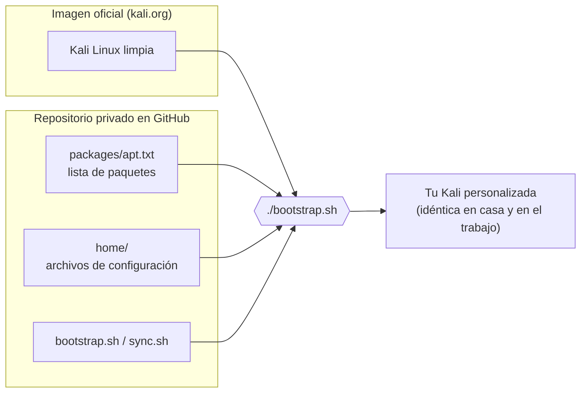
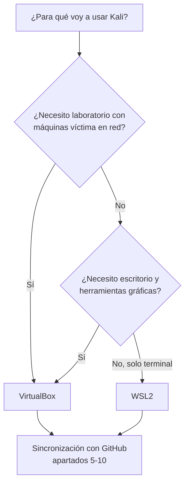
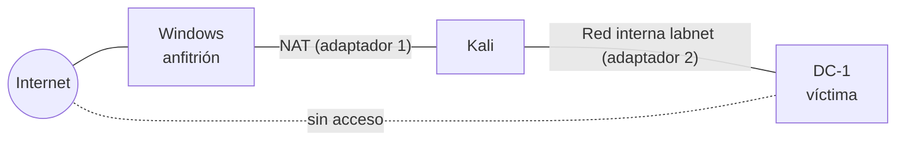
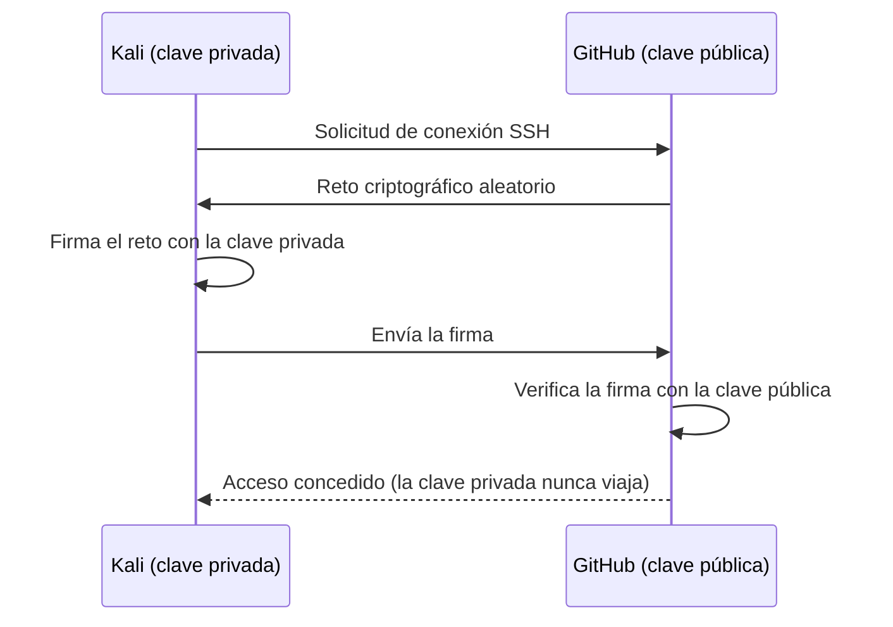
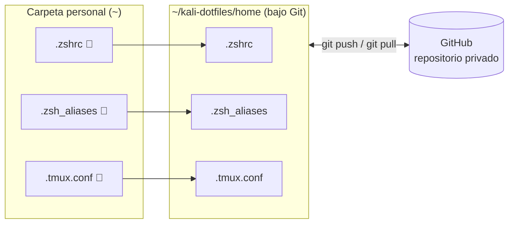
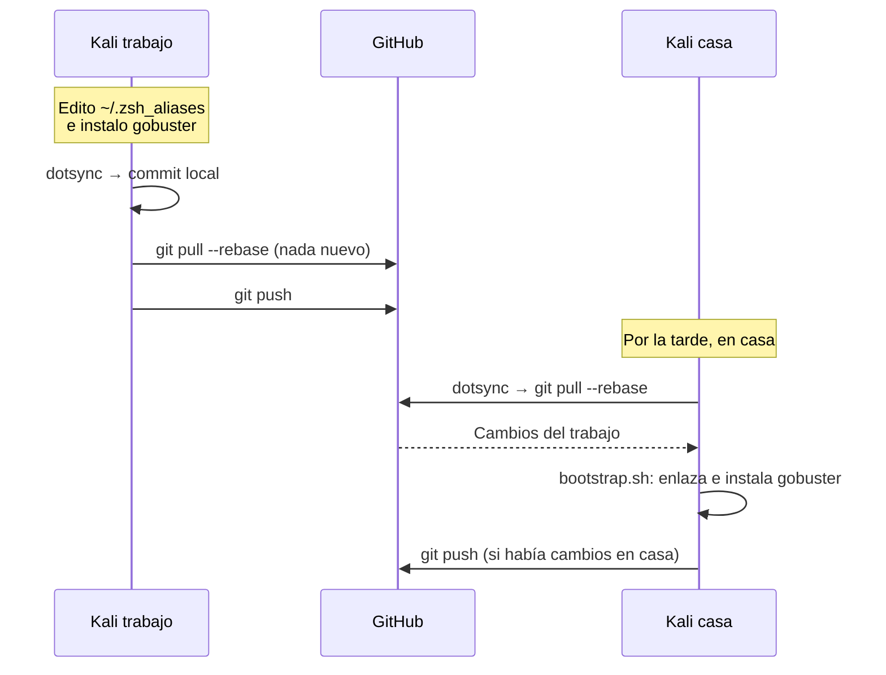
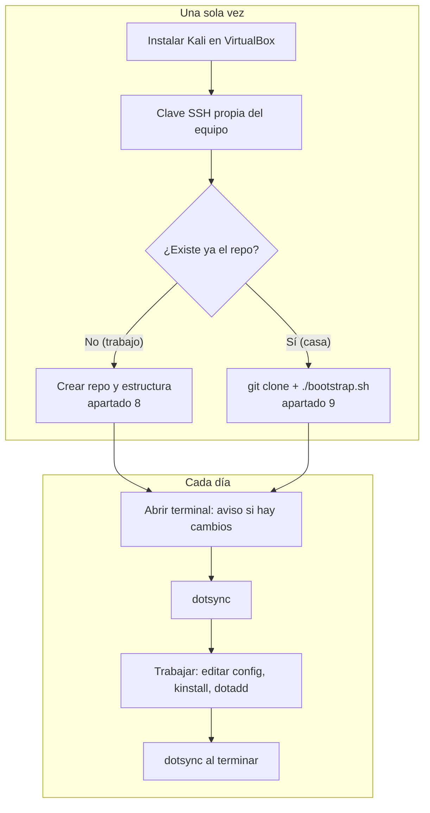

# Kali Linux en Windows con configuración sincronizada a través de GitHub

> **Objetivo.** Instalar una máquina Kali Linux en Windows y mantener **la misma configuración**
> en dos equipos (casa y trabajo), de modo que cualquier cambio hecho en uno se propague al otro
> con un único comando, usando un repositorio privado de GitHub como punto de encuentro.
>
> **Nivel.** Curso de Especialización en Ciberseguridad. Se asume manejo básico de la terminal;
> todo lo demás se explica paso a paso.

---

## Índice

1. [Idea general: qué se replica y qué no](#1-idea-general-qué-se-replica-y-qué-no)
2. [Elegir la vía de instalación: VirtualBox o WSL2](#2-elegir-la-vía-de-instalación-virtualbox-o-wsl2)
3. [Instalación de Kali en VirtualBox (vía recomendada)](#3-instalación-de-kali-en-virtualbox-vía-recomendada)
4. [Alternativa: Kali en WSL2](#4-alternativa-kali-en-wsl2)
5. [Preparar Git y la clave SSH para GitHub](#5-preparar-git-y-la-clave-ssh-para-github)
6. [Diseño del repositorio de configuración (dotfiles)](#6-diseño-del-repositorio-de-configuración-dotfiles)
7. [Los scripts: `bootstrap.sh` y `sync.sh`](#7-los-scripts-bootstrapsh-y-syncsh)
8. [Puesta en marcha: primer equipo (trabajo)](#8-puesta-en-marcha-primer-equipo-trabajo)
9. [Replicar en el segundo equipo (casa)](#9-replicar-en-el-segundo-equipo-casa)
10. [Uso diario: el ciclo de sincronización](#10-uso-diario-el-ciclo-de-sincronización)
11. [Seguridad: qué NO se sube nunca](#11-seguridad-qué-no-se-sube-nunca)
12. [Resolución de problemas frecuentes](#12-resolución-de-problemas-frecuentes)
13. [Chuleta final de comandos](#13-chuleta-final-de-comandos)

---

## 1. Idea general: qué se replica y qué no

Cuando decimos "replicar la misma máquina" caben dos interpretaciones muy distintas:

| Enfoque | Qué se copia | Tamaño | ¿Cabe en GitHub? | Cuándo usarlo |
|---|---|---|---|---|
| **Replicar la VM entera** | El disco virtual completo (`.vdi`/`.ova`) | 15–80 GB | **No** (límite de 100 MB por archivo) | Una sola vez, para clonar un laboratorio cerrado (USB / disco externo) |
| **Versionar la configuración** | Archivos de configuración + lista de paquetes + scripts | Unos pocos KB | **Sí** | Siempre: es el "sistema de actualización ligero" |

La clave conceptual es que **una Kali queda definida por tres cosas**:

1. La **imagen base** oficial de Kali (igual para todo el mundo, se descarga de kali.org).
2. Los **paquetes adicionales** que tú instalas encima.
3. Tus **archivos de configuración** (alias, prompt, ajustes de herramientas…).

Si versionamos (2) y (3) en GitHub, cualquier Kali recién instalada puede convertirse en "tu"
Kali ejecutando un script. Es el mismo principio de la *infraestructura como código*.



---

## 2. Elegir la vía de instalación: VirtualBox o WSL2

En Windows hay dos formas realistas de tener Kali:

| Criterio | VirtualBox (imagen oficial de Kali) | WSL2 (Kali desde Microsoft Store) |
|---|---|---|
| Qué es | Máquina virtual completa, con escritorio | Kali integrada en Windows, sobre todo en terminal |
| Interfaz gráfica | Sí, escritorio XFCE completo | Opcional (Win-KeX), más limitada |
| Herramientas incluidas | Todas las habituales ya instaladas | Casi ninguna: hay que instalar metapaquetes |
| Redes de laboratorio (red interna con DC-1, etc.) | **Sí**, control total de adaptadores | Muy limitado; no encaja con VMs víctima |
| Escaneo de red, captura de paquetes, Wi-Fi | Completo | Parcial (NAT de Windows, sin Wi-Fi) |
| Consumo de recursos | Mayor (4 GB RAM recomendados) | Menor |
| Aislamiento respecto a Windows | Alto (instantáneas, se puede restaurar) | Bajo (comparte sistema con Windows) |

> **Recomendación: VirtualBox.** Es coherente con la Práctica 2 de la UD01, donde Kali y la
> máquina víctima DC-1 deben convivir en una **red interna aislada**, algo que WSL2 no permite
> de forma sencilla. WSL2 queda como complemento útil para tareas de terminal rápidas
> (scripts, Git, consultas), pero no como puesto de ataque del laboratorio.
>
> El sistema de sincronización de los apartados 5–10 **funciona igual en ambas vías**: solo
> depende de tener Git y una terminal en Kali.



---

## 3. Instalación de Kali en VirtualBox (vía recomendada)

Este proceso se repite **igual en los dos equipos** (casa y trabajo).

### 3.1 Requisitos previos

| Requisito | Mínimo | Recomendado | Cómo comprobarlo en Windows |
|---|---|---|---|
| RAM del equipo | 8 GB | 16 GB | `Configuración > Sistema > Información` |
| Espacio libre en disco | 30 GB | 80 GB | Explorador de archivos |
| Virtualización por hardware (VT-x / AMD-V) | Activada | — | `Administrador de tareas > Rendimiento > CPU > Virtualización: Habilitado` |

Si la virtualización aparece como *Deshabilitado*, hay que activarla en la BIOS/UEFI del equipo
(opción *Intel Virtualization Technology* o *SVM Mode*). En el ordenador del trabajo puede ser
necesario pedirlo al servicio técnico.

### 3.2 Descargas

1. **VirtualBox**: <https://www.virtualbox.org/wiki/Downloads> → *Windows hosts*.
2. **Kali para VirtualBox**: <https://www.kali.org/get-kali/#kali-virtual-machines> → icono de
   *VirtualBox* (archivo `.7z`, unos 3 GB). Es una máquina **ya instalada y configurada**: no hay
   que pasar por el instalador de Linux.
3. **7-Zip** para descomprimir: <https://www.7-zip.org/>.

> **Buena práctica de seguridad (verificar la integridad).** En la página de descarga de Kali
> aparece el hash SHA256 del archivo. Compruébalo en PowerShell antes de usarlo:
>
> ```powershell
> Get-FileHash .\kali-linux-2026.X-virtualbox-amd64.7z -Algorithm SHA256
> ```
>
> Si el valor no coincide exactamente, el archivo está corrupto o manipulado: descárgalo de nuevo.

### 3.3 Importar la máquina

| Paso | Acción |
|---|---|
| 1 | Instala VirtualBox con las opciones por defecto (si avisa de que falta *Microsoft Visual C++ 2019 Redistributable*, instala antes <https://aka.ms/vs/17/release/vc_redist.x64.exe> y reinicia). |
| 2 | Descomprime el `.7z` con 7-Zip en una carpeta estable, por ejemplo `C:\VMs\Kali\`. |
| 3 | En VirtualBox: `Máquina > Añadir…` y selecciona el archivo `.vbox` de la carpeta. |
| 4 | Con la VM seleccionada: `Configuración > Sistema`: **4096 MB** de RAM y **2 CPU** (o más). |
| 5 | `Configuración > General > Avanzado`: *Portapapeles compartido* y *Arrastrar y soltar* en **Bidireccional**. |
| 6 | Arranca la VM. Usuario y contraseña por defecto: **`kali` / `kali`**. |

### 3.4 Configuración de red para el laboratorio

Para tener Internet (necesario para GitHub y actualizaciones) **y** a la vez una red aislada con
las máquinas víctima, se usan dos adaptadores:

| Adaptador | Modo | Para qué |
|---|---|---|
| Adaptador 1 | **NAT** | Salida a Internet (apt, GitHub) |
| Adaptador 2 | **Red interna** (nombre: `labnet`) | Comunicación con DC-1 y otras víctimas, sin salida al exterior |



La máquina víctima (DC-1) se conecta **solo** a `labnet`. Así nunca queda expuesta.

### 3.5 Primeros comandos dentro de Kali

Abre una terminal en Kali y ejecuta:

```bash
# 1. Cambiar la contraseña por defecto (imprescindible)
passwd

# 2. Actualizar el sistema completo
sudo apt update && sudo apt full-upgrade -y

# 3. Instalar Git (normalmente ya viene, pero lo aseguramos)
sudo apt install -y git
```

### 3.6 Instantánea de seguridad

Antes de seguir, en VirtualBox: `Máquina > Tomar instantánea` → nombre `limpia-actualizada`.
Si algo se rompe más adelante, se restaura en segundos.

> **Nota sobre Hyper-V / WSL2.** Si en el mismo Windows está activado WSL2 o Hyper-V, VirtualBox
> sigue funcionando, pero puede ir algo más lento (aparece una tortuga verde en la barra de
> estado de la VM). Es normal y no impide trabajar.

---

## 4. Alternativa: Kali en WSL2

Solo si se elige esta vía (o como complemento). En **PowerShell como administrador**:

```powershell
wsl --install -d kali-linux
```

Reinicia si lo pide, abre "Kali Linux" desde el menú Inicio y crea usuario y contraseña. Después:

```bash
sudo apt update && sudo apt full-upgrade -y
sudo apt install -y git kali-linux-headless   # herramientas principales sin escritorio
# Opcional, escritorio gráfico:
# sudo apt install -y kali-win-kex && kex --win -s
```

A partir de aquí, el resto de la guía es idéntico.

---

## 5. Preparar Git y la clave SSH para GitHub

GitHub necesita saber que la Kali que se conecta eres tú. Usaremos una **clave SSH**: un par de
claves criptográficas (pública + privada). Es el mismo concepto de criptografía asimétrica que se
estudia en el curso:

| Elemento | Archivo | Dónde va | ¿Se comparte? |
|---|---|---|---|
| Clave **privada** | `~/.ssh/id_ed25519` | Se queda en la Kali | **Nunca** |
| Clave **pública** | `~/.ssh/id_ed25519.pub` | Se pega en GitHub | Sí, es pública por diseño |

> **Una clave por equipo.** Genera una clave distinta en la Kali de casa y en la del trabajo.
> Si un equipo se pierde o se compromete, revocas solo esa clave en GitHub sin afectar al otro.

### 5.1 Identidad de Git

```bash
git config --global user.name  "Marta López"
git config --global user.email "tu-correo@ejemplo.com"
git config --global init.defaultBranch main
git config --global pull.rebase true
```

### 5.2 Generar la clave

```bash
ssh-keygen -t ed25519 -C "kali-trabajo"     # en casa: -C "kali-casa"
```

- Acepta la ruta por defecto pulsando *Intro*.
- Introduce una **frase de paso** (passphrase). Protege la clave si alguien copia el archivo.

Cargar la clave en el agente para no escribir la frase de paso continuamente:

```bash
eval "$(ssh-agent -s)"
ssh-add ~/.ssh/id_ed25519
```

### 5.3 Registrar la clave pública en GitHub

```bash
cat ~/.ssh/id_ed25519.pub
```

Copia la línea completa (empieza por `ssh-ed25519`) y en GitHub:
`Foto de perfil > Settings > SSH and GPG keys > New SSH key`. Título: `Kali trabajo`
(o `Kali casa`). Tipo: *Authentication Key*.

### 5.4 Comprobar la conexión

```bash
ssh -T git@github.com
```

La primera vez pregunta si confías en el servidor (`yes`). Debe responder:

```text
Hi martalopezron92! You've successfully authenticated, but GitHub does not provide shell access.
```



---

## 6. Diseño del repositorio de configuración (dotfiles)

En Linux, la configuración de usuario vive en archivos ocultos que empiezan por punto
(`.zshrc`, `.vimrc`…): de ahí el nombre ***dotfiles***. Kali usa **zsh** como intérprete por
defecto, así que el archivo central es `~/.zshrc`.

### 6.1 Estructura propuesta

```text
kali-dotfiles/
├── README.md               # Qué es y cómo se usa
├── .gitignore              # Lo que NUNCA se sube
├── bootstrap.sh            # Convierte una Kali limpia en "tu" Kali
├── sync.sh                 # Sincroniza en ambos sentidos con GitHub
├── packages/
│   ├── apt.txt             # Paquetes extra que instalas con apt (uno por línea)
│   └── pipx.txt            # Herramientas Python (opcional)
└── home/                   # Réplica de tu carpeta personal (~)
    ├── .zshrc
    ├── .zsh_aliases        # Tus alias y funciones (dotsync, kinstall, dotadd…)
    ├── .tmux.conf
    ├── .vimrc
    └── .config/
        └── ...             # Configuraciones de herramientas, misma ruta que en ~
```

### 6.2 La técnica: enlaces simbólicos

Los archivos reales viven **dentro del repositorio**, y en tu carpeta personal se crean
**enlaces simbólicos** (accesos directos) que apuntan a ellos:

```text
~/.zshrc  ──enlace──►  ~/kali-dotfiles/home/.zshrc
```

Consecuencia práctica: cuando editas `~/.zshrc`, en realidad estás editando el archivo del
repositorio, y Git detecta el cambio automáticamente. No hay que acordarse de copiar nada.



### 6.3 ¿Qué conviene versionar?

| Sí se versiona | Ejemplo | No se versiona | Motivo |
|---|---|---|---|
| Configuración del intérprete | `.zshrc`, `.zsh_aliases` | `~/.ssh/` | Claves privadas |
| Configuración de herramientas | `.tmux.conf`, `.vimrc`, `.config/...` | `.zsh_history` | Puede contener IPs, contraseñas tecleadas, objetivos |
| Lista de paquetes | `packages/apt.txt` | Bases de datos (`~/.msf4/`, `~/.local/share/`) | Pesadas y generadas automáticamente |
| Scripts propios | `bin/`, scripts de enumeración | Resultados de escaneos, *loot*, capturas `.pcap` | Datos sensibles de laboratorio |
| Plantillas de informes | `templates/` | `~/.secrets`, tokens, API keys | Secretos |

---

## 7. Los scripts: `bootstrap.sh` y `sync.sh`

### 7.1 `bootstrap.sh`: aplicar la configuración

Hace dos cosas y es **idempotente** (se puede ejecutar las veces que se quiera; si algo ya está
hecho, no lo repite):

1. Crea los enlaces simbólicos de `home/` en `~` (guardando copia de seguridad de lo que hubiera).
2. Instala los paquetes de `packages/apt.txt` que aún **no** estén instalados.

```bash
#!/usr/bin/env bash
# bootstrap.sh — convierte una Kali limpia en tu Kali personalizada.
# Uso: ./bootstrap.sh   (se puede repetir sin riesgo)
set -euo pipefail

REPO_DIR="$(cd "$(dirname "${BASH_SOURCE[0]}")" && pwd)"
BACKUP_DIR="$HOME/.dotfiles-backup/$(date +%Y%m%d-%H%M%S)"

echo "==> [1/3] Enlazando archivos de configuración"
cd "$REPO_DIR/home"
find . -type f -print0 | while IFS= read -r -d '' f; do
    f="${f#./}"
    src="$REPO_DIR/home/$f"
    dest="$HOME/$f"
    # Si ya es el enlace correcto, no hay nada que hacer
    if [ -L "$dest" ] && [ "$(readlink "$dest")" = "$src" ]; then
        continue
    fi
    mkdir -p "$(dirname "$dest")"
    # Si existe un archivo real, se guarda una copia antes de sustituirlo
    if [ -e "$dest" ] || [ -L "$dest" ]; then
        mkdir -p "$BACKUP_DIR/$(dirname "$f")"
        mv "$dest" "$BACKUP_DIR/$f"
        echo "    copia de seguridad: ~/$f"
    fi
    ln -s "$src" "$dest"
    echo "    enlazado: ~/$f"
done

echo "==> [2/3] Paquetes apt"
APT_LIST="$REPO_DIR/packages/apt.txt"
MISSING=()
if [ -f "$APT_LIST" ]; then
    while IFS= read -r pkg; do
        [[ -z "$pkg" || "$pkg" == \#* ]] && continue
        dpkg -s "$pkg" &>/dev/null || MISSING+=("$pkg")
    done < "$APT_LIST"
fi
if [ ${#MISSING[@]} -gt 0 ]; then
    echo "    instalando: ${MISSING[*]}"
    sudo apt-get update -qq
    sudo apt-get install -y "${MISSING[@]}"
else
    echo "    todos los paquetes ya están instalados"
fi

echo "==> [3/3] Herramientas pipx (opcional)"
PIPX_LIST="$REPO_DIR/packages/pipx.txt"
if [ -f "$PIPX_LIST" ] && command -v pipx &>/dev/null; then
    INSTALLED="$(pipx list --short 2>/dev/null | awk '{print $1}')"
    while IFS= read -r tool; do
        [[ -z "$tool" || "$tool" == \#* ]] && continue
        grep -qx "$tool" <<< "$INSTALLED" || pipx install "$tool"
    done < "$PIPX_LIST"
fi

echo "==> Listo. Abre una terminal nueva para cargar la configuración."
```

### 7.2 `sync.sh`: sincronizar en ambos sentidos

El orden de las operaciones importa: primero se **guarda** lo local, luego se **traen** los
cambios del otro equipo, se **aplican** y finalmente se **publica** el resultado.

```bash
#!/usr/bin/env bash
# sync.sh — sincroniza la configuración con GitHub (casa <-> trabajo).
# Uso: ./sync.sh ["mensaje opcional del cambio"]
set -euo pipefail

REPO_DIR="$(cd "$(dirname "${BASH_SOURCE[0]}")" && pwd)"
cd "$REPO_DIR"
MSG="${1:-sync desde $(hostname) $(date '+%Y-%m-%d %H:%M')}"

echo "==> 1. Guardando cambios locales"
if [ -n "$(git status --porcelain)" ]; then
    git status --short
    git add -A
    git commit -q -m "$MSG"
else
    echo "    sin cambios locales"
fi

echo "==> 2. Trayendo cambios del otro equipo"
git pull --rebase

echo "==> 3. Aplicando configuración y paquetes nuevos"
./bootstrap.sh

echo "==> 4. Publicando en GitHub"
git push

echo "==> Sincronización completada ($(git log -1 --format='%h %s'))"
```



### 7.3 `home/.zsh_aliases`: atajos para el día a día

Este archivo también se versiona, así que los atajos estarán en las dos máquinas:

```bash
# ~/.zsh_aliases — se carga desde ~/.zshrc
export DOTFILES="$HOME/kali-dotfiles"

# Sincronizar configuración con GitHub
alias dotsync="$DOTFILES/sync.sh"

# Instalar un paquete Y apuntarlo en la lista, para que se instale en el otro equipo
# Ejemplo: kinstall gobuster seclists
kinstall() {
    sudo apt install -y "$@" || return 1
    printf '%s\n' "$@" >> "$DOTFILES/packages/apt.txt"
    sort -u -o "$DOTFILES/packages/apt.txt" "$DOTFILES/packages/apt.txt"
    echo "Añadido a packages/apt.txt. Ejecuta 'dotsync' para propagarlo."
}

# Poner un archivo de configuración nuevo bajo control de versiones
# Ejemplo: dotadd ~/.config/htop/htoprc
dotadd() {
    local src rel
    src="$(realpath "$1")" || return 1
    rel="${src#$HOME/}"
    mkdir -p "$DOTFILES/home/$(dirname "$rel")"
    mv "$src" "$DOTFILES/home/$rel" && ln -s "$DOTFILES/home/$rel" "$src"
    echo "~/$rel ahora está versionado. Ejecuta 'dotsync' para propagarlo."
}

# Alias de ejemplo para el laboratorio
alias ll='ls -lah --color=auto'
alias myip="ip -br -c addr"
alias lab="cd ~/lab"
```

### 7.4 Aviso automático al abrir la terminal

Para no olvidar sincronizar, se añade al **final** de `~/.zshrc`. Comprueba en segundo plano
(máximo 3 segundos, sin pedir contraseña) si el otro equipo ha subido cambios:

```bash
# --- Configuración personal versionada ---
[ -f ~/.zsh_aliases ] && source ~/.zsh_aliases
[ -f ~/.zshrc.local ] && source ~/.zshrc.local   # ajustes propios de cada equipo (no se versiona)

# --- Aviso de cambios pendientes del otro equipo ---
if [ -d "$DOTFILES/.git" ]; then
    (
        cd "$DOTFILES" &&
        GIT_SSH_COMMAND="ssh -o BatchMode=yes -o ConnectTimeout=3" \
            timeout 5 git fetch -q 2>/dev/null &&
        [ "$(git rev-list --count 'HEAD..@{u}' 2>/dev/null || echo 0)" -gt 0 ] &&
        echo "⚠  Hay cambios de configuración del otro equipo. Ejecuta: dotsync"
    )
fi
```

> **Diferencias entre equipos.** Si algo debe ser distinto en casa y en el trabajo (por ejemplo,
> un proxy del trabajo), va en `~/.zshrc.local`, que **no** se versiona.

---

## 8. Puesta en marcha: primer equipo (trabajo)

Esta parte se hace **una sola vez**.

### Paso 1. Crear el repositorio vacío en GitHub

En <https://github.com/new>:

| Campo | Valor |
|---|---|
| Repository name | `kali-dotfiles` |
| Visibility | **Private** (imprescindible) |
| Add a README / .gitignore / license | **No** marcar nada (lo crearemos nosotros) |

### Paso 2. Clonar y crear la estructura

```bash
cd ~
git clone git@github.com:martalopezron92/kali-dotfiles.git
cd kali-dotfiles
mkdir -p home packages
touch packages/apt.txt packages/pipx.txt
```

### Paso 3. Crear los archivos

Crea con un editor (`nano` o `mousepad`) los archivos del apartado 7 y el `.gitignore` del
apartado 11:

```bash
nano bootstrap.sh          # pegar el contenido del apartado 7.1
nano sync.sh               # pegar el contenido del apartado 7.2
nano home/.zsh_aliases     # pegar el contenido del apartado 7.3
nano .gitignore            # pegar el contenido del apartado 11.2
chmod +x bootstrap.sh sync.sh
```

### Paso 4. Incorporar el `.zshrc` actual de Kali

Movemos el `.zshrc` que trae Kali al repositorio (conserva su prompt y ajustes originales) y le
añadimos al final el bloque del apartado 7.4:

```bash
mv ~/.zshrc home/.zshrc
nano home/.zshrc           # pegar al final el bloque del apartado 7.4
```

Si ya tienes otras configuraciones que quieras conservar, inclúyelas igual:

```bash
[ -f ~/.tmux.conf ] && mv ~/.tmux.conf home/
[ -f ~/.vimrc ]     && mv ~/.vimrc home/
```

### Paso 5. Aplicar y comprobar

```bash
./bootstrap.sh
ls -l ~/.zshrc             # debe mostrar: .zshrc -> /home/kali/kali-dotfiles/home/.zshrc
exec zsh                   # recarga la terminal
type dotsync kinstall      # deben existir
```

### Paso 6. Primer envío a GitHub

```bash
git add -A
git status                 # REVISAR: no debe aparecer nada sensible
git commit -m "Configuración inicial de Kali"
git branch -M main          # asegura que la rama se llama main
git push -u origin main
```

---

## 9. Replicar en el segundo equipo (casa)

En la Kali de casa, recién instalada y actualizada (apartados 3 y 5, con **su propia** clave SSH):

```bash
cd ~
git clone git@github.com:martalopezron92/kali-dotfiles.git
cd kali-dotfiles
./bootstrap.sh
exec zsh
```

`bootstrap.sh` guardará el `.zshrc` original de esta máquina en `~/.dotfiles-backup/…` y lo
sustituirá por el enlace al del repositorio. A partir de aquí, las dos Kali comparten
configuración.



---

## 10. Uso diario: el ciclo de sincronización

La regla es sencilla: **`dotsync` al empezar y `dotsync` al terminar**.

| Quiero… | Comando | Qué ocurre en el otro equipo tras su `dotsync` |
|---|---|---|
| Traer los cambios del otro equipo | `dotsync` | — |
| Añadir un alias o función | Editar `~/.zsh_aliases` → `dotsync` | Aparece el alias (en una terminal nueva) |
| Instalar una herramienta | `kinstall feroxbuster` → `dotsync` | Se instala automáticamente |
| Versionar una config nueva | `dotadd ~/.config/htop/htoprc` → `dotsync` | Se crea el enlace |
| Guardar con mensaje descriptivo | `dotsync "Alias para nmap rápido"` | — |
| Ver el historial de cambios | `cd $DOTFILES && git log --oneline` | — |
| Deshacer un cambio concreto | `cd $DOTFILES && git revert <id>` → `dotsync` | Se deshace también |

### Ejemplo completo

En el **trabajo**, durante la preparación de la Práctica 2:

```bash
kinstall feroxbuster
echo "alias nmapq='nmap -sC -sV -T4 -oN escaneo.txt'" >> ~/.zsh_aliases
dotsync "Herramienta de fuzzing web y alias de nmap"
```

Por la tarde, en **casa**, al abrir la terminal:

```text
⚠  Hay cambios de configuración del otro equipo. Ejecuta: dotsync
```

```bash
dotsync          # instala feroxbuster y trae el alias
exec zsh
nmapq 10.0.2.15  # el alias ya funciona
```

---

## 11. Seguridad: qué NO se sube nunca

Un repositorio de configuración mal gestionado es una fuente clásica de **fugas de
credenciales**, precisamente uno de los hallazgos más habituales en la fase de reconocimiento
(OSINT) de un hacking ético. Aplicamos aquí lo que enseñaremos a detectar.

### 11.1 Reglas

| Regla | Por qué |
|---|---|
| Repositorio **privado** siempre | Aun sin secretos, revela herramientas, rutas y hábitos de trabajo |
| Nunca `~/.ssh/`, `~/.gnupg/`, tokens ni contraseñas | Su exposición compromete tus cuentas |
| Nunca el historial (`.zsh_history`, `.bash_history`) | Puede contener contraseñas y direcciones de objetivos |
| Nunca resultados de escaneos ni datos de laboratorio | Información sensible y de terceros |
| Secretos en `~/.secrets.local`, cargado desde `.zshrc.local` | Están disponibles en la máquina pero fuera de Git |
| Revisar `git status` antes del primer `push` | Último control humano |

### 11.2 `.gitignore` del repositorio

```gitignore
# --- Claves y secretos ---
**/.ssh/
**/.gnupg/
*.key
*.pem
*.kdbx
*secret*
*.local
.env

# --- Historiales ---
**/.zsh_history
**/.bash_history
**/.python_history
**/.mysql_history

# --- Datos de laboratorio y resultados ---
*.pcap
*.pcapng
loot/
scans/

# --- Cachés y bases de datos generadas ---
**/.cache/
**/.msf4/
**/.local/share/
```

### 11.3 Si se sube un secreto por error

Borrarlo en un commit nuevo **no basta**: sigue en el historial de Git. El procedimiento
correcto es:

1. **Revocar/cambiar el secreto inmediatamente** (nueva contraseña, nuevo token, borrar la
   clave SSH en GitHub). Este es el paso que realmente protege.
2. Después, limpiar el historial (herramienta `git filter-repo`) si se desea.

> **Herramienta opcional de comprobación.** `gitleaks` analiza el repositorio buscando
> secretos: `sudo apt install gitleaks && gitleaks detect --source ~/kali-dotfiles`.

---

## 12. Resolución de problemas frecuentes

| Síntoma | Causa probable | Solución |
|---|---|---|
| `Permission denied (publickey)` | La clave no está en GitHub o no está cargada | Repetir 5.3; ejecutar `ssh-add ~/.ssh/id_ed25519` |
| `CONFLICT (content)` durante `dotsync` | El mismo archivo se cambió en ambos equipos sin sincronizar | Ver procedimiento abajo |
| `bootstrap.sh: Permission denied` | Falta permiso de ejecución | `chmod +x bootstrap.sh sync.sh` |
| `E: Unable to locate package X` | Nombre mal escrito en `apt.txt` | Corregir la línea en `packages/apt.txt` y `dotsync` |
| Al instalar VirtualBox: *needs the Microsoft Visual C++ 2019 Redistributable* | Falta el paquete de Visual C++ o la versión instalada es antigua | Instalar `vc_redist.x64.exe` desde <https://aka.ms/vs/17/release/vc_redist.x64.exe>, reiniciar Windows y volver a ejecutar el instalador de VirtualBox |
| La VM no arranca: *VT-x is not available* | Virtualización desactivada | Activarla en BIOS/UEFI (apartado 3.1) |
| Un alias no aparece tras `dotsync` | La terminal tiene la config antigua cargada | `exec zsh` o abrir terminal nueva |
| El aviso de cambios no sale nunca | Sin red o el agente SSH no tiene la clave | Es solo un aviso; ejecutar `dotsync` manualmente |

### Resolver un conflicto paso a paso

Ocurre si se edita la misma línea en casa y en el trabajo sin sincronizar entre medias. Git se
detiene y marca el archivo:

```text
<<<<<<< HEAD
alias nmapq='nmap -sC -sV -T4'
=======
alias nmapq='nmap -sC -sV -T4 -oN escaneo.txt'
>>>>>>> sync desde kali-casa
```

```bash
cd $DOTFILES
git status                       # muestra qué archivo está en conflicto
nano home/.zsh_aliases           # dejar la versión correcta y borrar las marcas <<< === >>>
git add home/.zsh_aliases
git rebase --continue            # se abre el editor con el mensaje: guardar y salir
dotsync                          # completa la sincronización
```

Si no se quiere resolver en ese momento: `git rebase --abort` deja todo como estaba.

---

## 13. Chuleta final de comandos

| Momento | Comando |
|---|---|
| Comprobar conexión con GitHub | `ssh -T git@github.com` |
| Clonar en un equipo nuevo | `git clone git@github.com:martalopezron92/kali-dotfiles.git ~/kali-dotfiles` |
| Aplicar configuración | `~/kali-dotfiles/bootstrap.sh` |
| Sincronizar (empezar y terminar) | `dotsync` |
| Instalar y registrar paquete | `kinstall <paquete>` |
| Versionar archivo de config | `dotadd <ruta>` |
| Ver historial | `git -C $DOTFILES log --oneline` |
| Restaurar la VM a estado limpio | VirtualBox → Instantáneas → `limpia-actualizada` → Restaurar |

> **Aplicación didáctica.** Este mismo flujo puede proponerse al alumnado como actividad: cada
> alumno mantiene su repositorio privado de configuración, lo que les enseña Git, SSH,
> criptografía asimétrica aplicada, gestión de secretos e infraestructura reproducible, todas
> ellas competencias directamente transferibles a la práctica profesional.
