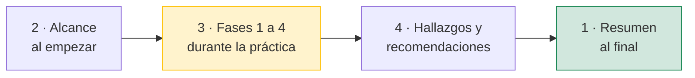

# Plantilla del informe · Laboratorio UD01 (LAB01 · DC-1)

**Módulo 5025 · Curso de Especialización en Ciberseguridad**

> **Cómo usarla.** El documentalista rellena esta plantilla **durante la sesión**, a medida que el
> equipo avanza. Sustituid lo que va entre `[corchetes]`. Al final solo queda escribir el resumen
> (apartado 1) y repasar. Un informe por equipo, entregado en Moodle.

---

## 1. Resumen (rellenar al final)

*Tres o cuatro frases para alguien sin perfil técnico: qué habéis auditado, qué habéis encontrado,
qué riesgo supone y qué tiene que hacer el cliente.*

[ ]

> **Ejemplo:** «Hemos auditado el servidor web de Drupalia. Hemos conseguido controlarlo por
> completo sin conocer ninguna contraseña porque su web usa un software sin actualizar. Un atacante
> podría robar o cambiar su información. Recomendamos actualizarlo cuanto antes.»

---

## 2. Datos y alcance (rellenar al empezar)

| Campo | Valor |
|---|---|
| Equipo | [ ] |
| Operador / Investigador / Documentalista | [ ] / [ ] / [ ] |
| Fecha | [ ] |
| IP de Kali | [10.0.1.__] |
| IP de DC-1 (objetivo) | [10.0.1.__] |
| Permitido | Solo la IP de DC-1: escaneo, análisis web, explotación y escalada |
| Prohibido | Cualquier otra IP, la red del centro, la denegación de servicio |
| ¿La IP de DC-1 está en `10.0.1.0/24`? | [Sí / No] |

---

## 3. Qué hemos hecho en cada fase

En cada fase, **antes de ejecutar** un comando, escribid en la columna «Qué esperamos» qué creéis
que va a pasar. Si no sabéis escribirlo, preguntad a la IA qué hace el comando antes de lanzarlo.

### Fase 1 · Reconocimiento: ¿qué máquina hay y qué servicios tiene?

> **Pregunta de ayuda para la IA:** «¿Cómo descubro qué equipos hay en mi red `10.0.1.0/24` y qué
> servicios tiene uno de ellos? Explícame qué hace cada opción del comando.»

| Comando | Qué esperamos | Qué ha salido (lo importante) | Captura |
|---|---|---|---|
| [ ] | [ ] | [ ] | [n.º] |
| [ ] | [ ] | [ ] | [n.º] |

**Servicios encontrados:** [puerto · servicio · versión]

**¿Qué servicio parece más interesante y por qué?** [ ]

> **Ejemplo de fila bien rellenada:**
>
> | Comando | Qué esperamos | Qué ha salido | Captura |
> |---|---|---|---|
> | `nmap -sV 10.0.1.5` | Ver los puertos abiertos y la versión de cada servicio | 22 SSH, 80 HTTP (Apache con Drupal 7), 111 rpcbind | 2 |

### Fase 2 · Vulnerabilidades: ¿qué tiene un fallo conocido?

> **Pregunta de ayuda para la IA:** «He encontrado este servicio y esta versión: […]. ¿Cómo busco
> si tiene vulnerabilidades conocidas? ¿Qué es un CVE?»

| Comando o fuente consultada | Qué esperamos | Qué ha salido | Captura |
|---|---|---|---|
| [ ] | [ ] | [ ] | [n.º] |

**Vulnerabilidad elegida (CVE) y qué permite hacer:** [ ]

### Fase 3 · Explotación: ¿cómo conseguimos entrar?

> **Pregunta de ayuda para la IA:** «Quiero aprovechar esta vulnerabilidad: […]. ¿Qué herramienta
> se usa y qué significa cada opción que tengo que configurar?»

| Comando | Qué esperamos | Qué ha salido | Captura |
|---|---|---|---|
| [ ] | [ ] | [ ] | [n.º] |

**¿Con qué usuario hemos entrado?** [ ]
**¿Por qué no somos administradores todavía?** [ ]

### Fase 4 · Posexplotación: ¿cómo llegamos a administrador?

> **Pregunta de ayuda para la IA:** «Tengo acceso como un usuario limitado en Linux. ¿Qué es
> escalar privilegios y qué debería revisar en el sistema?»

| Comando | Qué esperamos | Qué ha salido | Captura |
|---|---|---|---|
| [ ] | [ ] | [ ] | [n.º] |

**¿Qué fallo de configuración nos ha permitido escalar?** [ ]
**Usuario final:** [ ]

> Si no llegáis a esta fase, escribid hasta dónde habéis llegado y qué probaríais después. Se
> valora lo que sabéis explicar, no llegar a root.

---

## 4. Hallazgos y recomendaciones

Un hallazgo es **un fallo del servidor**, no lo que habéis hecho vosotros. Una fila por fallo.

| Fallo encontrado | Por qué existe (causa) | Gravedad | Cómo corregirlo | Cómo detectar el ataque |
|---|---|---|---|---|
| [ ] | [ ] | [Crítica / Alta / Media / Baja] | [ ] | [ ] |
| [ ] | [ ] | [ ] | [ ] | [ ] |

> **Ejemplo:**
>
> | Fallo | Causa | Gravedad | Cómo corregirlo | Cómo detectar el ataque |
> |---|---|---|---|---|
> | Drupal 7 vulnerable a *Drupalgeddon2* (CVE-2018-7600): permite ejecutar código sin contraseña | No se ha actualizado desde 2018 | Crítica | Actualizar Drupal a una versión corregida | Revisar los registros del servidor web en busca de peticiones anómalas a `/user/register` |
>
> ❌ Evitad respuestas como «Hemos entrado con Metasploit» o «Mejorar la seguridad».

---

## 5. Uso de la IA

Cada integrante añade al menos una fila con su bitácora.

| Quién | Qué preguntamos | Qué aprendimos | ¿La IA se equivocó? ¿Cómo lo comprobamos? |
|---|---|---|---|
| [ ] | [ ] | [ ] | [ ] |
| [ ] | [ ] | [ ] | [ ] |
| [ ] | [ ] | [ ] | [ ] |

---

## Antes de entregar

- [ ] Las cuatro fases tienen al menos un comando con lo que esperábamos, lo que salió y una captura.
- [ ] Cada fallo tiene causa, gravedad, corrección y detección.
- [ ] Está escrito el resumen del apartado 1.
- [ ] Cada integrante ha rellenado su fila de IA.
- [ ] Los tres sabemos explicar por qué hicimos cada paso (la defensa se sortea).
- [ ] Las capturas van adjuntas y numeradas.
