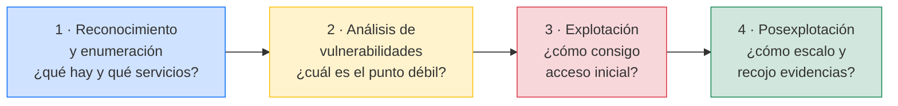
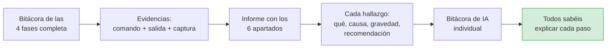

# Laboratorio UD01 · El primer test de intrusión (DC-1)

**Unidad didáctica 01 — Introducción al hacking ético**
**Curso de Especialización en Ciberseguridad**

> **Modalidad:** equipo de 3 personas con roles.
> **Duración:** una sesión de 120 minutos.
> **Requisito:** tu laboratorio de la Misión 0 montado y DC-1 conectada **solo** a `labnet`.
> **Entregable:** informe técnico del equipo (Moodle), elaborado con la
> [plantilla del informe](./Plantilla-Informe-LAB01.md), y defensa oral individual (en clase).

---

## 1. El encargo

Trabajáis como equipo de auditoría para un cliente ficticio, *Drupalia, S. L.*. Os piden auditar
un servidor web de su laboratorio y entregar un informe con lo que encontréis y cómo corregirlo.

| Apartado del encargo | Detalle |
|---|---|
| **Cliente** | Drupalia, S. L. (ficticio) |
| **Objetivo** | Servidor web DC-1, en `10.0.1.x` |
| **Alcance** | Solo esa IP. Escaneo de puertos y análisis del servicio web |
| **Fuera de alcance** | Cualquier otra IP, la red del centro, los ataques de denegación de servicio |
| **Entregable** | Informe técnico con hallazgos y recomendaciones |

> ### ⚠️ Norma de oro
> **Solo se ataca lo que está dentro de tu laboratorio y dentro del alcance de la misión.**
> Antes del primer escaneo, confirma que la IP objetivo está en `10.0.1.0/24`. Atacar un sistema
> sin autorización es un delito (arts. 197 bis y 264 del Código Penal), aunque sea «para probar».

---

## 2. Qué vas a demostrar

Al terminar la sesión serás capaz de:

1. Recorrer en orden las **cuatro fases** de un test de intrusión y justificar por qué pasas de una
   a la siguiente.
2. Relacionar un **servicio y su versión** con una vulnerabilidad conocida (CVE).
3. Explicar la diferencia entre **acceso inicial limitado** y **escalada de privilegios**.
4. Documentar cada paso con **evidencias** (comando, salida y captura).
5. Usar la IA para **entender e interpretar**, no para que resuelva por ti.

---

## 3. Las cuatro fases

| Fase | Pregunta que resuelves | Qué demuestra |
|---|---|---|
| **1 · Reconocimiento** | ¿Qué máquina hay y qué servicios ofrece? | Sin información no hay ataque: primero se mira, no se dispara |
| **2 · Vulnerabilidades** | ¿Qué servicio es antiguo o tiene un fallo conocido? | Relacionar servicio + versión + fecha con un CVE |
| **3 · Explotación** | ¿Cómo convierto ese fallo en un acceso real? | Pasar de una vulnerabilidad a un acceso estable |
| **4 · Posexplotación** | ¿Cómo paso de usuario limitado a administrador? | Entender los permisos del sistema y la escalada |

> **No saltes de fase sin entender la anterior.** El objetivo no es la flag: es poder explicar
> cómo la información de cada fase te habilitó la siguiente.

---

## 4. Tu rol en esta sesión

| Rol | Qué haces |
|---|---|
| 🖥️ **Operador** | Ejecutas los comandos. **Antes de cada uno**, dices en voz alta qué hace y qué esperas obtener |
| 🔎 **Investigador** | Consultas a la IA, interpretas las salidas y propones el siguiente paso |
| 📝 **Documentalista** | Guardas comando + salida + captura de cada hallazgo y redactas el informe |

> La persona que defiende el trabajo **se elige por sorteo**. Todos tenéis que entenderlo todo. Si
> eres operador, no ejecutes nada que no sepas explicar.

---

## 5. Cómo usar la IA (fase por fase)

La regla es siempre la misma: **la IA explica, tú ejecutas y decides.**

> **Microrregla.** Antes de ejecutar un comando que te sugiera la IA, escribe en una línea *qué
> hace y qué esperas obtener*. Si no sabes escribirlo, todavía no estás listo para ejecutarlo.

| Fase | ✅ Pregunta que te enseña | ❌ Pregunta que no te ayuda a aprender |
|---|---|---|
| Reconocimiento | «Esta es la salida del escaneo: ¿me ayudas a leerla? ¿Qué significa cada servicio?» | «Escanea la red por mí» |
| Vulnerabilidades | «La máquina ejecuta un CMS antiguo. ¿Cómo averiguo si tiene fallos conocidos? ¿Qué es un CVE?» | «Dame el exploit de DC-1» |
| Explotación | «¿Me explicas línea por línea qué hace este script antes de que yo lo lance?» | «Resuélveme la máquina paso a paso» |
| Posexplotación | «Tengo acceso limitado. ¿Qué es escalar privilegios y por qué no soy administrador todavía?» | «Dame el comando para ser root» |

**Si algo falla**, no pidas la solución: pide un diagnóstico.
> «He ejecutado esto y me da este error [pego el error]. ¿Qué puede estar pasando y qué debería
> comprobar?» ← la IA diagnostica, tú corriges.

> **La IA se equivoca**, sobre todo con CVE, fechas y detalles de comandos. Si detectas un error,
> apúntalo en tu bitácora: saber detectar los fallos de la IA se evalúa.

---

## 6. Guion de la sesión (120 min)

| Tiempo | Qué haces |
|---|---|
| 0–10 | **Briefing:** la profesora lee el encargo y el alcance. Confirmáis roles y la norma de oro |
| 10–20 | **Despliegue:** encendéis DC-1 y comprobáis conectividad desde Kali |
| 20–40 | **Fase 1 · Reconocimiento y enumeración** |
| 40–55 | **Fase 2 · Análisis de vulnerabilidades** |
| 55–75 | **Fase 3 · Explotación (acceso inicial)** |
| 75–90 | **Fase 4 · Posexplotación y escalada** |
| 90–100 | **Redacción:** el documentalista cierra el borrador del informe |
| 100–115 | **Debriefing y defensa oral** (se sortea quién defiende) |
| 115–120 | **Autoevaluación:** qué salió bien y qué repasaréis |

---

## 7. Bitácora de la sesión (rellénala mientras trabajas)

Usa esta tabla como guía de evidencias. **Por cada fase, anota qué buscabas, qué encontraste y qué
decidiste hacer a continuación.** Esto es la materia prima de tu informe.

> 📝 **Documentalista:** en lugar de esta tabla, podéis rellenar directamente el apartado 3 de la
> [plantilla del informe](./Plantilla-Informe-LAB01.md) mientras trabajáis. Así el informe
> queda casi terminado al acabar la fase 4.

| Fase | ¿Qué buscaba? | ¿Qué encontré? (evidencia) | ¿Qué decidí hacer y por qué? |
|---|---|---|---|
| 1 · Reconocimiento | | | |
| 2 · Vulnerabilidades | | | |
| 3 · Explotación | | | |
| 4 · Posexplotación | | | |

**Bitácora de IA (individual):**

| Pregunta que hice a la IA | Qué aprendí | ¿Detecté algún error de la IA? ¿Cuál? |
|---|---|---|
| | | |

---

## 8. El informe técnico (entrega del equipo)

Subid un único informe por equipo a Moodle. **Usad la
[plantilla del informe LAB01](./Plantilla-Informe-LAB01.md)**: ya tiene los apartados,
las tablas para cada fase y ejemplos de cómo rellenarlas. El informe debe recoger:

| Apartado | Qué poner |
|---|---|
| **Resumen ejecutivo** | Media página para alguien sin perfil técnico: qué encontrasteis y qué riesgo supone |
| **Alcance y autorización** | Objetivo, IP, qué estaba permitido y qué no |
| **Metodología por fases** | Qué hicisteis en cada fase, con comandos, salidas y capturas |
| **Hallazgos** | Cada vulnerabilidad, su causa y su gravedad |
| **Recomendaciones** | Cómo corregir cada fallo y cómo detectar el ataque |
| **Uso de la IA** | Qué consultasteis, qué aprendisteis y qué errores detectasteis |

**Ejemplo de un hallazgo bien redactado:**

> El servidor usa un CMS en una versión antigua afectada por un fallo de seguridad público (un CVE
> conocido). **Causa:** falta de actualización, que permite ejecutar código sin autenticarse.
> **Gravedad:** crítica. **Recomendación:** actualizar el CMS a una versión corregida y revisar los
> registros del servidor web en busca de peticiones anómalas.

Compáralo con un hallazgo de nivel bajo: *«Hemos entrado con una herramienta.»* No dice qué, ni por
qué, ni cómo evitarlo.

---

## 9. La defensa oral (individual)

Al final de la sesión, la profesora **sortea** a una persona del equipo para que explique el
trabajo y responda a una pregunta. La nota es individual. Se valora, sobre todo, que expliques **el
porqué** de cada paso.

Prepárate pensando en preguntas como estas:

- ¿Por qué escaneaste *antes* de atacar?
- Si el administrador hubiera actualizado el software, ¿qué habría cambiado en tu ataque?
- ¿Por qué el acceso inicial no te daba control total de la máquina?
- ¿Qué huella dejó tu ataque en el servidor? ¿Cómo lo detectaría un *blue team*?
- ¿Qué pasaría legalmente si hicieras esto contra una web real sin permiso?

> **Cómo prepararla:** como no sabes si te tocará a ti, explícate con tu equipo cada paso durante la
> sesión. La mejor preparación es que los tres sepáis contar lo mismo.

---

## 10. Checklist antes de entregar

- [ ] Confirmé que la IP objetivo estaba en `10.0.1.0/24` antes de empezar.
- [ ] Documenté las cuatro fases con evidencias.
- [ ] Cada hallazgo tiene causa, gravedad y recomendación.
- [ ] El informe incluye resumen ejecutivo y apartado de uso de la IA.
- [ ] He usado la [plantilla del informe](./Plantilla-Informe-LAB01.md) y he repasado su lista «Antes de entregar».
- [ ] Mi equipo y yo sabemos explicar *por qué* funciona cada paso.

---

## 11. Recuerda

| Pregunta | Respuesta |
|---|---|
| ¿Qué puedo atacar? | Solo DC-1, dentro de `labnet` y dentro del alcance del encargo |
| ¿Puedo usar la IA? | Sí, para entender e interpretar. Quien ejecuta y decide eres tú |
| ¿El objetivo es conseguir las flags? | No: es entender cómo cada fase habilita la siguiente y saber explicarlo |
| ¿Quién defiende el trabajo? | Una persona del equipo elegida por sorteo, así que todos debéis entenderlo todo |
| ¿Esto es legal? | Sí, porque la máquina es tuya y está aislada. El hacker ético se define por el permiso, no por la técnica |
