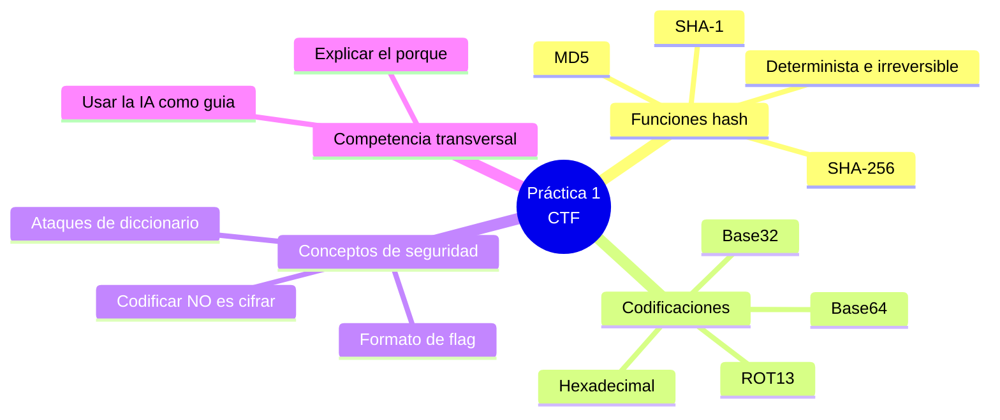
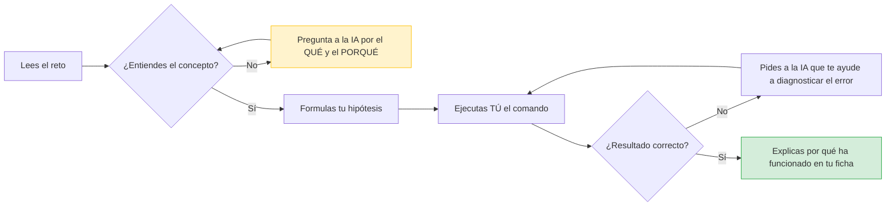
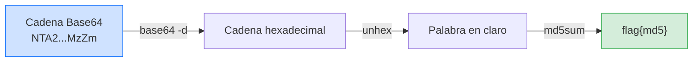

# Práctica 1 · Mi primer CTF — Retos de criptografía y codificación


**Unidad didáctica 01 — Introducción al Hacking Ético**
**Curso de Especialización en Ciberseguridad**

> **Modalidad:** individual · **Entorno:** plataforma Atenea (CCN-CERT) y terminal de Linux (Kali)
> **Carácter:** práctica **evaluable**
> **Lo que se evalúa:** no tanto la *flag* que obtienes, sino **que sepas explicar por qué haces
> cada cosa**. Una flag sin explicación no puntúa; una explicación correcta con un pequeño error
> de cálculo sí puntúa.

---
## Criterios de evaluación asociados

* RA1.a

---

## 1. Objetivos de aprendizaje

Al terminar esta práctica serás capaz de:

1. Explicar qué es una **función hash** y por qué es *determinista* e *irreversible*.
2. Diferenciar **codificar** de **cifrar**, y reconocer por qué codificar no protege información.
3. Calcular hashes (MD5, SHA-256, SHA-1) y decodificar formatos (Base64, Base32, hexadecimal, ROT13) desde la terminal.
4. Entender por qué una contraseña débil puede recuperarse de un hash mediante **ataques de diccionario**.
5. Usar la **inteligencia artificial como guía de tu razonamiento**, no como quien resuelve el reto por ti.



---

## 2. Normas del laboratorio (léelas antes de empezar)

- Todo se realiza en un **entorno autorizado y controlado**: la plataforma Atenea y tu máquina Kali.
- Estas técnicas solo son legales sobre sistemas propios o con permiso explícito. **El hacker ético se define por la autorización, no por la técnica.**
- El objetivo es *aprender*, no *competir por la flag*. Trabaja tu razonamiento con calma.

---

## 3. Cómo se evalúa esta práctica

La entrega consiste en una **ficha de razonamiento por cada reto** (plantilla en el Anexo A).
Para cada reto debes documentar *qué tipo de reto es, qué concepto hay detrás, qué herramienta
usas, por qué, y la flag obtenida*. La corrección prioriza el **porqué**:

| Qué se valora | Peso |
|---|---|
| **Identificación del concepto** — reconoces de qué trata el reto (hash, codificación, cifrado…) | 25 % |
| **Justificación del procedimiento** — explicas *por qué* cada paso, no solo lo ejecutas | 35 % |
| **Uso reflexivo de la IA** — tus preguntas a la IA buscan entender, y detectas si se equivoca | 20 % |
| **Resultado técnico** — la flag es correcta y está en el formato pedido | 10 % |
| **Expresión y rigor** — vocabulario técnico correcto y claridad | 10 % |

> Observa que el **resultado** pesa solo un 10 %. El 60 % se lo llevan el *porqué* y el *cómo
> razonas*. Esto es intencionado: en ciberseguridad vale más entender que acertar.

La rúbrica detallada está en el **Anexo B**.

---

## 4. Cómo usar la IA como guía (y no como quien hackea)

La IA es tu profesora particular, no tu respuesta. La **regla de oro** de esta práctica:

> **Si no sabes explicar qué hace un comando, aún no estás listo para ejecutarlo.**
> Antes de ejecutar nada que te sugiera la IA, escribe en una línea qué hace y qué esperas obtener.

| ❌ Pregunta que resuelve por ti (no la hagas) | ✅ Pregunta que te enseña (haz estas) |
|---|---|
| "¿Cuál es la flag del reto 5?" | "¿Qué es SHA-1 y en qué se diferencia de MD5?" |
| "Dame el comando exacto para este reto" | "¿Qué herramientas de Linux calculan un hash SHA-1 y qué hace cada parte del comando?" |
| "Descodifícame esta cadena Base32" | "¿Qué es Base32 y cómo sé que una cadena está en Base32 y no en Base64?" |
| "Resuélveme el reto combinado" | "Veo varias capas de codificación. ¿Cómo identifico el orden en que debo deshacerlas?" |



**Señal de alarma:** si copias y pegas la respuesta de la IA sin entenderla, lo notaremos en la
ficha, porque no sabrás explicar el *porqué*. Además, la IA **se equivoca a veces**: parte de la
práctica es que detectes cuándo te da un comando erróneo o una afirmación falsa.

---

## 5. PARTE A — Casos guiados (aprende con los 4 ejemplos resueltos)

Estos cuatro retos están **resueltos paso a paso** para que aprendas el método. Corresponden a
los primeros retos de la categoría *Básica* de Atenea. Reprodúcelos tú en tu terminal y asegúrate
de **entender cada línea** antes de pasar a la Parte B. En tu entrega, resume con tus palabras qué
concepto te enseñó cada uno.

### Caso guiado 1 — Hash 1 (MD5)

**Enunciado:** la contraseña es `LearnTheHashFunction`. Calcula su hash MD5 y envíalo en el
formato `flag{md5}`.

**Concepto:** una función hash transforma un texto en una huella de longitud fija. Es
*determinista*: la misma entrada da siempre la misma salida.

```bash
echo -n LearnTheHashFunction | md5sum
# b2f2d6b27b264d83fe1abe0169b7613e
```

**Flag:** `flag{b2f2d6b27b264d83fe1abe0169b7613e}`

> **¿Por qué `-n`?** La opción `-n` evita que `echo` añada un salto de línea al final. Si no la
> pones, el texto cambia (lleva un `\n` extra) y el hash sería **distinto y erróneo**. Este detalle
> es clave: en las funciones hash, *un solo carácter de diferencia cambia todo el resultado*.

### Caso guiado 2 — Hash 2 (SHA-256 → MD5)

**Enunciado:** la contraseña es `ThisIsAMoreSecureHashFunction`. Calcula su SHA-256 y, sobre ese
resultado, su MD5. Envía `flag{md5}`.

**Concepto:** se pueden **encadenar** funciones. El orden importa: primero SHA-256, luego MD5 del
resultado anterior.

```bash
echo -n ThisIsAMoreSecureHashFunction | sha256sum | awk '{printf $1}' | md5sum
# dd321a22229e0bbb5f8271e370b61eb0
```

**Flag:** `flag{dd321a22229e0bbb5f8271e370b61eb0}`

> **¿Por qué `awk '{printf $1}'`?** La salida de `sha256sum` incluye el hash **y** un guion y
> espacios al final. Con `awk` nos quedamos solo con el hash (`$1`) y con `printf` evitamos añadir
> un salto de línea, para que el MD5 se calcule exactamente sobre los 64 caracteres del SHA-256.

### Caso guiado 3 — Hash 3 (irreversibilidad y su límite)

**Enunciado:** encuentra el texto cuyo MD5 es `54f662a095fa3d5fbbdaac72d176701b`. Pásalo a
mayúsculas y calcula su MD5. Envía `flag{md5}`.

**Concepto:** en teoría un hash **no se puede invertir**. Pero si la contraseña es débil, se puede
recuperar probando millones de candidatas (ataque de **diccionario**). La web **CrackStation**
tiene muchos hashes ya precalculados.

```text
1) En crackstation.net pegamos 54f662a095fa3d5fbbdaac72d176701b  ->  masterofpuppets
2) Lo pasamos a mayúsculas: MASTEROFPUPPETS
```
```bash
echo -n MASTEROFPUPPETS | md5sum
# f395885371dd0ad12136d8a733e05e22
```

**Flag:** `flag{f395885371dd0ad12136d8a733e05e22}`

> **La gran idea:** la irreversibilidad del hash **no basta** si la contraseña es común. Por eso en
> seguridad real se usan contraseñas largas y aleatorias, y técnicas como el *salting*.

### Caso guiado 4 — Base64 (codificar ≠ cifrar)

**Enunciado:** decodifica el fichero  (en Base64) y obtén la contraseña. El contenido
decodificado revela que la contraseña es `recuerdaquebase64NOescifrar`. Envía `flag{md5}`.

**Concepto:** Base64 solo cambia la **representación** de los datos; **no protege nada**, porque
cualquiera puede decodificarlo sin clave.

```bash
base64 -d fichero.txt          # muestra el texto; la contraseña es recuerdaquebase64NOescifrar
echo -n recuerdaquebase64NOescifrar | md5sum
# cf9df460535b4ec175a464c6c120d3fe
```

**Flag:** `flag{cf9df460535b4ec175a464c6c120d3fe}`

> **La gran idea (no la olvides):** *codificar* (Base64) **no es** *cifrar*. Codificar es cambiar de
> alfabeto; cifrar es cerrar con llave. Confundirlos es un error de seguridad clásico.

**Resumen de lo aprendido en la Parte A:**

| Caso | Concepto nuclear | Herramienta |
|---|---|---|
| 1 | Hash determinista (MD5) | `md5sum`, `echo -n` |
| 2 | Encadenar funciones hash | `sha256sum`, `awk`, `md5sum` |
| 3 | Irreversibilidad y su límite (diccionario) | CrackStation, `md5sum` |
| 4 | Codificar ≠ cifrar | `base64 -d` |

---

## 6. PARTE B — Retos autónomos (resuélvelos tú y explica el porqué)

Ahora te toca a ti. Estos **5 retos nuevos** no tienen la solución escrita. Para cada uno,
entrega una **ficha de razonamiento** (Anexo A). Recuerda: lo que más puntúa es **explicar por
qué** haces cada paso, no la flag.

Todos los resultados se entregan en formato `flag{...}`. En cada reto se te indica qué debe ir
dentro de las llaves.

### Reto 5 — "Otra huella distinta" (SHA-1)

En los casos guiados usaste MD5 y SHA-256. Existen más algoritmos hash. Este reto usa **SHA-1**.

- **Dato:** la contraseña es `HashingIsOneWay2026`.
- **Tarea:** calcula su hash **SHA-1** y envía `flag{sha1}` (el hash en minúsculas, tal cual lo
  devuelve la herramienta).
- **Para tu ficha, responde:** ¿en qué se diferencia SHA-1 de MD5 en cuanto a longitud de salida?
  ¿Por qué el guion y los espacios de la salida del comando no deben formar parte de la flag?

### Reto 6 — "El mensaje en otro alfabeto" (hexadecimal)

El **hexadecimal** es otra forma de *representar* datos, no de cifrarlos.

- **Dato (cadena en hexadecimal):** `4b6572636b686f666673`
- **Tarea:** decodifícala para obtener una palabra. Envía `flag{palabra}` (la palabra decodificada,
  respetando mayúsculas y minúsculas).
- **Para tu ficha, responde:** ¿cómo supiste que estaba en hexadecimal? ¿El hexadecimal protege la
  información o solo la representa? Relaciónalo con lo aprendido en el Caso 4.

> *Pista conceptual para preguntar a la IA:* "¿Qué caracteres puede contener una cadena
> hexadecimal y cómo se agrupan para representar cada byte?" (No le pidas que la decodifique: pídele
> que te explique cómo hacerlo tú.)

### Reto 7 — "Base… ¿cuál?" (Base32)

Base64 no es la única codificación de su familia. Esta cadena está en **Base32**.

- **Dato (cadena en Base32):** `MRSWMZLOONQV6ZLOL5YHE33GOVXGI2LEMFSA====`
- **Tarea:** decodifícala y envía `flag{texto}` con el texto obtenido.
- **Para tu ficha, responde:** ¿en qué se diferencia Base32 de Base64 (alfabeto, relleno con `=`)?
  ¿Qué te hizo sospechar que *no* era Base64?

### Reto 8 — "El primer cifrado de la historia" (ROT13 / César)

Hasta ahora todo era *codificar* o *hashear*. Este reto usa un **cifrado de verdad** (clásico):
el **cifrado César** con desplazamiento 13, conocido como **ROT13**. Cada letra se sustituye por
la que está 13 posiciones más adelante en el alfabeto.

- **Dato (texto cifrado):** `FrthevqnqCbeBfphevqnqAbShapvban`
- **Tarea:** descífralo y envía `flag{texto}` con el texto en claro.
- **Para tu ficha, responde:** ¿por qué esto *sí* es cifrado y Base64 *no* lo era? ¿Por qué el
  cifrado César se considera inseguro? ¿Qué relación tiene el "13" con el alfabeto de 26 letras?

> *Pista conceptual:* ROT13 es su propia inversa: aplicar ROT13 dos veces devuelve el texto
> original. Pregúntale a la IA por qué ocurre eso.

### Reto 9 — "Capa sobre capa" (reto combinado) ⭐

Reto final que integra todo lo anterior. La información está **envuelta en varias capas** y debes
deshacerlas **en el orden correcto**.

- **Dato (cadena entregada):** `NTA2NTZlNzQ2NTczNzQ2OTZlNjc0NTc0Njk2MzZm`
- **Proceso:** esta cadena está en **Base64**. Al decodificarla obtendrás una cadena en
  **hexadecimal**. Al decodificar ese hexadecimal obtendrás una **palabra**. Calcula el **MD5** de
  esa palabra y envía `flag{md5}`.
- **Para tu ficha, responde:** ¿cómo decidiste el orden de las capas? ¿Cómo reconociste cada
  formato en cada paso (qué pistas te daba el aspecto de cada cadena)?



---

## 7. Qué debes entregar

1. Una ficha de razonamiento (Anexo A) **por cada uno de los 9 retos** (4 guiados + 5 autónomos).
   - Para los 4 guiados basta un resumen breve del concepto aprendido.
   - Para los 5 autónomos, la ficha completa es lo que se evalúa.
2. Un **documento en formato `.md`** con todas las fichas.
3. Opcional y valorado: una reflexión final de 5-10 líneas sobre *en qué momento la IA te ayudó a
   entender algo* y *si en algún momento te dio una respuesta incorrecta que supiste detectar*.

---

## Anexo A — Plantilla de ficha de razonamiento

Utiliza la siguiente  para completar la práctica. Sólo se evaluarán los retos NO guiados. 

---

## Anexo B — Rúbrica de evaluación por comprensión

| Criterio | Excelente (10-9) | Adecuado (8-6) | Insuficiente (5-0) |
|---|---|---|---|
| **Identificación del concepto** (25 %) | Nombra el concepto con precisión y lo relaciona con otros retos | Identifica el concepto principal | No reconoce de qué trata el reto |
| **Justificación del procedimiento** (35 %) | Explica el porqué de *cada* paso y detalle (p. ej. el `-n`, el orden de capas) | Explica los pasos principales | Solo ejecuta comandos sin justificar |
| **Uso reflexivo de la IA** (20 %) | Sus preguntas buscan entender; detecta errores o alucinaciones de la IA | Usa la IA para apoyarse y entender | Copia respuestas de la IA sin entenderlas |
| **Resultado técnico** (10 %) | Flag correcta y en el formato pedido | Flag correcta con fallo menor de formato | Flag incorrecta |
| **Expresión y rigor** (10 %) | Vocabulario técnico correcto y claro | Se entiende con imprecisiones menores | Vocabulario incorrecto o confuso |

> **Nota clave para el alumnado:** se puede sacar buena nota aunque una flag salga mal, si el
> razonamiento es correcto. Y se puede suspender con todas las flags correctas, si no se sabe
> explicar por qué. **Aquí se evalúa que entiendas.**

---

## Anexo C — Preparación del entorno y comandos de referencia

Para esta práctica **no necesitas Kali Linux**: los retos son de criptografía y codificación, y se
resuelven con herramientas sencillas. Tienes tres vías, y puedes combinarlas. Elige la que te
resulte más cómoda, pero entiende siempre *qué* hace cada operación.

| Necesitas | Cómo |
|---|---|
| Cuenta en Atenea | Registro gratuito en `atenea.ccn-cert.cni.es`, sección *Retos → Básica* |
| Un entorno de cálculo | Una de las tres vías de abajo (CyberChef, WSL o PowerShell) |

### Vía 1 (recomendada, sin instalar nada) — CyberChef en el navegador

**CyberChef** (`https://gchq.github.io/CyberChef/`) es una web que hace hashes y codificaciones
arrastrando "recetas". El propio libro la menciona. Funciona en cualquier ordenador, también en
Windows, **sin instalar nada**. Operaciones que necesitas (búscalas en el panel izquierdo):

| Reto | Operación de CyberChef |
|---|---|
| MD5 / SHA-1 / SHA-256 | `MD5`, `SHA1`, `SHA2` (eligiendo 256) |
| Base64 | `From Base64` |
| Base32 | `From Base32` |
| Hexadecimal | `From Hex` |
| ROT13 | `ROT13` |
| Reto combinado | encadena varias operaciones en la misma receta (ese es el ejercicio) |

> CyberChef te deja **encadenar pasos** visualmente, lo cual es perfecto para entender el reto
> combinado: ves cómo una cadena pasa de Base64 → Hex → texto → MD5 capa a capa.

### Vía 2 (terminal Linux real en Windows) — WSL

**WSL (Windows Subsystem for Linux)** instala un Linux dentro de Windows con un comando. En
PowerShell como administrador: `wsl --install`. Reinicia y tendrás una terminal Ubuntu con todos
los comandos de abajo. Es la opción si quieres que el alumnado practique la terminal "de verdad".

### Vía 3 (sin instalar, nativa de Windows) — PowerShell

| Operación | PowerShell |
|---|---|
| Hash de un texto | `"texto" \| Format-Hex` no; usa: `[System.BitConverter]::ToString([System.Security.Cryptography.MD5]::Create().ComputeHash([Text.Encoding]::UTF8.GetBytes("texto"))) -replace '-'` |
| Base64 decodificar | `[Text.Encoding]::UTF8.GetString([Convert]::FromBase64String("cadena"))` |

> PowerShell funciona, pero es más verboso. Para empezar, **CyberChef es lo más cómodo**; WSL es lo
> más parecido al laboratorio profesional.

### Chuleta de comandos Linux (WSL o Kali, entiéndelos, no los copies a ciegas)

```bash
echo -n "texto"            | md5sum          # hash MD5
echo -n "texto"            | sha1sum         # hash SHA-1
echo -n "texto"            | sha256sum       # hash SHA-256
echo -n "cadena_base64"    | base64 -d       # decodificar Base64
echo -n "cadena_base32"    | base32 -d       # decodificar Base32
echo -n "FrgevpTO"         | tr 'A-Za-z' 'N-ZA-Mn-za-m'   # ROT13
echo -n "4b6572..."        | xxd -r -p       # decodificar hexadecimal (si xxd está disponible)
```

> Para el hexadecimal y para encadenar pasos, **pregunta a la IA qué herramientas existen y qué
> hace cada opción** antes de usarlas. Ese es, precisamente, el ejercicio.
