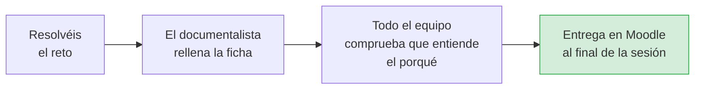

# Fichas de razonamiento · Práctica 1 (CTF): hashes, codificación y cifrado

**Módulo 5025 · Hacking ético · UD1**

> Este documento contiene **una ficha por cada reto** de la Práctica 1. El equipo rellena la
> ficha de cada reto que resuelve y entrega el documento completo en Moodle al final de cada
> sesión.

| Equipo | Operador/a | Investigador/a | Documentalista |
|---|---|---|---|
| | | | |

---

## Cómo rellenar las fichas

| Sesión | Retos | Fichas |
|---|---|---|
| **Sesión CTF 1** | Casos guiados 1 a 4 | Fichas 1 a 4 |
| **Sesión CTF 2** | Retos autónomos 5 a 9 | Fichas 5 a 9 |



Cada ficha tiene siempre los mismos apartados:

| Apartado | Qué escribís | Criterio de la rúbrica |
|---|---|---|
| 1. Tipo de reto | Hash, codificación, cifrado o combinado, y por qué | Concepto · 25 % |
| 2. Concepto | Qué idea de seguridad hay detrás, con vuestras palabras | Concepto · 25 % |
| 3. Procedimiento | El comando o la herramienta y qué hace cada parte | Procedimiento · 35 % |
| 4. Por qué lo hacemos así | La justificación de cada decisión y las pruebas que hacéis | Procedimiento · 35 % |
| 5. Uso de la IA | Qué le preguntasteis, qué aprendisteis y si se equivocó | IA · 20 % |
| 6. Flag | La flag obtenida | Resultado · 10 % |
| 7. Verificación | Cómo comprobáis que es correcta | Resultado · 10 % |

> **Recordad.** La flag solo vale el **10 %**. Las preguntas en *cursiva* os orientan sobre lo
> que una buena ficha debe explicar. Escribid con vuestras palabras: una respuesta copiada de la
> IA se nota y puntúa en el nivel bajo.

---

# Sesión CTF 1 · Casos guiados

## Ficha 1 · Caso guiado 1: Hash MD5

> **Enunciado.** La contraseña es `LearnTheHashFunction`. Calcula su hash **MD5** y envíalo como
> `flag{md5}`.

**1. Tipo de reto:** ☐ Hash ☐ Codificación ☐ Cifrado ☐ Combinado

*¿Por qué lo clasificáis así y no como codificación o cifrado?*

```
...
```

**2. Concepto.** *¿Qué es una función hash? ¿Qué significa que sea determinista, que tenga
longitud fija y que sea irreversible? ¿Para qué se usan los hashes en seguridad? ¿Qué longitud
tiene un hash MD5 y por qué ya no se considera seguro?*

```
...
```

**3. Procedimiento.** Comando exacto y explicación de cada parte:

| Parte del comando | Qué hace |
|---|---|
| | |
| | |
| | |

**4. Por qué lo hacemos así.** *¿Por qué `echo -n` y no `echo`? Haced estas pruebas y explicad
el resultado.*

| Prueba | Hash obtenido | ¿Coincide con el correcto? |
|---|---|---|
| `echo -n LearnTheHashFunction` | | |
| `echo LearnTheHashFunction` (sin `-n`) | | |
| `echo -n learnTheHashFunction` (minúscula) | | |

```
Conclusión: ...
```

**5. Uso de la IA**

| Pregunta que le hicimos | Qué aprendimos | ¿Se equivocó? ¿Cómo lo comprobamos? |
|---|---|---|
| | | |

**6. Flag:** `flag{...}`

**7. Verificación.** *¿Cuántos caracteres tiene un hash MD5? ¿Qué caracteres puede contener?*

```
...
```

---

## Ficha 2 · Caso guiado 2: SHA-256 y después MD5

> **Enunciado.** La contraseña es `ThisIsAMoreSecureHashFunction`. Calcula su **SHA-256** y, sobre
> ese resultado, su **MD5**. Envía `flag{md5}`.

**1. Tipo de reto:** ☐ Hash ☐ Codificación ☐ Cifrado ☐ Combinado

```
...
```

**2. Concepto.** *¿Qué diferencia hay entre SHA-256 y MD5 en longitud de salida y en seguridad?
¿Qué significa encadenar funciones hash? ¿Importa el orden?*

```
...
```

**3. Procedimiento.** Comando exacto y explicación de cada parte:

| Parte del comando | Qué hace |
|---|---|
| | |
| | |
| | |
| | |

**4. Por qué lo hacemos así.** *¿Qué muestra exactamente `sha256sum` además del hash? ¿Por qué hay
que quitarlo? ¿Para qué sirve `awk '{printf $1}'`?*

| Prueba | MD5 obtenido | ¿Coincide con el correcto? |
|---|---|---|
| Con `awk '{printf $1}'` | | |
| Sin `awk` (`sha256sum \| md5sum`) | | |

```
Conclusión: ...
```

**5. Uso de la IA**

| Pregunta que le hicimos | Qué aprendimos | ¿Se equivocó? ¿Cómo lo comprobamos? |
|---|---|---|
| | | |

**6. Flag:** `flag{...}`

**7. Verificación.** *¿Cuántos caracteres tiene el SHA-256 intermedio? ¿Y el MD5 final?*

```
...
```

---

## Ficha 3 · Caso guiado 3: romper un hash con un diccionario

> **Enunciado.** Encuentra el texto cuyo MD5 es `54f662a095fa3d5fbbdaac72d176701b`. Pásalo a
> mayúsculas y calcula su MD5. Envía `flag{md5}`.

**1. Tipo de reto:** ☐ Hash ☐ Codificación ☐ Cifrado ☐ Combinado

```
...
```

**2. Concepto.** *Si un hash es irreversible, ¿cómo es posible encontrar el texto original? ¿Qué
es un ataque de diccionario? ¿Qué hace CrackStation? ¿Qué es la «sal» (salt) y cómo evitaría
este ataque?*

```
...
```

**3. Procedimiento.** Pasos y herramientas:

| Paso | Herramienta | Qué hace |
|---|---|---|
| 1 | | |
| 2 | | |
| 3 | | |

**4. Por qué lo hacemos así.** *¿Por qué CrackStation encuentra esta contraseña? ¿La encontraría
si fuera `Xq7#mP2!vL9@`? ¿Qué os dice esto sobre cómo elegir contraseñas?*

```
...
```

**5. Uso de la IA**

| Pregunta que le hicimos | Qué aprendimos | ¿Se equivocó? ¿Cómo lo comprobamos? |
|---|---|---|
| | | |

**6. Flag:** `flag{...}`

**7. Verificación.** *¿Cómo podéis comprobar, sin fiaros de CrackStation, que el texto que os ha
dado es el correcto?*

```
...
```

---

## Ficha 4 · Caso guiado 4: Base64

> **Enunciado.** Decodifica el contenido en Base64 del reto y obtendrás una contraseña. Envía
> `flag{md5}` con el MD5 de esa contraseña.

**1. Tipo de reto:** ☐ Hash ☐ Codificación ☐ Cifrado ☐ Combinado

*¿Por qué Base64 no es un cifrado?*

```
...
```

**2. Concepto.** *¿Qué es una codificación? ¿Qué caracteres usa Base64 y para qué sirve el `=` del
final? ¿Hace falta una clave para leerlo? ¿Dónde se usa Base64 en la vida real?*

```
...
```

**3. Procedimiento.** Comandos exactos y explicación de cada parte:

| Parte del comando | Qué hace |
|---|---|
| | |
| | |
| | |

**4. Por qué lo hacemos así.** *¿Cómo reconocisteis que era Base64? ¿Qué pasaría si una
aplicación guardara las contraseñas en Base64?*

```
...
```

**5. Uso de la IA**

| Pregunta que le hicimos | Qué aprendimos | ¿Se equivocó? ¿Cómo lo comprobamos? |
|---|---|---|
| | | |

**6. Flag:** `flag{...}`

**7. Verificación.** *¿Cómo comprobáis que habéis copiado la contraseña exacta, sin espacios ni
signos de más?*

```
...
```

---

# Sesión CTF 2 · Retos autónomos

## Ficha 5 · Reto 5: otra huella distinta (SHA-1)

> **Enunciado.** La contraseña es `HashingIsOneWay2026`. Calcula su hash **SHA-1** y envía
> `flag{sha1}`.

**1. Tipo de reto:** ☐ Hash ☐ Codificación ☐ Cifrado ☐ Combinado

```
...
```

**2. Concepto.** *¿En qué se diferencia SHA-1 de MD5 en longitud de salida? ¿Se considera seguro
SHA-1 hoy? ¿Por qué?*

```
...
```

**3. Procedimiento.** Comando exacto y explicación de cada parte:

| Parte del comando | Qué hace |
|---|---|
| | |
| | |
| | |

**4. Por qué lo hacemos así.** *¿Por qué el guion y los espacios de la salida no forman parte de
la flag? Calculad también el MD5 de la misma contraseña y comparad las dos salidas.*

| Algoritmo | Hash obtenido | Nº de caracteres | Bits |
|---|---|---|---|
| MD5 | | | |
| SHA-1 | | | |

```
Conclusión: ...
```

**5. Uso de la IA**

| Pregunta que le hicimos | Qué aprendimos | ¿Se equivocó? ¿Cómo lo comprobamos? |
|---|---|---|
| | | |

**6. Flag:** `flag{...}`

**7. Verificación**

```
...
```

---

## Ficha 6 · Reto 6: el mensaje en otro alfabeto (hexadecimal)

> **Enunciado.** Decodifica la cadena hexadecimal `4b6572636b686f666673` y envía
> `flag{palabra}`.

**1. Tipo de reto:** ☐ Hash ☐ Codificación ☐ Cifrado ☐ Combinado

```
...
```

**2. Concepto.** *¿Qué es el hexadecimal? ¿Qué caracteres puede contener? ¿Cuántos caracteres
hexadecimales hacen falta para representar un byte? ¿Protege la información o solo la
representa?*

```
...
```

**3. Procedimiento.** Comando o herramienta y explicación:

| Parte del comando o paso | Qué hace |
|---|---|
| | |
| | |

**4. Por qué lo hacemos así.** *¿Cómo supisteis que estaba en hexadecimal? La cadena tiene 20
caracteres: ¿cuántas letras esperáis obtener y por qué? Relacionadlo con el caso guiado 4.*

```
...
```

**Para investigar.** La palabra que obtenéis es el apellido de una persona que enunció un
principio muy importante en criptografía. *¿Quién era y qué dice ese principio?*

```
...
```

**5. Uso de la IA**

| Pregunta que le hicimos | Qué aprendimos | ¿Se equivocó? ¿Cómo lo comprobamos? |
|---|---|---|
| | | |

**6. Flag:** `flag{...}`

**7. Verificación**

```
...
```

---

## Ficha 7 · Reto 7: Base… ¿cuál? (Base32)

> **Enunciado.** Decodifica la cadena en **Base32** `MRSWMZLOONQV6ZLOL5YHE33GOVXGI2LEMFSA====` y
> envía `flag{texto}`.

**1. Tipo de reto:** ☐ Hash ☐ Codificación ☐ Cifrado ☐ Combinado

```
...
```

**2. Concepto.** *¿En qué se diferencia Base32 de Base64? Comparad el alfabeto y el relleno con
`=`.*

| | Base64 | Base32 |
|---|---|---|
| Caracteres que usa | | |
| Relleno | | |
| ¿Usa minúsculas? | | |

**3. Procedimiento.** Comando exacto y explicación de cada parte:

| Parte del comando | Qué hace |
|---|---|
| | |
| | |

**4. Por qué lo hacemos así.** *¿Qué os hizo sospechar que no era Base64? ¿Qué pasa si intentáis
decodificarla con `base64 -d`?*

```
...
```

**Para investigar.** *El texto obtenido es un principio de seguridad. ¿Qué significa? Poned un
ejemplo aplicado a un instituto.*

```
...
```

**5. Uso de la IA**

| Pregunta que le hicimos | Qué aprendimos | ¿Se equivocó? ¿Cómo lo comprobamos? |
|---|---|---|
| | | |

**6. Flag:** `flag{...}`

**7. Verificación**

```
...
```

---

## Ficha 8 · Reto 8: el primer cifrado de la historia (ROT13)

> **Enunciado.** Descifra el texto `FrthevqnqCbeBfphevqnqAbShapvban`, cifrado con **ROT13**, y
> envía `flag{texto}`.

**1. Tipo de reto:** ☐ Hash ☐ Codificación ☐ Cifrado ☐ Combinado

*¿Por qué esto sí es un cifrado y Base64 no lo era? ¿Cuál es la clave?*

```
...
```

**2. Concepto.** *¿Qué es el cifrado César? ¿Qué es ROT13? ¿Por qué aplicar ROT13 dos veces
devuelve el texto original? ¿Qué relación tiene el 13 con un alfabeto de 26 letras?*

```
...
```

**3. Procedimiento.** Comando o herramienta y explicación:

| Parte del comando o paso | Qué hace |
|---|---|
| | |
| | |

**4. Por qué lo hacemos así.** *¿Por qué el cifrado César es inseguro? ¿Cuántas claves posibles
tiene? ¿Cómo lo romperíais si no supierais que el desplazamiento es 13?*

```
...
```

**Para investigar.** *El texto descifrado está relacionado con el reto 6. ¿Qué relación tiene con
el principio de Kerckhoffs?*

```
...
```

**5. Uso de la IA**

| Pregunta que le hicimos | Qué aprendimos | ¿Se equivocó? ¿Cómo lo comprobamos? |
|---|---|---|
| | | |

**6. Flag:** `flag{...}`

**7. Verificación.** *Volved a aplicar ROT13 al resultado. ¿Qué obtenéis?*

```
...
```

---

## Ficha 9 · Reto 9: capa sobre capa (combinado) ⭐

> **Enunciado.** La cadena `NTA2NTZlNzQ2NTczNzQ2OTZlNjc0NTc0Njk2MzZm` está en **Base64**. Al
> decodificarla obtendrás **hexadecimal**; al decodificar este, una **palabra**. Calcula el
> **MD5** de esa palabra y envía `flag{md5}`.

**1. Tipo de reto:** ☐ Hash ☐ Codificación ☐ Cifrado ☐ Combinado

*¿Qué técnicas de los retos anteriores se combinan?*

```
...
```

**2. Concepto.** *¿Por qué se usan varias capas de codificación? ¿Hace eso la información más
segura?*

```
...
```

**3. Procedimiento.** Completad la tabla con cada capa:

| Capa | Lo que tenéis | Cómo reconocéis el formato | Comando | Resultado |
|---|---|---|---|---|
| 1 | `NTA2NTZl…` | | | |
| 2 | | | | |
| 3 | | | | |

**4. Por qué lo hacemos así.** *¿Cómo decidisteis el orden de las capas? ¿Qué pasaría si
intentarais decodificar el hexadecimal antes que el Base64?*

```
...
```

**5. Uso de la IA**

| Pregunta que le hicimos | Qué aprendimos | ¿Se equivocó? ¿Cómo lo comprobamos? |
|---|---|---|
| | | |

**6. Flag:** `flag{...}`

**7. Verificación**

```
...
```

---

## Reflexión final del equipo (opcional, se valora en «Uso reflexivo de la IA»)

*En 5 a 10 líneas: ¿en qué momento la IA os ayudó a entender algo? ¿Os dio alguna respuesta
incorrecta que supisteis detectar? ¿Cómo lo hicisteis?*

```
...
```

---

## Rúbrica con la que se corrige cada ficha

| Criterio | Peso | Nivel alto | Nivel medio | Nivel bajo |
|---|---|---|---|---|
| **Identificación del concepto** (apartados 1 y 2) | 25 % | Nombra el concepto con precisión y lo relaciona con otros retos | Identifica el concepto principal | No reconoce de qué trata el reto |
| **Justificación del procedimiento** (apartados 3 y 4) | 35 % | Explica el porqué de cada paso y de los detalles | Explica los pasos principales | Ejecuta comandos sin justificar |
| **Uso reflexivo de la IA** (apartado 5) | 20 % | Sus preguntas buscan entender y detecta errores de la IA | Usa la IA para apoyarse y entender | Copia respuestas de la IA sin entenderlas |
| **Resultado técnico** (apartados 6 y 7) | 10 % | Flag correcta y en el formato pedido | Flag correcta con un fallo menor de formato | Flag incorrecta |
| **Expresión y rigor** (toda la ficha) | 10 % | Vocabulario técnico correcto y claro | Se entiende, con imprecisiones menores | Vocabulario incorrecto o confuso |

Cada criterio se puntúa con la escala de 8 niveles: Excelente 10 · Sobresaliente 9 · Notable 7,5
· Bien 6 · Aprobado 5 · Insuficiente 2 · Muy insuficiente 0,5 · Sin respuesta 0.
