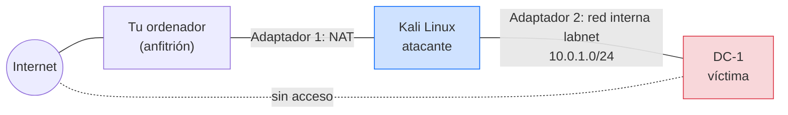
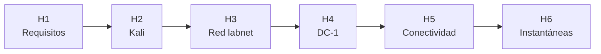

# Misión 0 · Monta tu laboratorio de hacking ético

**Unidad didáctica 1 — Introducción al hacking ético**
**Curso de Especialización en Ciberseguridad**

> **Modalidad:** cada persona monta su propio laboratorio y el equipo se ayuda.
> **Duración:** una sesión de 120 minutos.
> **Carácter:** requisito para el resto del curso. Sin laboratorio no hay misiones.
> **Resultado:** al terminar tendrás una máquina **Kali Linux** (atacante) y una máquina
> vulnerable **DC-1** (víctima) conectadas por una **red aislada**, lista para la Práctica 2.

---
## Criterios de evaluación asociados

* RA1.c
* RA1.e
* RA1.g

---

## 1. Briefing de la misión

Una empresa de auditoría os acaba de contratar como equipo de pentesting. Antes de tocar el
sistema de ningún cliente, la empresa exige que cada auditor tenga un **laboratorio propio y
aislado** donde practicar sin riesgo. Vuestra primera misión es montarlo, comprobar que funciona
y demostrar que está aislado de cualquier red real.

> **Norma de oro del laboratorio.** Las máquinas vulnerables se conectan **solo** a la red
> interna del laboratorio. Nunca a la red del centro, a tu wifi de casa ni a Internet. Una
> máquina vulnerable expuesta es un riesgo real para otras personas.

---

## 2. Objetivos

Al terminar esta misión serás capaz de:

1. Explicar por qué un laboratorio de hacking ético debe estar **aislado** y qué riesgo evita.
2. Importar y configurar máquinas virtuales en **VirtualBox**.
3. Diferenciar los modos de red **NAT** y **red interna**, y elegir el adecuado para cada máquina.
4. Comprobar la **conectividad** entre la máquina atacante y la víctima.
5. Usar **instantáneas** para poder volver a un estado limpio.

---

## 3. Esquema del laboratorio



| Máquina | Papel | Adaptadores de red | Por qué |
|---|---|---|---|
| **Kali Linux** | Atacante | 1: **NAT** · 2: **Red interna `labnet`** | NAT para actualizar e instalar herramientas, `labnet` para llegar a la víctima |
| **DC-1** | Víctima | 1: **Red interna `labnet`** (y ninguno más) | Así nunca sale de la red del laboratorio |

---

## 4. Roles del equipo en esta misión

Esta vez **todos montáis vuestro propio laboratorio**, pero cada rol tiene además una tarea para
el equipo:

| Rol | Tarea extra en la Misión 0 |
|---|---|
| 🖥️ **Operador** | Termina primero su laboratorio y ayuda a quien se atasque |
| 🔎 **Investigador** | Resuelve con la IA los errores que aparezcan en el equipo y los apunta |
| 📝 **Documentalista** | Recoge las evidencias de cada hito de todo el equipo para la entrega |

---

## 5. Hitos de la misión

Avanza hito a hito. **No pases al siguiente sin la evidencia del anterior**: la profesora
comprobará cada hito con la lista de cotejo.



### H1 · Comprobar los requisitos (10 min)

| Requisito | Mínimo | Cómo comprobarlo en Windows |
|---|---|---|
| RAM | 8 GB | *Configuración → Sistema → Información* |
| Disco libre | 30 GB | Explorador de archivos |
| Virtualización por hardware | Habilitada | *Administrador de tareas → Rendimiento → CPU → Virtualización* |

**Evidencia:** captura de la pantalla de CPU con *Virtualización: Habilitado*.

### H2 · Instalar VirtualBox e importar Kali (30 min)

Sigue los apartados 3.2, 3.3 y 3.5 de la guía de entorno
([Guia-Kali-Windows-sincronizada-GitHub.md](../ENTORNO/Guia-Kali-Windows-sincronizada-GitHub.md)):

1. Descarga VirtualBox y la imagen de Kali para VirtualBox.
2. **Verifica el hash SHA256** de la descarga antes de usarla.
3. Importa la máquina, asígnale 4096 MB de RAM y 2 CPU, y arráncala (`kali` / `kali`).
4. Cambia la contraseña por defecto con `passwd` y actualiza el sistema.

**Evidencia:** captura del hash comprobado en PowerShell y captura de la terminal de Kali tras
`passwd`.

### H3 · Crear la red aislada `labnet` (15 min)

Una red interna de VirtualBox no reparte direcciones IP por sí sola. Hay que crear un servidor
DHCP para ella. En el **anfitrión**, abre una terminal (PowerShell en Windows) y ejecuta:

```powershell
# En Windows, primero ve a la carpeta de VirtualBox
cd "C:\Program Files\Oracle\VirtualBox"
.\VBoxManage dhcpserver add --network=labnet --server-ip=10.0.1.1 --lower-ip=10.0.1.10 --upper-ip=10.0.1.50 --netmask=255.255.255.0 --enable
```

Después, con Kali **apagada**, en *Configuración → Red*:
- **Adaptador 1:** NAT.
- **Adaptador 2:** habilitado, *Conectado a: Red interna*, nombre `labnet`.

Arranca Kali y comprueba que tiene dirección en las dos interfaces:

```bash
ip -br addr
```

Debe aparecer una interfaz con una IP `10.0.2.x` (NAT) y otra con una IP `10.0.1.x` (`labnet`).

**Evidencia:** captura de la salida de `ip -br addr`.

### H4 · Importar la máquina víctima DC-1 (20 min)

1. Descarga **DC-1** desde VulnHub (archivo `.ova`).
2. En VirtualBox: *Archivo → Importar servicio virtualizado* y selecciona el `.ova`.
3. **Antes de arrancarla**, en *Configuración → Red*:
   - **Adaptador 1:** *Red interna*, nombre `labnet`.
   - Comprueba que **no hay ningún otro adaptador habilitado**.
4. Arráncala. No necesitas iniciar sesión en ella: es la víctima.

**Evidencia:** captura de la configuración de red de DC-1 con un único adaptador en `labnet`.

### H5 · Comprobar la conectividad (15 min)

Desde Kali, descubre qué máquinas hay en `labnet`:

```bash
# Sustituye eth1 por el nombre de tu interfaz 10.0.1.x (lo viste en H3)
sudo netdiscover -i eth1 -r 10.0.1.0/24
```

Pulsa `Ctrl+C` cuando aparezca la IP de DC-1 y comprueba que responde:

```bash
ping -c 3 IP_DE_DC-1
```

> **Antes de ejecutar:** escribe en tu ficha qué hace cada comando y qué esperas obtener. Si no
> lo sabes, pregúntalo a la IA (apartado 6). Aquí todavía **no** se escanean puertos: eso es la
> Práctica 2.

**Evidencia:** captura de `netdiscover` con DC-1 localizada y del `ping` respondiendo.

### H6 · Tomar instantáneas (5 min)

En VirtualBox, con cada máquina seleccionada: *Máquina → Tomar instantánea*.
- Kali → `kali-limpia`
- DC-1 → `dc1-original`

Si algo se rompe en una práctica, restauras la instantánea en segundos.

**Evidencia:** captura de la lista de instantáneas de las dos máquinas.

---

## 6. Cómo usar la IA en esta misión

En esta misión es normal encontrarse errores de instalación. La IA es muy buena diagnosticándolos
**si le das el contexto**.

| Situación | Prompt recomendado |
|---|---|
| Entender un concepto | «Explícame la diferencia entre los modos de red NAT, adaptador puente y red interna de VirtualBox. ¿Cuál es el más seguro para una máquina vulnerable y por qué?» |
| Diagnosticar un error | «Estoy importando una máquina en VirtualBox 7 sobre Windows 11 y me sale este error: [pega el error]. ¿Qué puede estar pasando y qué compruebo primero?» |
| Entender un comando | «Explícame qué hace `sudo netdiscover -i eth1 -r 10.0.1.0/24` y cada parámetro. No lo ejecutes por mí.» |
| Comprobar tu razonamiento | «Creo que mi laboratorio está aislado porque DC-1 solo tiene un adaptador en red interna. ¿Es suficiente? ¿Qué más podría comprobar?» |

---

## 7. Qué debes entregar

Un documento `.md` por persona con:

1. Las **evidencias** de los hitos H1 a H6 (capturas).
2. Una **ficha breve** con tres respuestas:
   - ¿Por qué DC-1 no debe tener adaptador NAT ni puente?
   - ¿Para qué sirve el servidor DHCP que creaste en H3?
   - ¿Qué hacen `netdiscover` y `ping`, y qué información te dio cada uno?
3. **Bitácora de IA:** un error que te apareció, qué le preguntaste a la IA y cómo lo resolviste.
   Si la IA se equivocó en algo, indícalo.

---

## 8. Criterios de superación

La Misión 0 se califica de forma **individual** con una lista de cotejo, sobre 10 puntos:

| Elemento | Cómo se puntúa | Puntos |
|---|---|---|
| **Hitos H1 a H6** | 1 punto por cada hito conseguido, comprobado en clase en tu pantalla | 6 |
| **Ficha** (3 preguntas) | 1 punto por cada respuesta correcta y razonada | 3 |
| **Bitácora de IA** | 1 punto si explicas el error, qué preguntaste y cómo lo resolviste | 1 |
| **Total** | | **10** |

> **Ejemplo:** consigues los seis hitos y entregas la bitácora, pero solo respondes bien a dos de
> las tres preguntas de la ficha. Tu nota es 6 + 2 + 1 = **8**.

| Hito | Conseguido si… |
|---|---|
| H1 | La virtualización está habilitada |
| H2 | Kali arranca, con la contraseña cambiada y el hash verificado |
| H3 | Kali tiene IP en NAT y en `labnet` |
| H4 | DC-1 tiene **un único** adaptador, en `labnet` |
| H5 | Kali localiza DC-1 y recibe respuesta al `ping` |
| H6 | Existen las dos instantáneas |
